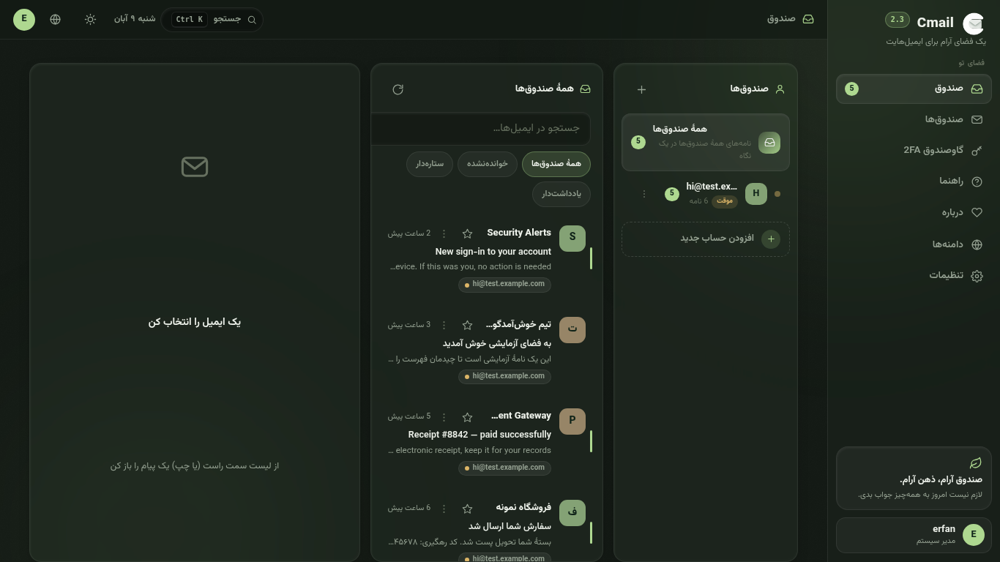
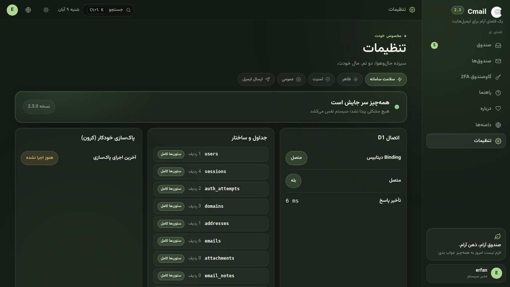
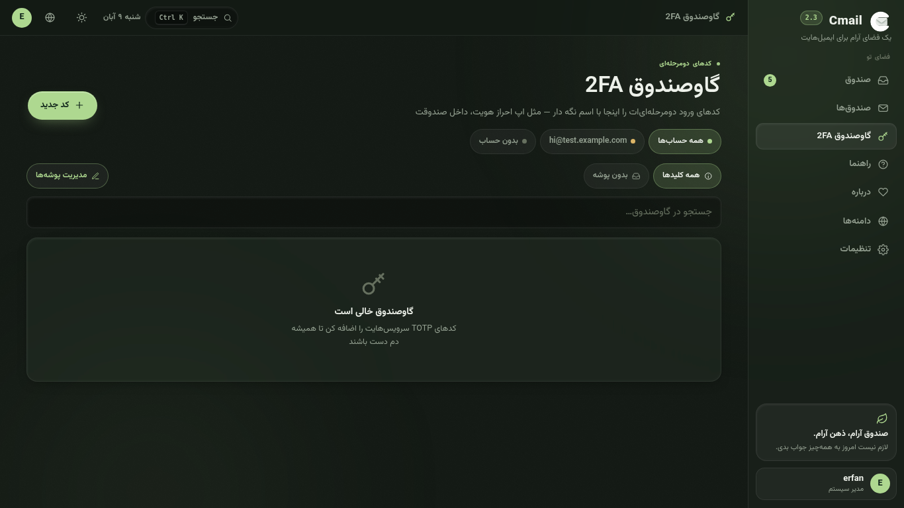
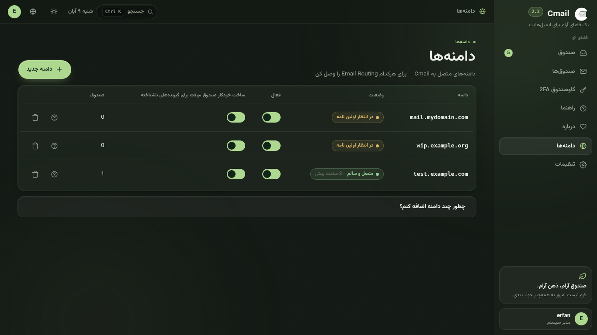
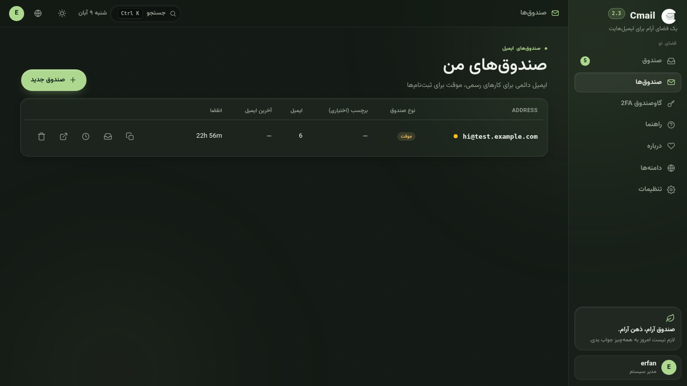
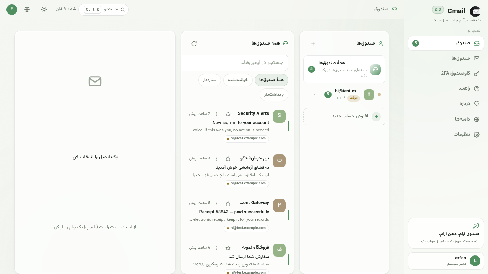
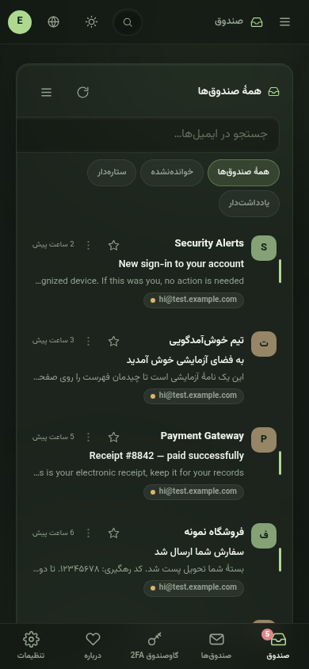
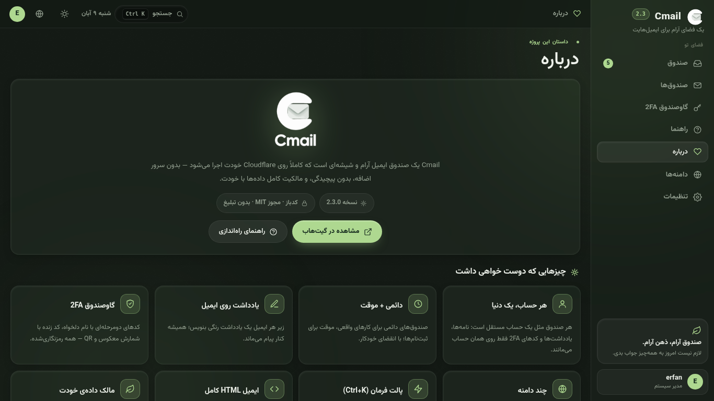

<div align="center" dir="rtl">


# Cmail

[](https://github.com/Erfan-8910/Cmail/releases)
[](https://workers.cloudflare.com)
[](#کل-سیستم-در-یک-نگاه)
[](LICENSE)

**یک اکوسیستم کامل ایمیل که تماماً داخل حساب Cloudflare خودت زندگی می‌کند — یک فایل ورکر، یک دیتابیس، صفر سرور، صفر قبض ماهانه.**

[راهنمای نصب](docs/DEPLOY.fa.md) · [راهنمای استفاده](docs/USAGE.fa.md) · [نسخه‌ها](https://github.com/Erfan-8910/Cmail/releases) · English — [README](README.md)

</div>

---

## Cmail چیست؟

Cmail پاسخ یک سؤال ساده است: **چرا برای یک صندوق ایمیل اجاره بدهیم؟**

تمام این اکوسیستم داخل همان حساب Cloudflareای اجرا می‌شود که از قبل داری. ایمیل‌های ورودی از مسیر **Email Routing** می‌رسند، همه‌چیز در **D1** (همان SQLite لبهٔ شبکه) ذخیره می‌شود و کل رابط کاربری — صفحه‌ها، استایل‌ها، اسکریپت‌ها، فونت‌ها و آیکون‌ها — توسط **یک فایل Worker** سرو می‌شود. نه سروری هست که نگه‌داری، نه دیتابیسی که تنظیم بخواهد، نه پنل اشتراکی، و هیچ‌چیزِ قابل‌گرفتن از دستت.

به‌جایش یک فضای ایمیل شخصی می‌گیری که واقعاً مال خودت است: دامنه، داده، کلید. آدرس‌های یک‌بارمصرف برای ثبت‌نام‌ها، صندوق‌های دائمی برای کارهای جدی، یادداشت رنگی زیر هر نامه، گاوصندوق 2FA داخلی، ارسال ایمیل از دامنهٔ خودت — همه در یک پنل شیشه‌ایِ آرام که فارسی و انگلیسی حرف می‌زند.

## دیوار امکانات

| | |
|---|---|
| 📬 **همهٔ صندوق‌ها، یک نگاه** | صندوق یکپارچه نامه‌های همهٔ میل‌باکس‌ها را در یک فهرست زنده می‌ریزد؛ هر ردیف یک نشان کوچک دارد که می‌گوید نامه به کدام صندوق رسیده. جابه‌جایی بین صندوق‌ها هم یک ضربه در نوار کناری است — همان چیزی که از سرویس‌های بزرگ انتظار داری. |
| ⏱️ **صندوق خودش نفس می‌کشد** | هر ۱۵ ثانیه یک بار بی‌صدا نامه‌های تازه را چک می‌کند، نامهٔ تازه را هایلایت می‌کند و نشان‌های خوانده‌نشده را همگام نگه می‌دارد — دیگر لازم نیست محکم‌کاری دکمهٔ به‌روزرسانی را بزنی. |
| 🩺 **سلامت سامانه، روی صحنه** | گزارش کامل سلامت در تنظیمات: اتصال D1 با تأخیر لحظه‌ای، تک‌تک جدول‌ها با تعداد ردیف و وضعیت ستون‌ها، ضربان کرون، و جریان ایمیل — هرکدام با دکمهٔ ترمیم خودش. |
| 🚨 **مشکل‌ها خودشان را اعلام می‌کنند** | وقتی چیز جدی‌ای می‌شکند — D1 قطع، جدول ناقص، ساختار قدیمی، توقف جریان ایمیل — بنری بالای برنامه ظاهر می‌شود که علت و راه‌حل یک‌کلیکی را کنار هم می‌گوید. خبر را اول از برنامهٔ خودت می‌شنوی، نه از صندوقی که کار نمی‌کند. |
| 🌐 **ویزارد وصل‌کردن دامنه** | دامنه را که اضافه کردی دستت را می‌گیرد: اول راهنمای تمیز اتصال در Cloudflare، بعد یک کد صحت‌سنجی که خودت به دامنه‌ات می‌فرستی. صفحه هر چند ثانیه خودش را دوباره چک می‌کند تا حلقه ثابت شود — و بعد صندوق‌ها باز می‌شوند. |
| 🔎 **بازرس D1** | صفحهٔ راه‌اندازی هر جدول مورد انتظار را با تعداد ردیفش نشان می‌دهد؛ ناقص‌ها را با یک دکمه بساز، جدول‌های بیگانه را پاک کن، دیتابیس‌ات منظم بماند. همین بازرس برای همیشه در تب سلامت هم هست. |
| 🗒️ **یادداشت روی ایمیل‌ها** | یک یادداشت شخصیِ رنگی زیر هر نامه — شماره سفارش، لینک رهگیری، هرچه. جست‌وجو فوری پیدایش می‌کند. |
| 👤 **هر صندوق یک حساب است** | هر میل‌باکس مثل یک حساب مستقل رفتار می‌کند: نامه‌هایش، یادداشت‌هایش و کدهای 2FA خودش، همه داخل همان فضا می‌مانند. |
| 🔐 **گاوصندوق 2FA** | یک احرازکنندهٔ داخلی: کدهای ۶ رقمی زنده با حلقهٔ شمارش، رمزنگاری‌شده با AES-256-GCM، ۷۷ نشان آماده، پوشه‌بندی و اتصال به هر صندوق. |
| 🛡️ **2FA حساب** | خودِ ورود هم می‌تواند با TOTP محافظت شود. |
| 📤 **ارسال ایمیل — اختیاری** | با یک کلید API به Brevo یا Resend وصل شو و از دامنهٔ خودت بفرست؛ با یک تست واقعی. هیچ‌وقت راه بقیهٔ برنامه را نمی‌بندد. |
| ⌘ **پالت فرمان** | همه‌جا <kbd>Ctrl/⌘</kbd>+<kbd>K</kbd> بزن: بپر هر جا، اجرا کن هر کاری، همزمان با تایپ نامه‌ها را جست‌وجو کن. |
| 🧹 **پاک‌سازی خودکار** | یک کرون ساعتی صندوق‌های موقت را منقضی و نامه‌های قدیمی را پاک می‌کند — و ضربانش در تب سلامت دیده می‌شود. |
| 🌙 **رابط شیشه‌ای** | پوستهٔ تاریک و روشن، ۱۳ حالت رنگی با اسم، فارسی (راست‌چین) و انگلیسی. |
| 📱 **واقعاً واکنش‌گرا** | از گوشی ۳۲۰ پیکسلی تا دسکتاپ ۱۹۲۰ — پنل‌ها به کشو و برگهٔ پایین تبدیل می‌شوند. |
| 🔒 **داده‌ی تو، قانون تو** | D1 خودت، کلیدهای خودت، دامنهٔ خودت. نامه‌هایت پیش هیچ‌کس دیگری نیست. |

## گالری

<div align="center" dir="rtl">

| **کابین فرمان** — همهٔ صندوق‌ها در یک جریان زنده، هر ردیف با نشان صندوق خودش |
|---|
|  |

| **اتاق فرمان دیتابیس** — اتصال، جدول‌ها، ضربان کرون و جریان ایمیل؛ هر مشکل دکمهٔ ترمیم خودش را دارد |
|---|
|  |

| **گاوصندوق** — کدهای ۶ رقمی زنده، پوشه‌ها، یک نشان برای هر کلید |
|---|
|  |

| **هر دامنه، یک نگاه** — وضعیت ثبت واقعی، نشان سلامت، کلیدهای Catch-all |
|---|
|  |

| **دفترچهٔ آدرس‌ها** — فضاهای دائمی و موقت، شمارش معکوس TTL، بازگردانی |
|---|
|  |

| **یک کلید، از هر جا به هر جا** |
|---|
|  |

| **پوستهٔ روشن، همان آرامش** |
|---|
|  |

| **کل کابین، در جیب پیراهن** |
|---|
|  |

| **در ورودی** — کارت وسط‌چین، شفق زنده، راهنمای بازیابی سر جایش |
|---|
|  |

| **درباره — ریزه‌کاری‌هایی که جان دارند** |
|---|
|  |

</div>

## تازه‌های ۲.۳ — نسخه‌ای که به حرف کاربرانش گوش داد

- **صندوق یکپارچه.** «همهٔ صندوق‌ها» نامه‌های همهٔ میل‌باکس‌ها را در یک فهرست می‌ریزد و هر ردیف نشان کوچکی از صندوق مقصد دارد. نوار کناری مثل سرویس‌های بزرگ جابه‌جا می‌شود — یک ضربه، بدون رفرش صفحه.
- **صندوق نفس می‌کشد.** هر ۱۵ ثانیه بی‌صدا نامهٔ تازه را چک می‌کند، تازه‌رسیده را هایلایت می‌کند و نشان‌های خوانده‌نشده را تازه نگه می‌دارد — حتی بدون اینکه انگشتی به صفحه بزنی.
- **پنل سلامت در تنظیمات.** اتصال D1 با تأخیر لحظه‌ای، هر جدول با تعداد ردیف **و وضعیت ستون‌هایش**، ضربان کرون، و جریان ایمیل با فهرست بررسیِ «نامه نمی‌رسی؟». جدول کم داری؟ دکمهٔ ساخت همان‌جا. ساختار قدیمی است؟ دکمهٔ ترمیم همان‌جا.
- **مشکل‌های جدی بالای صفحه ظاهر می‌شوند.** D1 قطع، جدول ناقص، ساختار قدیمی (همان قاتل خاموش نامه‌ها!)، کرون ساکت، توقف جریان ایمیل، دامنهٔ نیمه‌کاره — بنری با زبان آدمیزاد بالای برنامه می‌آید و راه‌حلش یک دکمه است.
- **دریافت ایمیل در برابر ناسازگاری مقاوم شد.** گزارش کاربران واقعی: بعد از ارتقای ورکر بدون مهاجرت دیتابیس، کوئریِ ستون‌های جدید خطا می‌داد و هندلر ایمیل، نامه‌های واقعی را برگشت می‌زد. حالا هندلر با هر شکلی از دیتابیس کنار می‌آید و تحویل را متوقف نمی‌کند — و پنل سلامت ناسازگاری را نشانه‌گذاری می‌کند تا با یک دکمه ترمیم شود.

<details>
<summary><b>تازه‌های ۲.۲، ۲.۱ و ۲.۰</b></summary>

- **۲.۲** — ویزارد وصل‌کردن دامنه (راهنمای روتینگ → کد صحت‌سنجی حلقه‌ای → پال زنده)، خروج با پیش‌نویس در هر مرحله و ادامه از همان‌جا، مرحلهٔ بازرس D1 در صفحهٔ راه‌اندازی، ارسال ایمیل رسماً اختیاری با تست واقعی، و `schema.sql` ضدخطای Console.
- **۲.۱** — تکمیل ایندکس‌های دیتابیس با کامنت «چرا»، جدا شدن راهنماها به انگلیسی و فارسی، و عکس‌های تازه از بیلد جاری.
- **۲.۰** — کل برنامه یک فایل شد: صفحه‌ها، استایل‌ها، اسکریپت‌ها، فونت‌ها و آیکون‌ها داخل `worker.js` جاسازی شدند. بدون آپلود پوشه، بدون binding اضافه — فقط **Edit Code + یک Binding**.

</details>

## برای چه کسی است؟

- **هرکس از اسپم خسته است** — برای هر ثبت‌نام یک آدرس یک‌ساعته بساز و صندوق واقعی‌ات تمیز بماند.
- **برنامه‌نویس‌ها و تسترها** — ده‌ها صندوق تست بساز، ایمیل‌های سیستمی را بگیر، تمام که شد بگذار منقضی شوند.
- **آدم‌های حرمت‌خصوصی** — بدون آنالیتیکس، بدون اسکریپت ثالث؛ همه‌چیز در حسابت است، زیر کلیدهای خودت.
- **صاحبان دامنه** — دامنه‌هایی که همین حالا روی Cloudflare نشسته‌اند را به یک اکوسیستم کامل ایمیل تبدیل کن؛ با یک ویزارد واقعی، نه دانش سینه‌به‌سینه.
- **هرکس می‌خواهد ابزارش واقعاً مال خودش باشد** — یک بار راه بینداز، برای همیشه مالک باش.

## دانلود — بدون کلون کردن

- **[`worker.js`](https://github.com/Erfan-8910/Cmail/releases/download/v2.3.0/worker.js) آماده** — کل برنامه در یک فایل (حدود ۱٫۲ مگابایت، ~۴۷۰ کیلوبایت gzip). برای نصب گرافیکی همین یک فایل کافی است.
- **بستهٔ کامل v2.3.0:** [`CMail-v2.3.0.zip`](https://github.com/Erfan-8910/Cmail/releases/download/v2.3.0/CMail-v2.3.0.zip) — سورس‌ها، `schema.sql`، مایگریشن‌ها و اسکریپت‌ها.
- همهٔ نسخه‌ها: [Releases](https://github.com/Erfan-8910/Cmail/releases)

## راهنماها — برای هر زبان

| | نصب | استفاده |
|---|---|---|
| **فارسی** | [راهنمای نصب](docs/DEPLOY.fa.md) | [راهنمای استفاده](docs/USAGE.fa.md) |
| **English** | [Deployment](docs/DEPLOY.md) | [Usage](docs/USAGE.md) |

## کل سیستم در یک نگاه

```
                     ┌──────────────────────────────────────────┐
                     │               Cloudflare                  │
 incoming mail       │                                           │
 SMTP ──────────►  Email Routing (MX)                            │
                     │        │ catch-all                        │
                     │        ▼                                  │
 browser ────────►  Worker ── serves embedded UI (single file)   │
                     │   │  │                                    │
                     │   │  └── Brevo / Resend ──► outgoing mail │
                     │   ▼                                       │
                     │  D1 (SQLite) — mail · inboxes · account   │
                     │               · notes · TOTP · settings   │
                     └──────────────────────────────────────────┘
```

یک Worker رابط کاربری، API، هندلر ایمیل ورودی و پاک‌سازی ساعتی را سرو می‌کند. یک دیتابیس D1 همه‌چیز را نگه می‌دارد. رابط کاربری بخشی از باندل Worker است، پس دیپلوی اتمی است: یک فایل جای‌گذاری کن، رابط و بک‌اند همیشه با هم هم‌نسخه‌اند.

**ساخته‌شده برای روز بد** — هندلر ایمیل ورودی روی دیتابیس‌های قدیمی به‌جای برگشت‌زدن نامه‌ها، محتاطانه عقب می‌نشیند و تحویل را ادامه می‌دهد؛ هر کرش به یک صفحهٔ راهنمای دوزبانه تبدیل می‌شود نه یک خطای خام؛ و پنل سلامت فرق «همه‌چیز مرتب است» با «این دقیقاً همان چیزی است که باید بزنی» را می‌داند.

## مجوز

MIT © [Erfan-8910](https://github.com/Erfan-8910)

---

<div align="center" dir="rtl">

**Cmail** — *صندوق خودت، قانون خودت.* 🌿

[راهنمای نصب](docs/DEPLOY.fa.md) · [راهنمای استفاده](docs/USAGE.fa.md) · [نسخه‌ها](https://github.com/Erfan-8910/Cmail/releases) · [English](README.md)

</div>
