<div align="center" dir="rtl">


# Cmail

[](https://github.com/Erfan-8910/Cmail/releases)
[](https://workers.cloudflare.com)
[](#کل-سیستم-در-یک-نگاه)
[](LICENSE)
[](https://deploy.workers.cloudflare.com/?url=https://github.com/Erfan-8910/Cmail)

**یک اکوسیستم کامل ایمیل که تماماً داخل حساب Cloudflare خودت زندگی می‌کند — یک فایل ورکر، یک دیتابیس، صفر سرور، صفر قبض ماهانه.**

[راهنمای نصب](docs/DEPLOY.fa.md) · [راهنمای استفاده](docs/USAGE.fa.md) · [نسخه‌ها](https://github.com/Erfan-8910/Cmail/releases) · English — [README](README.md)

</div>

---

## Cmail چیست؟

Cmail پاسخ یک سؤال ساده است: **چرا برای یک صندوق ایمیل اجاره بدهیم؟**

تمام این اکوسیستم داخل همان حساب Cloudflareای اجرا می‌شود که از قبل داری. ایمیل‌های ورودی از مسیر **Email Routing** می‌رسند، همه‌چیز در **D1** (همان SQLite لبهٔ شبکه) ذخیره می‌شود و کل رابط کاربری — صفحه‌ها، استایل‌ها، اسکریپت‌ها، فونت‌ها و آیکون‌ها — توسط **یک فایل Worker** سرو می‌شود. نه سروری هست که نگه‌داری، نه دیتابیسی که تنظیم بخواهد، نه پنل اشتراکی، و هیچ‌چیزِ قابل‌گرفتن از دستت.

به‌جایش یک فضای ایمیل شخصی می‌گیری که واقعاً مال خودت است: دامنه، داده، کلید. آدرس‌های یک‌بارمصرف برای ثبت‌نام‌ها، صندوق‌های دائمی برای کارهای جدی، یادداشت رنگی زیر هر نامه، گاوصندوق 2FA داخلی، ارسال ایمیل از دامنهٔ خودت — همه در یک پنل شیشه‌ای که فارسی و انگلیسی حرف می‌زند.

## دیوار امکانات

| | |
|---|---|
| 🖨️ **استودیوی چاپ — نامه، برگهٔ اداری می‌شود** | هر نامه دکمهٔ **چاپ / PDF** دارد. یک فشار یک برگهٔ واقعی می‌سازد: کاغذ بافت‌دار با دانه و خط، سربرگ با **نشان خودت** (از تنظیمات بارگذاری‌اش می‌کنی)، و یک مُهر رسمیِ گرد که همان لحظه با SVG کشیده می‌شود — حلقهٔ دوم، قوس ستاره‌ها، بو، روبان، و پلاکِ تاریخ‌وساعتِ دقیقِ دستگاه. خط‌های موجیِ پست گوشهٔ مُهر را می‌کِشند؛ «Save as PDF» و نامه برگه است. |
| 📎 **پیوست واقعیِ خروجی** | پنجرهٔ ارسال **فایل و تصویر** می‌گیرد — چهار فایل تا حدود ۶۵۰ کیلوبایت — با بندانگشتی زندهٔ تصاویر و کشیدن‌ورهاکردن دسکتاپی روی متن. از سرویس ارسال بیرون می‌روند *و* در نسخهٔ ارسالی می‌مانند؛ قابل دانلود مثل پیوست دریافتی. |
| ⭕ **دایرهٔ حساب‌ها — تنها محل تعویض حساب** | هر صندوق، یک حساب مستقل است و دایرهٔ بالای صفحه تنها جایی است که حساب‌ها عوض می‌شوند — هر حساب جزئیات ریز خودش را قبل از ورود نشان می‌دهد: چند نامه گرفته، چند کد 2FA نگه می‌دارد، چند نخوانده دارد. از همان پنل **حساب جدید** هم اضافه می‌شود. هیچ‌جای صندوق — نه نوار کناری، نه پوشه‌ها، نه سرستون — به‌خودی‌خود حساب را عوض نمی‌کند. |
| 📂 **بیضی هویت و یک کارتِ بزرگ** | صندوق مثل سرویس‌های بزرگ‌سال خوانده می‌شود: **بیضی هویتِ** حساب — چهره، اسم و آدرس کامل با دکمهٔ کپی — بالای یک کارتِ زنده که کل صندوق را در خود دارد. نوارابزار با انتخاب‌همه، رفرش و نقطهٔ نفس‌کشِ به‌روزرسانی خودکار؛ ردیف‌های تک‌خطی (چهره · فرستنده · موضوع — پیش‌نمایش · ستاره · زمان)؛ و ریل پوشه‌ها کنارش با **همه · نخوانده · ستاره‌دار · یادداشت‌دار** و شمارندهٔ زنده — به‌علاوهٔ **پوشه‌های خودت برای هر حساب**، هر کدام با نقطهٔ رنگی، شمارنده و قانون فرستندهٔ اختیاری که نامه‌های تازه را خودش بایگانی می‌کند. |
| 📄 **هر ایمیل، صفحهٔ خودش** | بازکردن نامه دیگر پاپ‌آپ روی فهرست نیست — به یک صفحهٔ واقعی با آدرس خودش می‌روی: دکمهٔ بازگشت، فلش‌های قدیمی‌تر/جدیدتر، نوار کامل اقدامات. ایمیل HTML سندباکس‌شده و ضدِدستکاری رندر می‌شود؛ متن ساده هم کلید نمایش خودش را دارد. |
| ⏱️ **صندوق خودش نفس می‌کشد** | هر ۱۰ ثانیه یک بار بی‌صدا نامه‌های تازه را چک می‌کند، نامهٔ تازه را هایلایت می‌کند و نشان‌های خوانده‌نشده را همگام نگه می‌دارد — دیگر لازم نیست محکم‌کاری دکمهٔ به‌روزرسانی را بزنی. و هیچ بارگذاری‌ای بی‌صدا نیست: نوار پیشرفتِ باریکِ زنده بالای صفحه و نوار وضعیتِ صندوق، همیشه می‌گویند چه خبر است. |
| 🩺 **سلامت سامانه، روی صحنه** | گزارش کامل سلامت در تنظیمات: اتصال D1 با تأخیر لحظه‌ای، تک‌تک جدول‌ها با تعداد ردیف و وضعیت ستون‌ها، ضربان کرون، و جریان ایمیل — هرکدام با دکمهٔ ترمیم خودش. |
| 🚨 **مشکل‌ها خودشان را اعلام می‌کنند** | وقتی چیز جدی‌ای می‌شکند — D1 قطع، جدول ناقص، ساختار قدیمی، توقف جریان ایمیل — بنری بالای برنامه ظاهر می‌شود که علت و راه‌حل یک‌کلیکی را کنار هم می‌گوید. خبر را اول از برنامهٔ خودت می‌شنوی، نه از صندوقی که کار نمی‌کند. |
| 🌐 **ویزارد وصل‌کردن دامنه** | دامنه را که اضافه کردی دستت را می‌گیرد: اول راهنمای تمیز اتصال در Cloudflare، بعد یک کد صحت‌سنجی که خودت به دامنه‌ات می‌فرستی. صفحه هر چند ثانیه خودش را دوباره چک می‌کند تا حلقه ثابت شود — و بعد صندوق‌ها باز می‌شوند. وسط کار رفتی؟ پیش‌نویس با نشان وضعیت و دکمهٔ **ادامهٔ اتصال** هم در صفحهٔ راه‌اندازی می‌ماند هم در صفحهٔ دامنه‌ها — هیچ‌وقت لازم نیست دامنه را دوباره بنویسی. |
| 🎨 **اتاقی که با رنگ تو هم‌رنگ می‌شود** | کل محیط با پالتی که انتخاب می‌کنی یک‌جا رنگ عوض می‌کند: **دوازده پالت با نام خودِ رنگ** — هرکدام درخشش صحنه، پرتوهای نور، شیشه و اکسنت‌ها را در یک نفس هم‌رنگ خودشان می‌کنند. یک صحنهٔ زنده، همیشه جان‌دار — بدون ردیف تنظیمات اضافه. |
| 🔎 **بازرس D1** | صفحهٔ راه‌اندازی هر جدول مورد انتظار را با تعداد ردیفش نشان می‌دهد؛ ناقص‌ها را با یک دکمه بساز، جدول‌های بیگانه را پاک کن، دیتابیس‌ات منظم بماند. همین بازرس برای همیشه در تب سلامت هم هست. |
| 🗒️ **یادداشت روی ایمیل‌ها** | یک یادداشت شخصیِ رنگی زیر هر نامه — شماره سفارش، لینک رهگیری، هرچه. جست‌وجو فوری پیدایش می‌کند. |
| 📄 **خروجی PDF رسمی** | هر نامه به یک سند A4 با سربرگ Cmail، مهر رسمی با تاریخ، جدول جزئیات و نتیجهٔ SPF/DKIM/DMARC تبدیل می‌شود — به زبان خود پنل و از راه پنجرهٔ چاپ خود مرورگر؛ هیچ کتابخانهٔ PDF وسط راه نیست تا متن فارسی به‌هم نریزد. |
| 👤 **هر صندوق یک حساب است** | هر میل‌باکس مثل یک حساب مستقل رفتار می‌کند: نامه‌هایش، یادداشت‌هایش و کدهای 2FA خودش، همه داخل همان فضا می‌مانند. |
| 🔐 **گاوصندوق 2FA — حساب‌به‌حساب** | یک احرازکنندهٔ داخلی: کدهای ۶ رقمی زنده با حلقهٔ شمارش، رمزنگاری‌شده با AES-256-GCM، ۷۷ نشان آماده. گاوصندوق همیشه روی حسابی که داخلش هستی باز می‌شود — و **پوشه‌ها مالِ یک حساب‌اند**؛ پوشه‌بندیِ حسابِ دیگر هرگز کدهای این حساب را قاطی نمی‌کند. |
| ❄️ **یخ‌زده تا وقتی خودت تصمیم بگیری** | دکمهٔ ارسال ایمیل و گاوصندوق آدرس‌های موقت تا وقتی مجوزشان تنظیم نشده، کنار لوگوی خودشان نشانِ یخ‌زدهٔ برف‌وِقفل دارند — لوگو سر جایش می‌ماند، نشان حقیقت را می‌گوید. مجوز را یک بار بدهی، نشان به شعلهٔ باز تبدیل می‌شود و پنجرهٔ مسئولیت دیگر تکرار نمی‌شود. |
| 🤝 **یک صندوق را به اشتراک بگذار — یا پنج‌تا** | به هر کسی یک دسترسی مهمان بده برای **هر تعداد صندوقی که انتخاب می‌کنی**: نام کاربری/گذرواژهٔ خودش (همیشه دوباره پیدا می‌شود، **Regenerate** جفتِ تازه می‌ریزد)، فهرست اجازه‌ها (خواندن · ستاره · آرشیو · حذف · ارسال · یادداشت)، انقضا با پیش‌فرض‌ها، سقف دستگاه، حتی یک پیام خوش‌آمد که مهمان هنگام ورود می‌خواند. هر دسترسی **فهرست دستگاه‌ها** و **فهرست نشست‌ها**ی خودش را دارد — تک‌تک را همان لحظه غیرفعال کن — به‌علاوهٔ حسابرسی زنده، بیرون‌انداختن با یک فشار، ابطال آنی و کلید تعلیق دستی با انتخابِ **ثابت ماندن زمان / کم شدن از تایم**. مهمان‌ها از درِ **ورود اشتراکی** روی کارت ورود وارد می‌شوند، زیر یک **داینامیک آیلند** جمع‌وجور زندگی می‌کنند و چیزی جز همان که داده‌ای نمی‌بینند — کنترل‌های بی‌مجوز اصلاً رندر نمی‌شوند. |
| 🛡️ **2FA حساب** | خودِ ورود هم می‌تواند با TOTP محافظت شود. |
| 📤 **ارسال ایمیل — اختیاری** | با یک کلید API به Brevo یا Resend وصل شو و از دامنهٔ خودت بفرست؛ با یک تست واقعی. هیچ‌وقت راه بقیهٔ برنامه را نمی‌بندد. |
| ⌘ **پالت فرمان** | همه‌جا <kbd>Ctrl/⌘</kbd>+<kbd>K</kbd> بزن: بپر هر جا، اجرا کن هر کاری، همزمان با تایپ نامه‌ها را جست‌وجو کن. |
| 🧹 **پاک‌سازی خودکار** | یک کرون ساعتی صندوق‌های موقت را منقضی و نامه‌های قدیمی را پاک می‌کند — و ضربانش در تب سلامت دیده می‌شود. |
| 🌙 **رابط شیشه‌ای** | پوستهٔ تاریک و روشن، دوازده پالت رنگی با نام خودِ رنگ، یک صحنهٔ زنده، فارسی (راست‌چین) و انگلیسی. |
| 📱 **واقعاً واکنش‌گرا** | از گوشی ۳۲۰ پیکسلی تا دسکتاپ ۱۹۲۰ — پنل‌ها به کشو و برگهٔ پایین تبدیل می‌شوند. |
| 🔒 **داده‌ی تو، قانون تو** | D1 خودت، کلیدهای خودت، دامنهٔ خودت. نامه‌هایت پیش هیچ‌کس دیگری نیست. |

## گالری

<div align="center" dir="rtl">

| **کابین فرمان** — بیضی هویت (اسم + آدرس + کپی) بالای یک کارتِ زنده؛ ردیف‌های تک‌خطی، ریل پوشه‌ها با شمارندهٔ زنده — و روی هر نامه یک منوی مدیریت با راست‌کلیک |
|---|
| 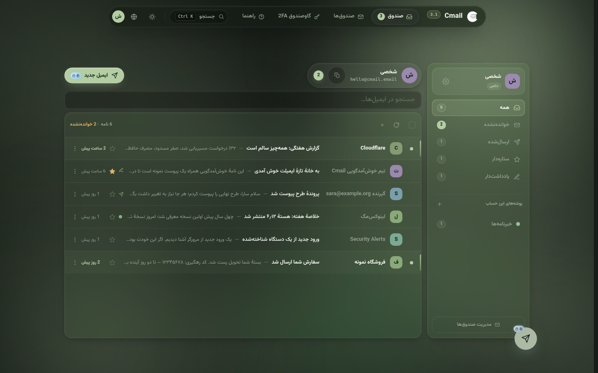 |

| **منوی راست‌کلیک** — بازکردن، پاسخ، ستاره، وضعیت خواندن، خروجی PDF، کپی آدرس فرستنده، انتقال به پوشه و حذف؛ همان‌جای نشانگر باز می‌شود، داخل قاب دید کلیپ می‌شود و روی موبایل برگهٔ پایین‌صفحه می‌گیرد |
|---|
| 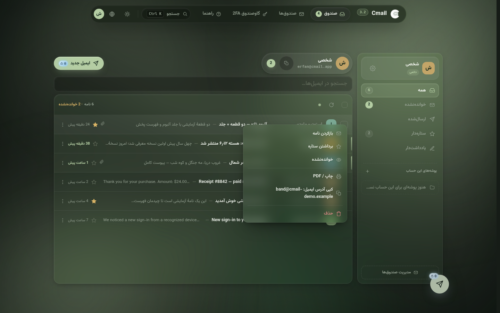 |

| **دایرهٔ حساب‌ها** — تنها محل تعویض حساب، با جزئیات هر حساب قبل از ورود |
|---|
| 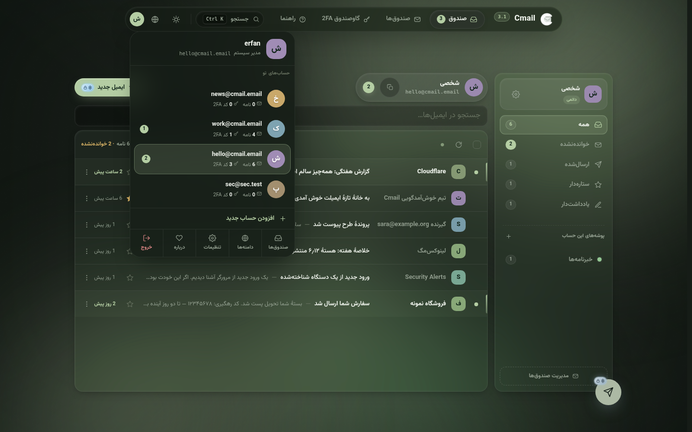 |

| **یک ایمیل، یک صفحه** — آدرس خودش، دکمهٔ بازگشت و نوار اقدامات؛ نه پاپ‌آپ |
|---|
| 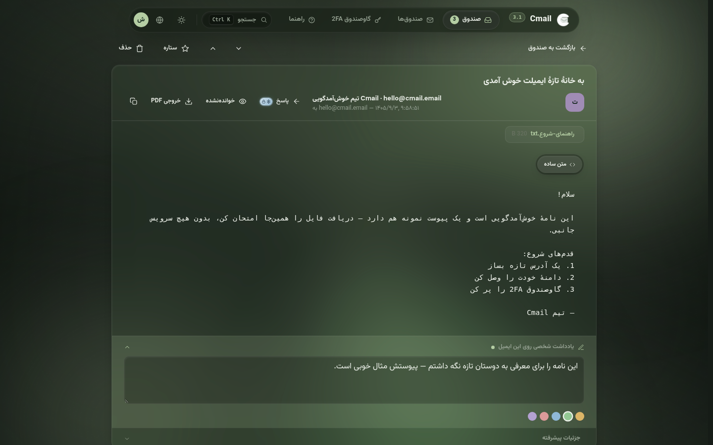 |

| **اتاق فرمان دیتابیس** — حلقهٔ امتیاز که از زبان خود دیتابیس می‌خواند؛ اتصال، جدول‌ها، ضربان کرون و جریان ایمیل؛ هر مشکل دکمهٔ ترمیم خودش را دارد |
|---|
| 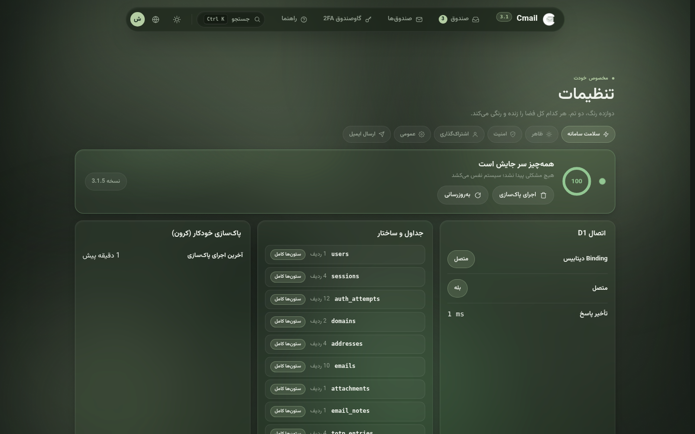 |

| **گاوصندوق هر حساب** — کدهای زنده فقط برای همین حساب، **پوشه‌های چسبیده به همین حساب**؛ آدرس موقت تا تصمیم تو یخ‌زده است |
|---|
| 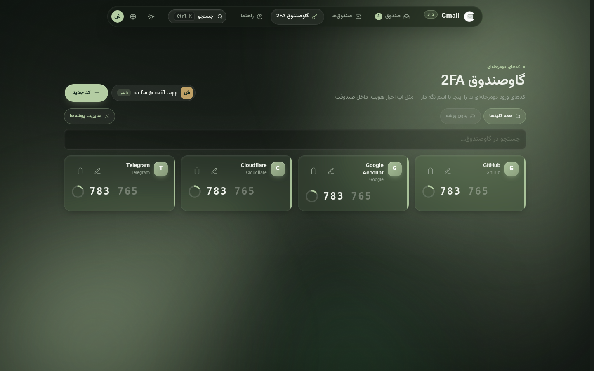 |

| **هر دامنه، یک کارت** — مسیر ثبت، نوار آمار، کلیدهای Active و Catch-all، حلقهٔ ضربان وقتی نامه در جریان است؛ دکمهٔ «جزئیات» پروندهٔ کامل را باز می‌کند |
|---|
| 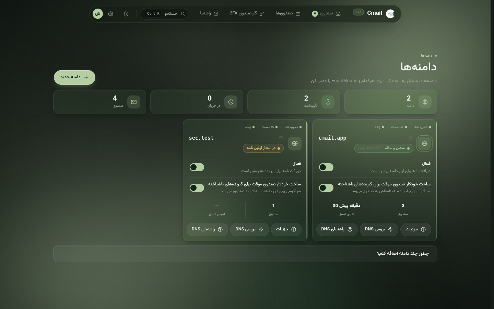 |

| **پروندهٔ دامنه** — نتیجهٔ زندهٔ DNS (MX و SPF)، فهرست عیب‌یابی که هر مشکل را با راه‌حلش می‌گوید، و رکوردهای صحیح برای مقایسه |
|---|
| 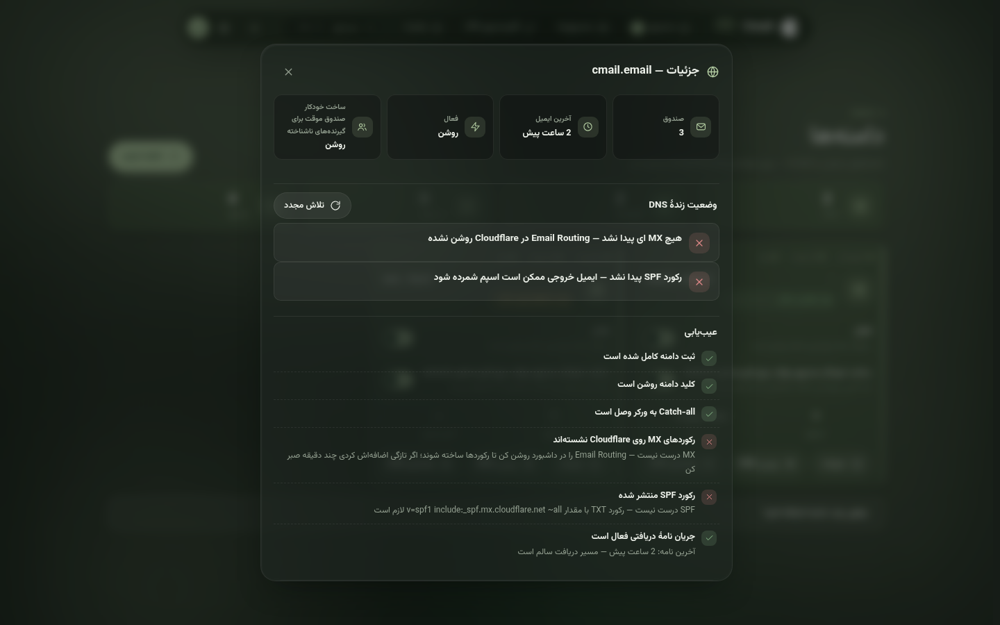 |

| **هر حساب، یک کارت** — نوار آمار، شمارش معکوس انقضا، ورود به صندوق با یک کلیک |
|---|
| 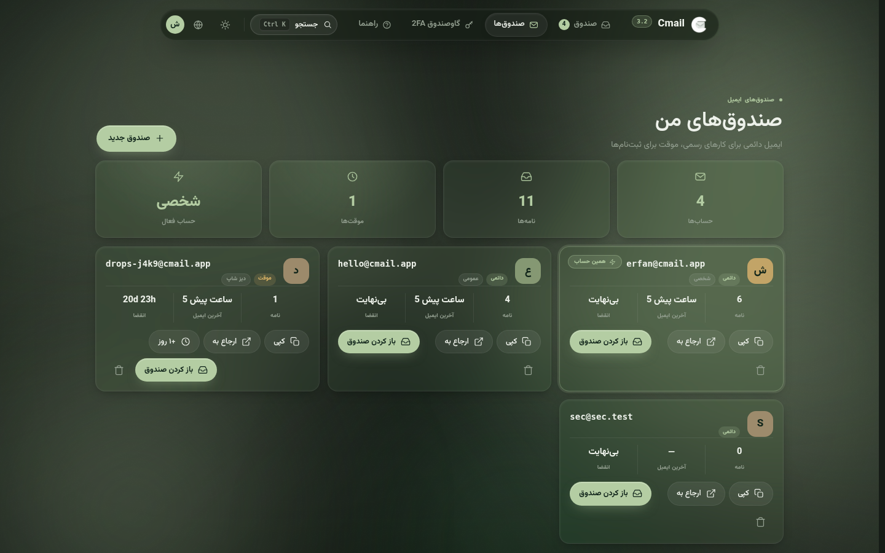 |

| **یک کلید، از هر جا به هر جا** |
|---|
| 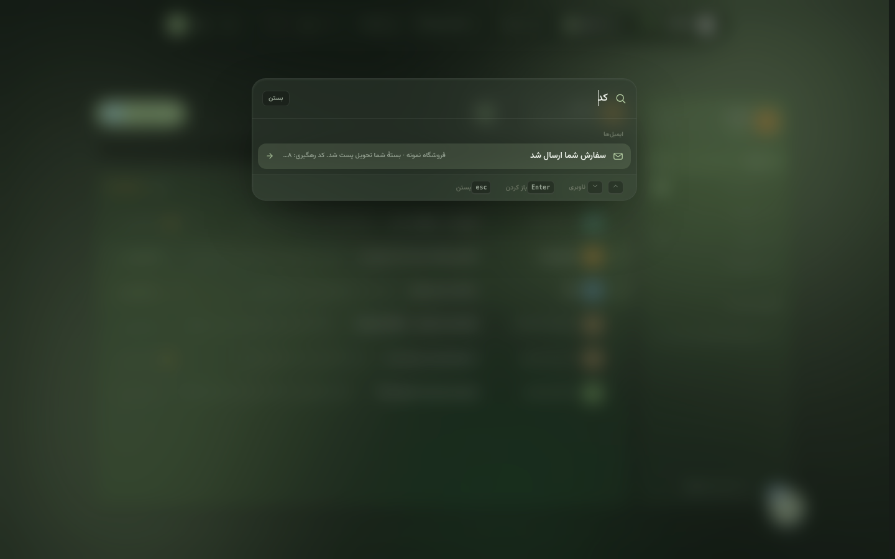 |

| **پوستهٔ روشن** |
|---|
| 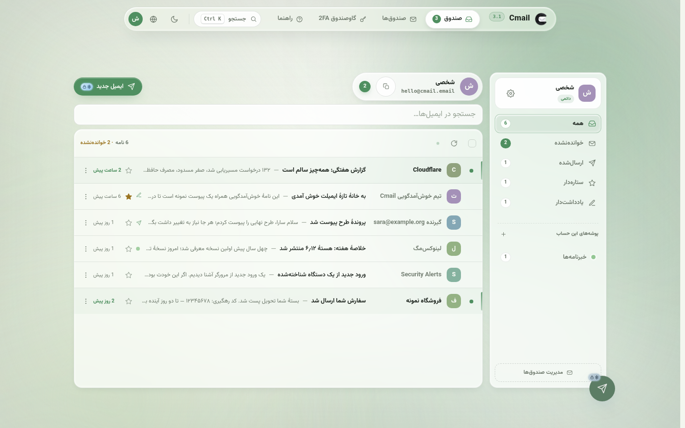 |

| **کل کابین، در جیب پیراهن** |
|---|
| 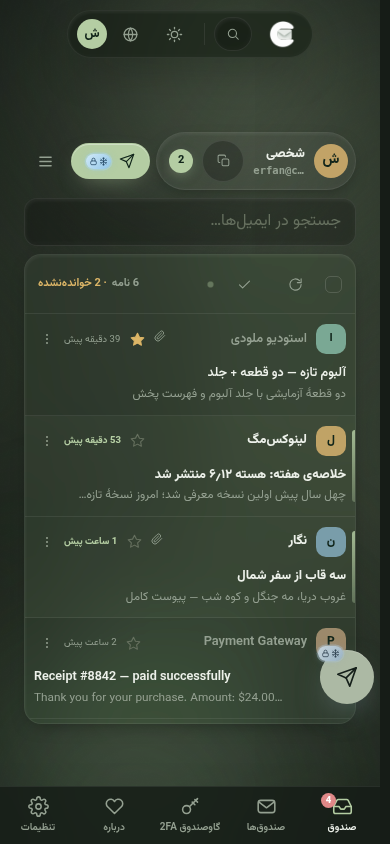 |

| **در ورودی** — کارت وسط‌چین، شفق زنده، راهنمای بازیابی سر جایش |
|---|
| 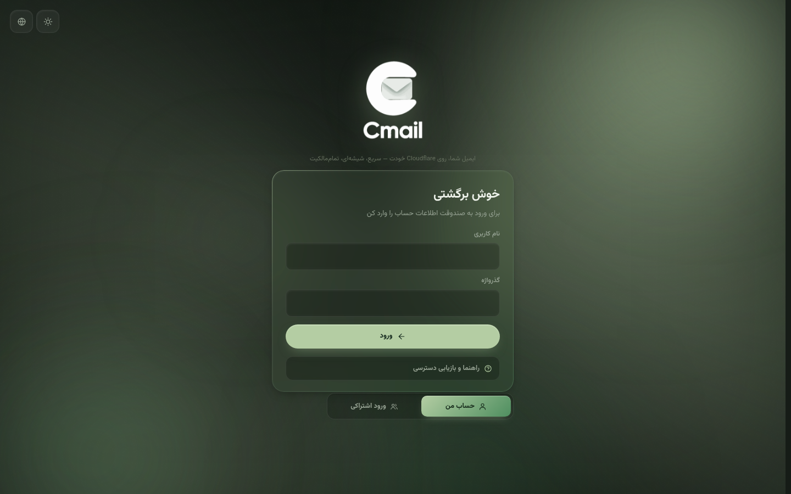 |

| **درباره — کارت سازنده، بررسی به‌روزرسانی و روبان Climind-W** |
|---|
| 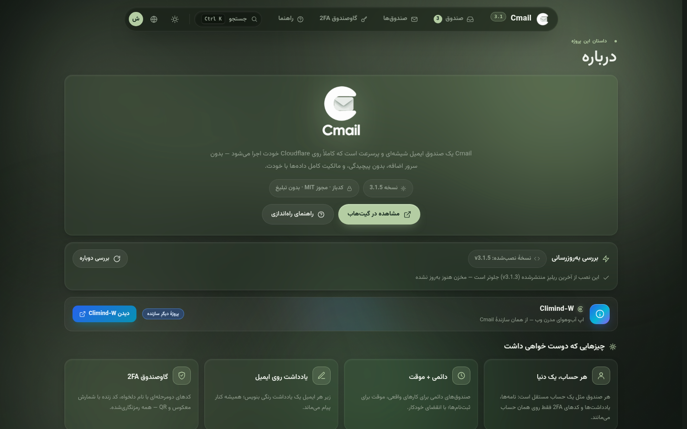 |

</div>

## تازه‌های ۳.۲.۲ — پیوست‌ها بزرگ شدند و دیسک صندوق عقربهٔ سوخت گرفت

۳.۲.۲ جوابِ دو گزارش تازه است — و دومی، بزرگ‌ترین ارتقای این نسخه شد: سیستم پیوست از نو ساخته شد و دیسکِ صندوق — یک دیتابیس D1 — بالاخره یک عقربهٔ صادق و قابلِ مدیریت گرفت.

- 🛠️ **زدنِ ضربدرِ بنِ هشدار دیگر صفحه را نمی‌ریزد.** بستنِ بنِ سیستمی کارت را کنار می‌گذاشت ولی حالتِ `has-alert` را جا می‌گذاشت — نما پدینگ و ارتفاعِ دورانِ بن را نگه داشته می‌ماند با هیچ بنی بالای سرش، و کل اپ زیر پیل‌بار سر می‌خورد: همان گزارشِ «ضربدر را می‌زنیم و همه‌چیز به‌هم می‌ریزد». حالا کرومِ بن‌ها در یک جا سینک می‌شود (`has-alert` + **ارتفاع اندازه‌گیری‌شدهٔ** بن‌ها در یک متغیر CSS)، حالتِ مخفی در CSS واقعی است، و چیدمان به‌جای عددِ حدسیِ ۱۵۰ پیکسل، ارتفاعِ واقعیِ بن‌ها را می‌خواند — با یک بن، سه بن، یا متن فارسیِ سه‌خطی، همه‌بار درست.
- 📎 **پیوست‌ها بزرگ شدند.** محتوای بزرگ‌تر از بودجهٔ ~۶۵۰ کیلوبایتیِ قدیم، فقط به‌شکل متادیتا با چیپی مرده ذخیره می‌شد که نه باز می‌شد نه بارگیری — در حالی که فهرست still گیره می‌کشید، چون پرچم از حجمِ نامه حدس زده می‌شد. حالا: **ذخیرهٔ قطعه‌قطعه** (مایگریشن ۰۰۱۴، برش‌های مرتب در `attachment_chunks`، سرهم‌شدن هنگام خواندن) **۸ فایل تا ۶ مگابایت برای هر فایل و ۱۸ مگابایت برای هر نامه** حمل می‌کند — همان عکس‌ها، ویس‌ها و پی‌دی‌اف‌هایی که نامهٔ واقعی می‌آورد. پرچمِ گیره حالا حقیقتِ خودِ پیوست است (`has_att`)، فایل‌های ردشده صادقانه می‌گویند، نامِ بارگیری با RFC 5987 می‌آید (نام فارسی سالم می‌ماند)، و یک خطای ذخیره‌سازی روی یک فایل هیچ‌وقت کل نامه را پس نمی‌زند — قانون صفر سرِ جایش است: کدِ قدیم `setReject()` می‌داد و نامه‌ای که نصفه ذخیره شده بود برمی‌گشت.
- 🖼️ **آتلیهٔ پیوست.** عکس‌ها با بندانگشتیِ زنده پیش‌نمایش می‌شوند و در **لایت‌باکس** باز می‌شوند (جهت‌نمای کیبورد، زوم، بارگیری). صدا **پخش‌کنندهٔ خودِ Cmail** را می‌گیرد — نوارِ شیشه‌ای که به لبهٔ پایین می‌نشیند: پخش/توقف، جای‌یابیِ موجی، زمان‌شمار، چرخش سرعت (۰٫۷۵× تا ۲×)، بارگیری. ویدیو در نمایشگر باز می‌شود؛ پی‌دی‌اف و متنِ ساده داخل اپ؛ همه‌چیز بارگیری می‌شود. و متنِ نامه بالاخره عکس‌های خودش را نشان می‌دهد: **ارجاع‌های `cid:` به URLهای واقعیِ هم‌مبدا بازنویسی می‌شوند** داخل فریمِ سندباکس‌شده — تصویرِ تعبیه‌شده داخل نامه رندر می‌شود، نه جعبهٔ شکسته.
- ⛽ **عقربهٔ سوخت.** یک دیتابیس D1، کلِ دیسک این صندوق است و اولین نشانهٔ پرشدنش، ایمیلی است که دیگر سینک نمی‌شود — پس حالا پنل زودتر حرف می‌زند. تنظیمات ← عمومی، **مدیریت حافظه** را می‌آورد: گیجِ حلقه‌ای، نوارِ تقسیم‌شده و ردیفِ هر نوع (متن‌نامه · عکس · ویدیو · صدا · پی‌دی‌اف · سند · فشرده · سایر)، ویرایشگرِ سقف (پیش‌فرض ۴۵۰ مگابایت — سقفِ D1 روی پلن رایگان)، **اجازهٔ پاک‌سازی خودکار** («اگر حافظه پر شد، قدیمی‌ترین نامه‌ها برای نامهٔ تازه جا باز می‌کنند — ستاره‌دارها هرگز، و ۱۰ تای آخر می‌مانند») و پاک‌سازیِ یک‌دکمه‌ای. از ۸۰٪ به بالا ادمین بنِ «حافظه‌ات کم است — اگر همین‌طور بماند ممکن است ایمیل‌هایت سینک نشوند» را می‌بیند و دیسکِ پر، هشدارِ جدی می‌کشد. عقربه دربارهٔ خودش هم صادق است: بایتِ محتوا، نه عددِ از خودساخته.
- 🧮 **موسر هم هماهنگ شد.** ۸ فایل، ۶ مگابایت هر فایل، با سنجهٔ زندهٔ مجموع و توست‌های صادق وقتی بودجهٔ فایل یا نامه پر می‌شود.

تست‌شده: `tsc` تمیز، توازن i18n **۹۳۵/۹۳۵**، ماتریس امنیتی **۱۱۱/۱۱۱** روی نصبِ تازه، E2E ویژگی‌های ۳.۲ برابر **۲۲/۲۲**، و سوئیت تازهٔ ۳.۲.۲ برابر **۲۹/۲۹** — بازخوانیِ بایت‌به‌بایتِ قطعه‌ها، انضباطِ inline/MIME (SVG هیچ‌وقت inline نمی‌شود)، نقاطِ انتهاییِ حافظه، جریانِ سقف/پاک‌سازی خودکار و پرچم‌های سلامت — همه روی ورکرِ زنده.

<details>
<summary><b>تازه‌های ۳.۲.۱ — مُهر چهرهٔ واقعی‌اش را گرفت، منوی راست‌کلیک برگشت و قفل محکم‌تر بسته شد</b></summary>

## تازه‌های ۳.۲.۱ — مُهر چهرهٔ واقعی‌اش را گرفت، منوی راست‌کلیک برگشت و قفل محکم‌تر بسته شد

۳.۲.۱ جوابِ سه گزارشِ روزهای اولِ نسخهٔ کاغذی است — و هر سه، باگ‌های واقعی و درخورِ تعریف بودند.

- 🪧 **منوی راست‌کلیک برگشت — زیر یک کاراکترِ شکسته دفن شده بود.** راست‌کلیک روی نامه منو را باز می‌کرد، ولی قاعدهٔ CSS که منو را شناور می‌کند بلعیده شده بود: مرج، `/*` ابتدای یک بنِ کامنت را خورده بود و پارسر همه‌چیز تا قانونِ بعدی را در یک سلکتور نامعتبر فرومی‌بُرد. منو در DOM بود و هیچ‌جا رندر نمی‌شد — دقیقاً همان «هیچ اتفاقی نمی‌افتد». پیدا شدن با مقایسهٔ شیلهٔ پارس‌شدهٔ مرورگر با فایل روی دیسک، درست شدن با یک کاراکتر، و اثبات با اندازه‌گیری زندهٔ `position: fixed` منو روی صفحهٔ واقعی.
- 🖨️ **نامهٔ چاپی حالا نشانِ واقعی را می‌برد.** مُهرِ SVGِ دستی حذف شد؛ گوشهٔ سند حالا **مُهر رسمی خانه** نشسته — همان تمبر لاستیکی آبی سلطنتیِ سایش‌خورده با نشان Cmail داخلش، نام، روبان OFFICIAL، شاخه‌های غار و ستاره‌ها — عینِ نمونه. سربرگ **لوگوی خودِ Cmail** را حمل می‌کند (یا نشانِ آپلودی ادمین، مثل قبل). بلوک مشخصات قابِ دوتایی گرفت، واترمارکِ شبح‌وارِ نشان، و برگهٔ کاملِ اداری: طرفین، صندوق، نوع، حجم، مسیر، نتیجهٔ SPF · DKIM · DMARC به‌شکل چیپ جوهری، پیوست‌ها با حجمشان و یادداشتِ نامه. لوح تاریخ‌وساعت حالا با سلول‌های ایزولهٔ HTML کشیده می‌شود تا رقم فارسی هیچ‌وقت خودش را به‌هم نریزد، و سند به زبان پنل حرف می‌زند — پنل فارسی حتی برای نامهٔ انگلیسی یک گواهی کاملاً راست‌به‌چپ چاپ می‌کند.
- 🔒 **قفل دیگر کلید یدکی زیر ورزشک ندارد.** درِ سرور همیشه محکم بود — نشستِ قفل‌شده روی هر داده‌ای `403` می‌گیرد، دوباره ۱۱۱/۱۱۱ — ولی سمت مرورگر دو نرمی داشت. فیلد رمز مرورگر را دعوت می‌کرد **رمز ذخیره‌شدهٔ پنل** را خودش در قفل بریزد (autofill با `current-password`) — حالا `new-password` می‌خواهد تا autofill بیرون بماند و ترفندِ افشا با inspect بی‌نفس شود. و پاک‌کردن اورلی با inspect تا ناوبری بعدی یک پوستهٔ خالی می‌گذاشت — حالا یک `MutationObserver` قفل را همان لحظه برمی‌گرداند و پوستهٔ اطرافش تاریک می‌شود: تار، بی‌اثر به کلیک، حتی شمارندهٔ نخوانده‌ها هم دیده نمی‌شود.
- 🧬 **کش‌باستر اثر انگشت گرفت.** هر نسخه URLهای asset را با شمارهٔ بسته مُهر می‌کرد (`?v=3.2.0`) — و یک بیلد دوباره با همان شماره می‌توانست بعضی مرورگرها را برای همیشه روی css/js کهنه نگه دارد؛ همان کشِ هم‌نسخه، دستِ پنهانِ پشت دو گزارشِ اول. URLها حالا اثر انگشتِ بایت‌های همهٔ فایل‌های embed را حمل می‌کنند — هر تغییر محتوا در هر جا، خودش یک URL تازه می‌سازد.

تست‌شده: `tsc` تمیز، توازن i18n **۸۹۳/۸۹۳**، ماتریس امنیتی **۱۱۱/۱۱۱** روی نصبِ تازه، E2E ویژگی‌های ۳.۲ برابر **۲۲/۲۲**، و سند چاپ در هر دو زبان زنده پیموده شد — مُهر، لوح، گواهی، یادداشت و واترمارک همه روی صفحه.

</details>

<details>
<summary><b>تازه‌های ۳.۲.۰ — نسخهٔ کاغذی: نامه برگهٔ اداری می‌شود</b></summary>

## تازه‌های ۳.۲.۰ — نسخهٔ کاغذی

این یکی با یک سؤال شروع شد که هنوز هیچ‌وقت برای Cmail جواب داده نشده بود: **چرا نامه باید شیشه‌ای بماند؟** نامه، ذاتاً برگهٔ اداری است. ۳.۲.۰ اجازه می‌دهد نامه بالاخره به کاغذ برسد — و در همین راه، سه چیزی را که واقعاً گزارش کرده بودی درست می‌کند، پنجرهٔ ارسال را از نو می‌سازد و به برنامه جواب صادقانه‌ای دربارهٔ نسخهٔ خودش می‌دهد.

- 🖨️ **استودیوی چاپ** *(بازنویسی خروجی PDFِ ۳.۱.۵ روی کاغذ واقعی)*. هر نامه حالا دکمهٔ **چاپ / PDF** دارد. یک فشار، یک برگهٔ واقعی می‌سازد: کاغذ گرم و بافت‌دار با دانه و خط‌های laid، سربرگ با نشان خودت، و — مراسم اصلی — یک **مُهر رسمیِ گرد** که همان لحظه با SVG کشیده می‌شود: حلقهٔ دوم، قوس ستاره‌ها، شاخه‌های بو، نشان وسط، روبان OFFICIAL، و یک پلاک که **تاریخ و ساعت دقیق دستگاه خودت** را لحظهٔ چاپ رویش می‌نشاند. خط‌های موجیِ پست هم گوشهٔ مُهر را می‌کِشند — انگار همین تازه مأمور پست رفته. در پنجرهٔ چاپ «Save as PDF» بزن؛ نامه برگه می‌شود.
- 🖋️ **نشانِ تو، نه نشان ما.** تنظیمات ← ظاهر ← «مُهر و کاغذ نامه» هر PNG/JPG می‌گیرد و **تصویر خودت** را جایی که لوگوی Cmail بود می‌نشاند — وسط مُهر و روی سربرگ. تصویری نگذاشتی؟ نشانِ کشیده‌شدهٔ Cmail می‌ایستد.
- 📎 **پیوست واقعی، خروجی.** پنجرهٔ ارسال حالا **فایل و تصویر** می‌گیرد — تا چهار فایل، هرکدام حدود ۶۵۰ کیلوبایت. تصویرها با بندانگشتی زنده می‌نشینند؛ فایل را می‌توانی مستقیم روی متن رها کنی، همان ژستی که سرویس‌های دسکتاپ یادمان دادند. پیوست‌ها از Brevo/Resend بیرون می‌روند *و* در نسخهٔ ارسال‌شده هم می‌مانند — قابل دانلود، دقیقاً مثل پیوست نامه‌های دریافتی.
- ✈️ **پنجرهٔ ارسال، بازسازی‌شده.** نشان هواپیمای کاغذی با گرادیان، ریل نماد کنار هر فیلد، ریل ابزار در پانوشت (پیوست · پاک‌کردن پیش‌نویس)، راهنمای `Ctrl ↵` که همان کاری را می‌کند که می‌گوید، و خطاها همین کنار فیلد — نه از بالای صفحه فریاد.
- 🔄 **مرکز به‌روزرسانی، بازطراحی‌شده.** کارت کوچکِ بررسی ۳.۱.۵ حالا یک مرکز کامل است — قرص‌های نسخه، وضعیت‌ها، یادداشت انتشار، و وقتی نسخهٔ تازه رسیده باشد سه قدمِ رسیدن به آن. به‌روز باشی جشن می‌گیرد. دیگر برای حدس‌زدن «الان چه نسخه‌ای دیپلوی شده» سراغ چند داشبورد نمی‌روی.
- 🧭 **دروغِ نسخه مرد.** نسخه حالا **زمانِ ساخت، داخل خود بسته** حک می‌شود (`scripts/build-worker.mjs` → esbuild `--define`). ورکری که دستی در داشبورد Cloudflare جای‌گذاری شده — جایی که متغیرهای wrangler.jsonc وجود ندارند — قبلاً در UI به `3.0.0` قدیمی برمی‌گشت. حالا خودِ بیلد حقیقت را می‌گوید: ۳.۲.۰ را دیپلوی کن و همه‌جا ۳.۲.۰ می‌بینید.
- ⭐ **ستارهٔ حالت هاور، حقیقت را می‌گوید و دیگر پرش ندارد.** ستارهٔ اقدام سریع هرگز وضعیت ستاره‌دار بودن نامه را نشان نمی‌داد و با هر لمس کل فهرست زیر نشانگر بازکشیده می‌شد — قرص وسط کلیک ناپدید می‌شد. حالا ستاره درجا برمی‌گردد، روشن که کهربایی و پر است، با یک پاپِ کوچک؛ فهرست فقط وقتی بازکشیده می‌شود که عضویت جعبهٔ «ستاره‌دار» واقعاً عوض شود.
- 🎛️ **ظاهر، جمع‌وجورتر.** انتخاب‌گر پس‌زمینه بازنشسته شد (صحنهٔ زنده، همان پس‌زمینهٔ یگانه است — نیازی به ردیف تنظیمات ندارد)، کارت‌های پوسته/زبان نمادمحور و جمع‌وجورتر شدند، و همهٔ پنل‌های تنظیمات یک زبان مشترک گرفتند: سرتیترهای کاشی‌گرادیانی، خط‌چین میان ردیف‌ها، فاصلهٔ کمتر، سیگنال بیشتر.

تست‌شده: `tsc` تمیز، توازن i18n **۸۸۶/۸۸۶**، کل ماتریس امنیتی سبز روی ورکر واقعی، و کل مسیر با `wrangler dev` از ابتدا تا انتها — مُهرِ نسخه، سندِ چاپ، پیوست در رفت‌وبرگشت، دو درِ ورود، ستاره.

</details>

<details>
<summary><b>تازه‌های ۳.۱.۵ — صندوق با راست‌کلیک، نخستین خروجی PDF، پروندهٔ کامل دامنه، خطاهای D1 جمله‌وار</b></summary>

## تازه‌های ۳.۱.۵

این نسخه از یک پشتهٔ گزارش واقعی ساخته شد: صندوق می‌خواست رفتار دسکتاپی بگیرد (راست‌کلیک، همان‌طور که در کلاینت‌های جدی عادت داریم)، بخش جداول گاهی `D1-Error: not authorized SQLITE_…` خام نشان می‌داد، زبانه‌های صفحهٔ ورود روی دسکتاپ سر جای درستشان نمی‌نشستند، صفحهٔ تکمیل راه‌اندازی وانمود می‌شد خودش را آپدیت می‌کند، و ویزارد دامنه هر بار که بیرون می‌آمدی و برمی‌گشتی یک آدرس تأیید تازه می‌ساخت و آدرس قبلی را بی‌استفاده می‌گذاشت. کنارش خواستهٔ همیشگی «شیک‌تر و حرفه‌ای‌تر» برای چند اتاق: جزئیات دامنه‌ها، سلامت سامانه، راهنمای درون‌برنامه‌ای، و بخش اشتراک‌گذاری و امنیت. همه در یک سیکل رفتند:

- **صندوق، منوی راست‌کلیک واقعی.** روی هر نامه راست‌کلیک کن: منوی مدیریت همان‌جای نشانگر باز می‌شود — بازکردن، پاسخ، ستاره، خوانده/نخوانده، خروجی PDF، کپی آدرس فرستنده، انتقال به پوشه و حذف. منو داخل قاب دید کلیپ می‌شود، با اسکرول یا Escape جمع می‌شود و روی موبایل به‌شکل برگه از پایین می‌آید؛ دکمهٔ سه‌نقطهٔ هر ردیف هم به‌جای مودال قدیمی همین منو را باز می‌کند. مهمانِ اشتراکی فقط آیتم‌هایی را می‌بیند که مجوزش اجازه می‌دهد.
- **خروجی PDF رسمی.** هر نامه — دریافتی یا ارسالی — می‌تواند به یک سند A4 با سربرگ Cmail تبدیل شود: مهر رسمی با تاریخ، جدول جزئیات (فرستنده، گیرنده، صندوق، نوع، حجم، مسیر ارسال و نتیجهٔ SPF/DKIM/DMARC)، بدنهٔ نامه در جهتِ واقعی متنش، فهرست پیوست‌ها و یادداشت. سند به زبان خود پنل حرف می‌زند — فارسی راست‌به‌چپ با Vazirmatn، انگلیسی با Inter — و «ذخیره به‌صورت PDF» کار خود مرورگر است؛ هیچ کتابخانهٔ PDF وسط راه نیست، پس متن فارسی هیچ‌وقت به‌هم نمی‌ریزد.
- **خطاهای D1 جمله‌آمده‌اند، نه ریختهٔ خام.** هر شکست دیتابیس قبل از رسیدن به صفحه طبقه‌بندی می‌شود و به یک جملهٔ انسانی در زبان پنل تبدیل می‌شود، با اشاره به جایی که راه‌حل واقعاً هست — تنظیمات ← سلامت سامانه. بازرس جداول صفحهٔ راه‌اندازی هم خطای دیتابیس را خودش می‌گیرد و به‌جای توقف خام، همان کد طبقه‌بندی‌شده را برمی‌گرداند.
- **زبانه‌های صفحهٔ ورود بالای کارت نشستند.** در DOM بعد از کارت اضافه می‌شدند و روی دسکتاپ زیر فرم رها شده بودند — همان گزارش «گزینه‌ها سر جایشان نیستند».
- **صفحهٔ تکمیل راه‌اندازی صادقانه خودش را آپدیت می‌کند.** حلقهٔ بازبینی خودکار بعد از یک fetch ناموفق دیگر تا ابد نمی‌اُفتد — آفلاین هم با شمارش معکوس واقعاً دوباره تلاش می‌کند؛ وقتی صفحه بسته شده خودش را متوقف می‌کند؛ و لحظهٔ خروج روی خودِ صفحه دیده می‌شود: شمارش واقعی «انتقال خودکار تا ۵ ثانیه…»، دکمه‌ای که به «ورود به Cmail» بدل می‌شود و یک «می‌مانم» برای کسی که می‌خواهد اول یک دور دیگر نگاه کند. در همان بازنویسی، یک باگ دوتایی هم بیرون آمد: دکمهٔ اصلی هم listener بازبینیِ قدیمی را داشت هم هندلر تازه را — یک کلیک دو کار می‌کرد.
- **ویزارد دامنه به قولش وفادار ماند.** قبلاً هر resend یا بازگشت به ویزارد کد تازه‌ای می‌ساخت و آدرسی که مالک به آن نامه زده بود بی‌استفاده می‌ماند. حالا کد تأیید، هویت دامنه است: وسط کار خارج شو، هر وقت برگشتی همان آدرس سر جایش است؛ فقط پنجرهٔ ۲۴ ساعته‌اش تازه می‌شود و نامهٔ دوباره به همان ایمیل حلقه را کامل می‌کند.
- **پروندهٔ کامل هر دامنه.** دکمهٔ «جزئیات» روی هر کارت دامنه یک پنجرهٔ کامل باز می‌کند: آمار دامنه، وضعیت زندهٔ DNS از resolver واقعی (MX و SPF — خودکار اجرا می‌شود)، فهرست عیب‌یابی که هر مشکل را با راه‌حلش می‌گوید — ثبت ناتمام، دامنهٔ خاموش، Catch-all بسته، MX ناکامل، SPF غایب، جریان ساکت — و جدول رکوردهای صحیح برای مقایسه. خطوط DNS هم دیگر متنشان را دو بار نمی‌گویند.
- **هستهٔ ارسال، محکم‌تر.** فراخوان‌های سرویس ارسال سقف سختِ ۲۰ ثانیه گرفتند تا کامپوزر تا ابد روی «در حال ارسال» نماند؛ متن ساده به‌جای `<pre>` لخت در بلوکی تمیز با خط‌فاصلهٔ واقعی سفر می‌کند؛ خطای سرویس با ترجمهٔ پنل و جزئیات فنیِ بریده‌شده نشان داده می‌شود؛ و پاسخ حالا نقل‌قول واقعی دارد — متن اصلی با تاریخ و نام فرستنده، خط‌به‌خط با `>` — و «Re:» فقط وقتی اضافه می‌شود که در موضوع نباشد.
- **سلامت سامانه، مثل یک ابزار دقیق.** قهرمان صفحه حلقهٔ امتیاز گرفت — درصد جداول سالم از زبان خود دیتابیس، نه عدد جعلی — کنارش اکشن‌های سریع (پاک‌سازی فوری، به‌روزرسانی) و یک کارت تازه برای وضعیت ارسال ایمیل با میان‌بر به تنظیمات.
- **اشتراک‌گذاری و امنیت، جمع‌وجورتر.** فرم دسترسی اشتراکی روی نمایشگر پهن دو ستون آرام شد — چه کسی وارد می‌شود و چه کاری مجاز است، در کنار اینکه تا کی و با چند دستگاه؛ کارت‌های امنیت هم فشرده‌تر نشستند.
- **راهنمای درون‌برنامه‌ای جست‌وجو دارد.** یک فیلتر زنده بالای صفحه بخش‌های بی‌ربط را کنار می‌برد؛ فصل‌های تازه برای مدیریت راست‌کلیکی صندوق، خروجی PDF و پروندهٔ دامنه‌ها اضافه شد و رفع اشکال به فصل هفت رفت.
- **بررسی به‌روزرسانی در «درباره».** کارت تازه نشان می‌دهد این نصب روی کدام نسخه است، خودش مخزن را چک می‌کند (کش ده‌دقیقه‌ای داخل ورکر؛ اگر سهمیهٔ API گلوگاه شد، ریدایرکتِ `releases/latest` جواب می‌دهد) و دکمهٔ «بررسی دوباره» مسیر بی‌کش را می‌رود. نسخهٔ جدید که منتشر شود همان‌جا با دکمهٔ مستقیم به مخزن می‌آید.

تست‌ها: ماتریس امنیتی **۱۱۱/۱۱۱** روی ورکر واقعی، tsc بدون خطا، پاریتی i18n ۸۴۸/۸۴۸، و مرور مرورگری همهٔ سطوح تازه در هر دو زبان — منوی راست‌کلیک، سند PDF، پروندهٔ دامنه، جست‌وجوی راهنما، کارت به‌روزرسانی، دو ستونِ اشتراک‌گذاری و حلقهٔ سلامت. بج نسخه، لینک‌های دانلود، ورکر تک‌فایلی و نصب یک‌کلیکی همه روی ۳.۱.۵.
</details>


<details>
<summary><b>تازه‌های ۳.۱.۳ — آخرین قدم دکمهٔ Deploy سبز شد و کدِ مصرف‌شده دیگر مصرف نمی‌شود</b></summary>

گزارشی که این نسخه را ساخت مشخص بود: آخرین مرحلهٔ دکمهٔ Deploy خطا می‌داد و پیامش هیچ راهی نشان نمی‌داد. کل پایپ‌لاین از یک کلون تازه اجرا شد و معلوم شد هیچ‌چیز از کد خراب نیست — اکانت جای خالی نداشت. پلن رایگان Cloudflare سقف ۱۰ دیتابیس D1 برای هر اکانت دارد و دیتابیس‌های آزمایشیِ جامانده همین سقف را پر کرده بودند. ۳.۱.۳ این بن‌بست را به یک پیام روشن تبدیل می‌کند:

- نصب‌کننده سقف اکانت را همان قدم اول تشخیص می‌دهد، نه بعد از چند دقیقه کار، و راه‌حل را شفاف می‌گوید: داشبورد → Storage & Databases → D1 → دیتابیسی که واقعاً دیگر استفاده نمی‌شود را حذف کن، بعد نصب را دوباره اجرا کن.
- `CMAIL_D1_ID=<id>` کشف خودکار دیتابیس را کلاً رد می‌کند و نصب‌کننده را مستقیم به شناسه‌ای وصل می‌کند که از داشبورد کپی شده.
- `deploy.sh` هم همین متن خطای خواناتر را گرفت.

یک اصلاح UI هم از دل همین گزارش بیرون آمد: روی نمایشگر ۳۲۰ پیکسلی، ردیف‌های بازرس D1 صفحهٔ راه‌اندازی از هم می‌پاشیدند — برچسب «ساخته نشده»، نام جدول و دکمهٔ Build هر کدام به خطی جدا می‌افتادند. ردیف‌ها بازنویسی شدند: در هر عرضی هر جدول یک خط می‌خواند (نماد، نام، وضعیت) و روی صفحهٔ باریک دکمهٔ Build به یک + فشرده می‌شود، تا وقتی جا شد برچسب کاملش برمی‌گردد. چک‌شده در ۳۲۰/۳۶۰/۳۹۰/۱۲۸۰ پیکسل با هر دو زبان و پوسته، به‌علاوهٔ بازبینی کامل همهٔ نماها در ۳۲۰ پیکسل — هیچ سرریزی وجود ندارد.

کار امنیت این بار مستقیم روی کدهای یک‌بارمصرف رفت:

- **کدهای TOTP یک‌بارمصرف واقعی شدند.** هر در — ورود، بازکردن قفل پنل، خاموش‌کردن 2FA — آخرین پلهٔ پذیرفته‌شده را با کلید `totp_step:<userId>:<door>` نگه می‌دارد و یک کد را فقط یک بار می‌پذیرد؛ کدِ رهگیری‌شده قابل‌پخش مجدد نیست. رکورد به‌ازای هر در جدا است، پس کدی که قفل را باز کرده در همان پله هنوز می‌تواند 2FA را خاموش کند — همان عادت معمول کار با اپ احراز هویت.
- `/totp/enable` سقف نرخ خودش را گرفت (۱۰ در هر ۱۰ دقیقه برای هر IP) و فعال‌سازی مجدد 2FA همهٔ رکوردها را صفر می‌کند تا راز تازه با تاریخچهٔ تمیز شروع شود.
- نام کاربری ناموجود هم‌هزینهٔ گذرواژهٔ غلط شد: در هر دو حالت یک هش PBKDF2 فریبنده محاسبه می‌شود و زمان پاسخ دیگر مشخص نمی‌کند کدام نام‌ها اکانت دارند.
- پیوست‌هایی که مرورگر می‌تواند اجرا کند (HTML، SVG، XHTML، XML) همیشه به‌صورت `application/octet-stream` دانلود می‌شوند با `nosniff` صریح — هرگز رندر نمی‌شوند.
- کوکی نشست به SameSite=Strict تغییر کرد و دیگر با گذارهای بین‌سایتی ارسال نمی‌شود.

تست‌ها: ماتریس امنیتی **۱۱۱/۱۱۱** روی ورکر واقعی، با یازده چک تازه روی دیوار پخش مجدد — رد کد مصرف‌شده، رد پلهٔ کهنه‌تر، پذیرش پلهٔ فعلی با رانش جزئی، و حفظ ایزولاسیون درها. tsc بدون خطا، پاریتی i18n ۷۹۹/۷۹۹. بج نسخه، لینک‌های دانلود، ورکر تک‌فایلی و نصب یک‌کلیکی همه روی ۳.۱.۳.

</details>
<details>
<summary><b>تازه‌های ۳.۱.۲ — رفع جابه‌جایی نمادها، سقف نرخ ارسال ایمیل و هدرهای COOP/CORP</b></summary>

گزارش از خود صفحهٔ تکمیل راه‌اندازی می‌آمد: نمادهایی که سر جای خودشان نمی‌نشستند. سه متهم، هر سه روی نصب واقعی اثبات و رفع شدند:

- برچسب «اختیاری» به کادر خط‌چینِ تمام‌عرض کشیده می‌شد — سلکتور عام `.check__txt span` که مال توضیحِ ردیف بود، چیپ را می‌ربود. سلکتور حالا فقط توضیح را می‌گیرد و برچسب دوباره چیپ کوچکِ کنار عنوان است.
- نشان «SERVER ONLINE» روی لوگوی شناور می‌نشست — لوگو و نشان هر دو inline بودند و یک line box مشترک داشتند؛ بدترین حالت روی گوشی. لوگو بلوک شد و نشان خط خودش را گرفت؛ همین اصلاح روی لوگوی صفحهٔ ورود هم اعمال شد.
- کانفتی جشن با z-index 320 روی خودِ کارت می‌بارید. حالا پشت برنامه می‌بارد — فقط روی پس‌زمینه و کم‌رنگ از پشت شیشه — و با «کاهش حرکت» کلاً خاموش است.

ریسپانسیو هم آتل بست: یازده گرید `minmax(N, 1fr)` سپر `min(N, 100%)` گرفتند (کارت‌های سلامت روی گوشی‌های ۳۲۰–۳۶۰ پیکسلی RTL نصفه بیرون می‌زدند)، نام دامنه‌های بلند واقعاً بیضی می‌شوند و آیکون کپی همیشه داخل کارت می‌ماند، ردیف‌های بازرس D1 به‌جای فشردگی می‌شکنند، برچسب‌های ریل ویزارد روی ≤۳۶۰px بیضی می‌شوند و نشان‌های وضعیت فشرده‌تر شدند. وریفای روی ۳۲۰ پیکسل با هر دو زبان و پوسته: هیچ نمایی حتی یک پیکسل بیرون نمی‌زند.

و امنیت یک پله بالاتر: `POST /api/emails/send` سقف ۲۰ در هر ۱۰ دقیقه برای هر IP گرفت و `POST /api/admin/test-send` سقف ۱۰ (جواب 429، سطل هر IP جدا) تا نشستِ لو رفته یا مهمانِ بیش‌مجوز نتواند از حساب Brevo/Resend مالک نامهٔ بی‌رویه بفرستد؛ هدرهای COOP و CORP هم روی همهٔ پاسخ‌ها سوار شدند. ماتریس امنیتی ۱۰۰/۱۰۰ (شش چک تازه) به‌علاوهٔ هر ۹۴ چکِ قبلی، هنوز سبز.

</details>

<details>
<summary><b>تازه‌های ۳.۱.۱ — قفل پنل روی سرور، به‌علاوهٔ دیوار دوم CSRF</b></summary>

گزارش دقیق بود: قفل پنل هنوز دور زدنی بود — راست‌کلیک، حذف المان پوشش در inspect، و پنل بدون هیچ رمزی باز می‌شد. درست بود: ۳.۱.۰ رمز بازکردن را روی سرور تأیید می‌کرد ولی خودِ «وضعیت قفل» هنوز یک فلگ مرورگری بود و سرور اصلاً نمی‌دانست نشست قفل است. ۳.۱.۱ خودِ قفل را به سرور می‌برد:

- زدن قفل، `sessions.locked_at` را در D1 مهر می‌زند (مایگریشن 0013) و از همان لحظه ورکر همهٔ مسیرهای دادهٔ آن نشست را رد می‌کند — نامه، کدهای گاوصندوق، پیوست‌ها، پوشه‌ها، آدرس‌ها، ادمین، ارسال — همه `403 session_locked`. فقط سطوحی که خودِ قفل لازم دارد باز می‌مانند: `/me`، `/lock`، `verify-unlock`، خروج، وضعیت عمومی راه‌اندازی و پروب سلامت. هیچ‌چیز داخل مرورگر نمی‌تواند یک ردیف D1 را عوض کند: داده به‌سادگی از ورکر بیرون نمی‌آید.
- قفل‌کردن، پنلِ پشت پوشش را خالی می‌کند — ریشهٔ برنامه، دیالوگ‌های باز، پالت فرمان، کش حساب‌ها؛ هیچ فهرست نامه یا کد گاوصندوقی زیر روکش پنهان نیست. بازکردن قفل صفحه را تازه رندر می‌کند.
- `/me` قفل‌شده چیزی لو نمی‌دهد: تعداد نخوانده‌ها و خطِ جدیدترین نامه پشت رمز می‌مانند.
- قفل به‌ازای هر نشست است؛ دستگاه‌های دیگرِ واردشده سرِ کارشان می‌مانند و هر تبی که از پوشش‌اش جا بماند با کلام بعدیِ سرور دوباره قفل می‌شود — keepalive بیست‌ثانیه‌ای یا اولین درخواست داده‌ای که `session_locked` می‌شنود.
- هر فراخوان API که وضعیت را عوض می‌کند، `Origin`/`Referer` را با host مقایسه می‌کند؛ POST جعلیِ بین‌دامنه‌ای قبل از اجرا رد می‌شود.
- ارتقا بی‌خطر: دیتابیس قدیمی تا وقتی مایگریشن ستون را اضافه نکرده، بدون آن ستون هم جواب می‌گیرد و اولین فشارِ قفل خودش جدول را ترمیم می‌کند؛ نشست‌های موجود دست‌نخورده می‌مانند. توکن‌های منقضی pending هم با کرون ساعتی جمع می‌شوند.

ماتریس امنیتی ۹۴/۹۴ روی ورکر واقعی — ۲۳ چک تازه برای خودِ قفل به‌علاوهٔ هر ۷۱ چکِ ماتریس ۳.۱.۰.

</details>

<details>
<summary><b>تازه‌های ۳.۱.۰ — ارتقای امنیتی: همهٔ قفل‌ها به سرور</b></summary>

کاربرها پیدا کردند و حق داشتند: بخش بزرگی از امنیت، تئاترِ سمت مرورگر بود. دسترسیِ تعلیق‌شده از راه API هنوز صندوق‌هایش را می‌خواند، صفحهٔ ورود یک گذرواژهٔ بازیابیِ دائمی خواندنی با devtools داشت و متر قدرت گذرواژه در مرورگر زندگی می‌کرد. ۳.۱.۰ همهٔ قفل‌ها را به سرور می‌برد:

- گذرواژهٔ بازیابیِ دائمی حذف شد. پنل بازیابی هر بار که باز می‌شود، در مرورگر خودت یک گذرواژهٔ یک‌بارمصرف تازه و هش PBKDF2 هم‌زوجش می‌سازد؛ هیچ مقدار قابل‌استفاده مجددی در برنامه، مخزن یا مستندات نیست و سرور هش ساخته‌شده در مرورگر را بدون اصطکاک می‌پذیرد.
- همهٔ هش‌ها PEPPER گرفتند: خروجی PBKDF2 با کلیدی مشتق از `APP_SECRET` امضای HMAC می‌خورد — کلیدی که در Worker Secret زندگی می‌کند نه در دیتابیس. لو رفتن D1 به‌تنهایی حتی یک حدسِ گذرواژه را تأیید نمی‌کند. هش‌های قدیمی با هر ورودِ موفق شفاف به شکل جدید بازنویسی می‌شوند.
- خط‌کش گذرواژه مال سرور است: حداقل ۸ کاراکتر، حرف و رقم الزامی (یونی‌کدآگاه — گذرواژهٔ فارسی دقیقاً مثل لاتین پاس می‌شود)، سیاههٔ رمزهای رایج شامل مقدار قدیمی بازیابی، و ردِ کاراکترهای تکراری.
- اشتراکِ معلق واقعاً معلق است: نامه، گاوصندوق، پوشه‌ها، آدرس‌ها و ارسال همگی `403 suspended_share` می‌دهند؛ فقط `/me` و خروج باز می‌مانند.
- نشت فیلدهای مهمان بسته شد (`forward_to` و یادداشت‌های خصوصی حذف شدند) و `shareCan` fail-closed شد: نشست اشتراکی بدون زمینهٔ قابل‌حل هیچ مجازی نمی‌دهد.
- خاموش‌کردن 2FA گذرواژه می‌خواهد؛ تغییر گذرواژه همهٔ نشست‌های دیگرِ آن اکانت را می‌کشد و خودش سقف نرخ جدا دارد.
- کلید ارسال ایمیل به‌صورت رمزشدهٔ AES-GCM ذخیره می‌شود؛ ایمیل‌های HTML تحت CSP سختِ خودشان اجرا می‌شوند و meta-refresh از آنها حذف است؛ HSTS و `frame-ancestors 'self'` همه‌جا؛ ادمین نمی‌تواند نقش خودش را تنزل دهد.

ماتریس امنیتی اختصاصی (`scripts/test-security.mjs`): ۷۱/۷۱ روی ورکر واقعی.

</details>

<details>
<summary><b>تازه‌های ۳.۰.۳ — ریشه‌یابی حلقهٔ ورود (ایشو #2)</b></summary>

گذرواژه هیچ‌وقت اشتباه نبود. روی نصب‌هایی که با زنجیرهٔ مایگریشن ترمینالی ساخته شده بودند (`deploy.sh`، `npm run setup`، `wrangler d1 migrations apply`)، جدول `share_links` دو ستون کم داشت (`max_devices` و `guest_note`) — مایگریشن 0010 اجرایش را به اسکریپتی سپرده بود که هرگز اجرا نشد — و lookup نشستی که به هر درخواستِ واردشده جواب می‌دهد، دقیقاً به همان ستون‌ها دست می‌زد. خطا بی‌سروصدا «کاربر نیست» تفسیر می‌شد و پنل بلافاصله بعد از ورودِ موفق به فرم ورود برمی‌گشت؛ هیچ ریست گذرواژه‌ای درستش نمی‌کرد.

سه لایه آن را دفن می‌کند:

- ستون‌ها مایگریشن 0012 مخصوص خودشان را گرفتند.
- خوانندهٔ نشست ورکر دومرحله‌ای شد و به شکل دیتابیس وابسته نیست؛ نشست مالک روی هر شکل دیتابیسی دیگر `share_links` را لمس نمی‌کند.
- دکمهٔ Repair پنل سلامت، دروازهٔ راه‌اندازی و پاس ترمیمِ جدیدِ `deploy.sh` ستون‌ها را هر جا جا افتاده باشند اضافه می‌کنند؛ جدول ناهماهنگ با عنوان `schema_outdated` و نام دقیق ستون‌ها نشانه‌گذاری می‌شود.

همچنین: تلاش ناموفق ورود روی دیتابیس ناهماهنگ به‌جای خطای خام `500 server_error` جواب تمیز `401 invalid_credentials` می‌دهد؛ و اسکریپت بازیابی در برابر shell مقاوم شد — SQL ریست کاراکتر `$` دارد و پیست در گیومهٔ دوتایی بی‌سروصدا هش را خراب می‌کند؛ راهنما هشدار می‌دهد و نسخه‌های گیومه‌تکی و `--file=` می‌دهد. تأیید با ۴۱/۴۱ چک E2E روی ورکر زنده.

</details>

<details>
<summary><b>تازه‌های ۳.۰.۲ — هر نصب، دیتابیس خودش؛ خطای سقف کرون رفع شد</b></summary>

دو خطای جداگانه یک علامت مشترک داشتند — نصب تازه‌ای که رمز عبور می‌خواست:

- دکمه، دیتابیسی را که اسمش را می‌شناخت دوباره استفاده می‌کرد، پس ورکر تازه می‌توانست به دیتای زندهٔ نصب اول سیم‌کشی شود. قدم Deploy حالا به هر نصب دیتابیس خودش را به نام ورکر خودش می‌دهد (`<worker-name>-db`)، همان را پیدا می‌کند یا می‌سازد، هر id بیگانه را دوباره می‌بندد و خودش کانفیگ کاری را وصله می‌زند (نام دیتابیس، id، نشانگر `CMAIL_DB_NAME`).
- دیپلویی که واقعاً موفق شده بود، وقتی اکانت سهم کرون نداشت باز قرمز می‌شد — پلن رایگان سقف ۵ کرون‌تریگر دارد (خطای 10072) و وصل‌کردن کرون پاک‌سازی ساعتی قدم آخر بود. resolver آن را می‌گیرد، بدون کرون دیپلوی می‌کند و با جملهٔ ساده می‌گوید بعداً چطور وصلش کنی.
- شناسهٔ دیتابیس از سه راه بازیافت می‌شود: `wrangler d1 list`، بایندینگ‌های خودِ ورکر زنده، یا ساختن — پس توکن CI که اجازهٔ ساختن دارد ولی اجازهٔ فهرست‌کردن ندارد هم دیپلوی می‌شود.
- لاگ دیپلوی خوانا شد و `deploy.sh` دیپلوی نهایی‌اش را از همان resolver می‌گذراند.

وریفای سرتاسری ۲۱/۲۱: نصب دوم با جدول ادمین خالیِ خودش بالا آمد و پروداکشن حتی یک ردیف از دست نداد.

</details>

<details>
<summary><b>تازه‌های ۳.۰.۱ — دروازهٔ راه‌اندازی، دکمهٔ Deploy خودترمیم، چند نصب روی یک اکانت</b></summary>

- نصب تازه همیشه به دروازهٔ راه‌اندازی می‌رسد. روی دیتابیس خالی یا نامعلوم همهٔ مسیرها به گیت می‌روند؛ کارت ورود به‌جای فرم رمز، پنل صادقانهٔ «دیتابیس هنوز آماده نیست» را نشان می‌دهد؛ و `POST /api/setup/admin` خطای تمیز `409 tables_missing` می‌دهد، نه خطای خام D1. دکمهٔ ساخت دسترسی فقط بعد از ساخته‌شدن جدول‌ها ظاهر می‌شود — و هرگز قبل از آن.
- دکمهٔ Deploy خودش را ترمیم می‌کند. مخزن عمداً `database_id` جای‌نگهدار دارد و قدم Deploy با خطای 10021 می‌مرد؛ حالا اسکریپت خود-حل‌کننده (`scripts/deploy-resolve.mjs`، وصل به `npm run deploy`) بایندینگ را می‌خواند، دیتابیس را به نام پیدا می‌کند یا می‌سازد، کپی کاری `wrangler.jsonc` را وصله می‌زند، بعد کنترل را به wrangler می‌دهد.
- چند نصب روی یک اکانت، صفر تداخل: نصب‌کننده با پرسش هویت باز می‌شود — Enter نصب تکی پیش‌فرض، اسم تایپ‌شده نصب مستقل، و `CMAIL_WORKER_NAME` / `CMAIL_DB_NAME` برای نصب‌های اسکریپتی. هویت (نام ورکر، نام دیتابیس، `database_id` ریست‌شده به جای‌نگهدار) داخل کانفیگ نوشته می‌شود تا resolver همیشه دیتابیسِ همان نام را ببندد. Catch-all در Email Routing به هر نمونه‌ای می‌تواند اشاره کند (`configure-email-routing.sh` نام ورکر را می‌گیرد) و راهنمای نصب بخش «چند نمونه روی یک اکانت» گرفت — سقف پلن رایگان: ۱۰ دیتابیس D1.
- کل جریان زنده تست شد: نمونهٔ دوم با جدول ادمین خالیِ خودش بالا آمد و پروداکشن دست‌نخورده ماند. پاریتی i18n ۷۹۴/۷۹۴.

</details>

<details>
<summary><b>تازه‌های ۳.۰.۰ — اشتراک‌گذاری چندصندوقی و دو در روی صفحهٔ ورود</b></summary>

- یک دسترسی مهمان حالا هر تعداد صندوق که انتخاب می‌کنی را می‌تواند داشته باشد، نه فقط یکی. انتخاب‌گر صندوق (یک چیپ برای هر صندوق) در تنظیمات → اشتراک‌گذاری است؛ مهمان دقیقاً همان چیزی را می‌بیند که داده‌ای. فهرست، جستجو، ستاره، پوشه‌ها، یادداشت‌ها، عملیات دسته‌ای و ارسال (با هر یک از آدرس‌های اشتراکی) همه چندصندوقی را می‌فهمند.
- هر دسترسی سقف دستگاه هم‌زمان دارد (نامحدود / ۱ / ۲ / ۳) و یک پیام خوش‌آمد که مهمان لحظهٔ ورود می‌خواند؛ اجازه‌ها، انقضا با پیش‌تنظیم و تاریخ دقیق، نام کاربری/گذرواژهٔ سفارشی، حساب زندهٔ لحظه‌ای، بیرون‌انداختن، باطل‌کردن و حذف کامل همچنان در یک پنل.
- صفحهٔ ورود کنترل سگمنتی باریک دارد: «حساب من» برای مالک، «ورود اشتراکی» برای مهمان‌ها.
- پنل مهمان یک Dynamic Island شد: قرص شناور با نام صندوق (یا «n صندوق»)، شمارش معکوس زنده و «؟»ای که فقط ضروری‌ها را باز می‌کند — زمان باقی‌مانده، فهرست صندوق‌ها، یادداشت ادمین، خروج. شناور است، روی حالت تعلیق عدد صادقانهٔ ثابت نشان می‌دهد و هر ۲۰ ثانیه خودش را همگام می‌کند.
- اتاق کنترل هر دسترسی: فهرست دستگاه‌ها و نشست‌ها با غیرفعال‌سازی تک‌تک، نام کاربری/گذرواژهٔ همیشه قابل‌دیدن (AES-256-GCM)، و Regenerate با اختیارِ بیرون‌انداختن همهٔ مرورگرهای زنده.
- تعلیق چرخهٔ کامل شد: اشتراکی که صندوق نداشته باشد خودش معلق می‌شود و با تعیین صندوق بیدار می‌شود؛ تعلیق دستی دو حالت دارد (شمارش ادامه پیدا کند یا زمان ثابت بماند)؛ صفحهٔ یخ‌زده زمان باقی‌مانده را نشان می‌دهد؛ حذف صندوقی که مهمان دارد اول هشدار می‌دهد.
- کد 2FAای که مهمان اضافه می‌کند همان ردیفی است که ادمین می‌بیند و کد زنده هر دو طرف یکی است؛ باگ بایندینگ پارامتر D1 که هر کوئری گاوصندوق مهمان را می‌شکست از ریشه بسته شد (مایگریشن `0011_share_control`).
- هیچ چیز بی‌مجوزی حتی به شکل خاموش رندر نمی‌شود؛ تایپ مستقیم `#/settings` یا `#/domains` بی‌درنگ به نمای صندوق برمی‌گردد.

</details>

<details>
<summary><b>تازه‌های ۲.۹.۵ — پوشه برای هر حساب، پس‌زمینه‌های صحنه، بازنویسی پنجرهٔ ارسال</b></summary>

- پوشه‌ها یک طبقهٔ دوم گرفتند: برای هر حساب پوشه‌های خودت را می‌سازی — هر پوشه یک نقطهٔ رنگی، شمارندهٔ زنده و قانون خودش را دارد و نامهٔ دو حساب را قاطی نمی‌کند. نامه را از منوی همان ردیف به پوشه ببر؛ انتخاب دسته‌ای را با نوار «انتقال به پوشه» جابه‌جا کن؛ و به پوشه یک قانون فرستنده بده (چند واژهٔ جداشده با ویرگول مثل `news, bills`) تا نامهٔ تازهٔ همان فرستنده‌ها لحظهٔ رسیدن داخلش بنشیند. حذف پوشه نامه‌هایش را به صندوق اصلی برمی‌گرداند؛ هیچ‌چیز از دست نمی‌رود.
- تنظیمات ← ظاهر انتخاب‌گر پس‌زمینهٔ صحنه دارد: چهار صحنهٔ دستی‌سازِ متحرک — تپه‌های سبز، شفق قطبی، غروب، آسمان شب — به‌علاوهٔ بدون صحنه. همه با سیستم کاهش‌حرکت هماهنگ‌اند.
- پنجرهٔ ارسال از نو ساخته شد: ردیف‌های هم‌تراز، متن‌نامه‌ای که با پیام بلندتر بزرگ می‌شود، فرستنده با آواتار کنار گزیننده، خطاها کنار خود فیلد (نه از ته صفحه)، دکمهٔ ارسال با چرخان، Ctrl/Command + Enter، و پیش‌نویسی که خودش ذخیره می‌شود و از بستن تب جان سالم می‌برد.
- راهنما دکمهٔ رسمی Deploy to Cloudflare را گرفت؛ نصب‌کنندهٔ ترمینال (`deploy.sh`) هم هر دو شکل کانفیگ را می‌شناسد.
- ایمنی کلیک‌های سریع بلندتر شد: بارگذاری پوشه‌ها توکن توالی دارند، تعویض حساب مجموعهٔ پوشه‌های حساب قبلی را پاک می‌کند و هیچ نقاشی‌ای بیرون از نمای زنده اتفاق نمی‌افتد.

</details>

<details>
<summary><b>تازه‌های ۲.۹ — بازسازی کامل صندوق</b></summary>

- صندوق از صفر ساخته شد: یک بیضی هویت بالای یک کارت زنده — چهرهٔ حساب، اسم، آدرس کامل با کپی یک‌لمسی — و ردیف‌های تک‌خطی مثل سرویس‌های بزرگ (چهره · فرستنده · موضوع — پیش‌نمایش · ستاره · زمان). ردیف نخوانده به‌جای چک‌باکس یک نقطهٔ کوچک دارد؛ نزدیکش شوی چک‌باکس جای نقطه می‌نشیند. ستون خواندنِ بلااستفاده حذف شد و فهرست صاحبِ تمام‌عرض شد.
- بارگذاری دروغ نمی‌گوید: هر درخواستِ کش‌دار نوار پیشرفت باریک بالای صفحه می‌گیرد، صندوق نوار وضعیت خودش را دارد (حتی وسط به‌روزرسانی پس‌زمینه)، بار شکست‌خورده دکمهٔ تلاش دوباره می‌دهد، و پوشهٔ خالی / جستجوی بی‌نتیجه / «حسابی انتخاب نشده» هر کدام پیام خودشان را دارند.
- روبان درباره روی موبایل چیدمان دومردی درست گرفت و شفقش روی GPU موبایل ساکن می‌ماند.
- یک بوت، تضمینی: اسکریپت ورودی نسخه‌دار بود ولی ایمپورت‌های ماژول نه؛ کل پوسته دو بار بارگذاری می‌شد — دو روتر، دو شنوندهٔ hash، و ریشهٔ واقعی خانوادهٔ باگ «دو بخش هم‌زمان باز می‌شوند». حالا هر ایمپورت مُهر نسخهٔ ورودی را دارد.

</details>

<details>
<summary><b>تازه‌های ۲.۸ — تعویض حساب تک‌خانه شد؛ پوشه‌های گاوصندوق مال هر حساب</b></summary>

- تعویض حساب فقط از دایرهٔ بالای صفحه انجام می‌شود. نوار کناری دیگر فهرست حساب‌ها نیست و چیپ سرستون یک پلاک هویت آرام است. زیر پلاک ریل پوشه‌های همان حساب است — همه · نخوانده · ستاره‌دار · یادداشت‌دار — با شمارندهٔ زندهٔ سمت مرورگر؛ جابه‌جایی آنی است و شمارنده‌ها همیشه درست‌اند.
- هر پوشه گاوصندوق از تولد به یک حساب گره می‌خورد (`0006_vault_folder_scope.sql`، ارتقای نرم برای نصب‌های قدیمی): انتخاب‌گر پوشه فقط پوشه‌های همان حساب را نشان می‌دهد و جابه‌جایی کد به حساب دیگر، پوشهٔ حساب قبلی را از آن جدا می‌کند.
- نشان یخ‌زده همراه حساب موقت هر جا که باشد دیده می‌شود — کارت هویت نوار کناری، چیپ گاوصندوق، دکمهٔ «کد جدید» — و بعد از پذیرش مسئولیت به شعلهٔ نفس‌کش تبدیل می‌شود.
- ریشهٔ باگ کلیک‌های پشت‌سرهم پیدا شد: ادامهٔ ناهمگام نمای قدیمی از `getElementById` به DOM نمای تازه می‌رسید و دو بار نقاشی می‌کرد؛ حالا هر نما فقط داخل گره‌های خودش نقاشی می‌کند. پنجره‌های باز، منوهای شناور و پاپ‌آورها لحظهٔ ناوبری جمع می‌شوند.
- تنظیمات فیلد «نام سرویس» را از دست داد؛ فایل‌های asset آدرس نسخه‌دار گرفتند (`app.css?v=2.8.0`) تا هیچ مرورگری بعد از به‌روزرسانی اسکریپت کهنه اجرا نکند؛ صفحهٔ درباره روبان انیمیشنی Climind-W پوشید؛ دامنه‌ها هالهٔ شفق زیر موس و حلقهٔ ضربان برای دامنه‌هایی که واقعاً نامه می‌گیرند گرفتند؛ هم‌پوشانی نشان‌ها روی موبایل رفع شد؛ و ۲۴ اسکرین‌شات از هر نما و هر دو زبان دوباره گرفته شد.

</details>

<details>
<summary><b>تازه‌های ۲.۷ — نام واقعی پالت‌ها و قفل یخ‌زده هر جا که مسئولیت است</b></summary>

- پالت‌ها می‌گویند چه رنگی‌اند: سبز · آبی · بنفش · کهربایی؛ حالت‌های پس‌زمینه هم همین‌طور: متحرک · ساکن · ساده. اسم‌های قدیمی خودکار به رنگ خودشان می‌روند و تعویض پالت همچنان کل فضا را همان لحظه و بدون رفرش رنگ می‌کند.
- تا وقتی سرویس ارسال وصل نیست، دکمهٔ نوشتن (سرستون و شناور) و دکمهٔ پاسخ در صفحهٔ خواندن نشان یخ‌زده دارند — لمسش می‌کند بگوید چه چیزی کم است، نه اینکه بی‌صدا غیبش بزند. سرویس وصل شد، نشان به قفلِ باز تبدیل می‌شود.
- گاوصندوق آدرس موقت هم همین قانون را دارد: افزودن کد اول قفل است و پشت پنجرهٔ مسئولیت می‌ماند؛ شمارش معکوس حذف را یک بار بپذیری، برای همان حساب به خاطر سپرده می‌شود و نشان به شعلهٔ نفس‌کش تبدیل می‌شود — بقیهٔ حساب‌های موقت مستقل و همچنان یخ‌زده می‌مانند.
- صندوق جمع‌وجورتر شد (ردیف‌های لاغرتر) و به‌روزرسانی خودکارش هر ۱۰ ثانیه است.
- کلیک‌های پشت‌سرهم مقاوم شدند: تب‌های تنظیمات، کارت‌های پالت، فیلترهای صندوق و تعویض حساب توکن رندر می‌گیرند و رندر از‌افتاده دور انداخته می‌شود؛ نوشتن دوباره باز نمی‌شود؛ منوهای بازشو روی لایهٔ ثابت صفحه می‌نشینند و از به‌روزرسانی پس‌زمینه جان سالم می‌برند؛ نوار کناری فقط وقتی چیزی واقعاً عوض شده نقاشی می‌شود.
- تنظیمات ارسال با چیپ زندهٔ «قفل است / آماده است» باز می‌شود تا وضعیت خروجی قبل از خواندن اولین فیلد معلوم باشد.

</details>

<details>
<summary><b>تازه‌های ۲.۶ — کارت‌های حساب و دامنه؛ گاوصندوق اسکوپ‌دار</b></summary>

- سرستون صندوق حساب فعال را به شکل چیپ نشان می‌دهد (آواتار، آدرس، نوع، شمار نامه‌ها)؛ بازش کنی کارت شیشه‌ای همهٔ حساب‌ها با نشان نخواندهٔ هر کدام باز می‌شود و همان‌جا، بدون ترک صندوق، بین حساب‌ها جابه‌جا می‌شوی.
- صفحهٔ صندوق‌ها جدول خشک را با کارت‌های واقعی عوض کرد: نوار آمار بالا و برای هر حساب یک کارت با آواتار، برچسب دائمی/موقت، سه عدد (نامه‌ها، آخرین نامه، انقضا با شمارش معکوس) و کپی / بازگردانی / +۱ روز / بازکردن صندوق / حذف.
- صفحهٔ دامنه‌ها هم همین‌طور: نوار آمار (دامنه‌ها · تأییدشده · در جریان · صندوق‌ها) و کارت هر دامنه با مسیر ثبت (ذخیره شد → کد تأیید → زنده)، نشان‌های وضعیت واقعی و کلیدهای Active و Catch-all با توضیح یک‌خطی.
- گاوصندوق 2FA روی حساب فعلی باز می‌شود و دکمهٔ «کد جدید» پیش‌فرض به همان حساب وصل است.
- برای آدرس موقت، دکمهٔ افزودن کد قفل است؛ پنجرهٔ مسئولیت دقیقاً می‌گوید آدرس تا چند ساعت دیگر حذف می‌شود و کدهای وصل به آدرس موقت شمارش معکوس زنده دارند.
- باگ‌های ظاهری بسته شدند: اعلان‌ها با × خودشان تمیز بسته می‌شوند و تایمرشان لغو می‌شود، پنجره‌ها هنگام بستن شنوندهٔ Escape را با خود می‌برند، کلیک‌های پشت‌سرهم دو بخش را هم‌زمان باز نمی‌کنند، و نشانگر منو به یک قرص شیشه‌ای واقعی تبدیل شد که از صفحه‌ای به صفحهٔ دیگر پرش می‌کند.

</details>

<details>
<summary><b>تازه‌های ۲.۵ — دایرهٔ حساب‌ها و صفحهٔ مستقل هر ایمیل</b></summary>

- آواتار بالای صفحه یک سوییچر حساب واقعی باز می‌کند، همان‌طور که از سرویس‌های بزرگ می‌شناسی: تک‌تک صندوق‌ها با جزئیاتشان — چند نامه گرفته‌اند، چند کد 2FA دارند، چند نخوانده — به‌علاوهٔ افزودن حساب جدید و ردیف مدیریت/تنظیمات/خروج. یک کلیک کل برنامه را به فضای همان حساب می‌برد و خود دایره هم رنگ و حرف همان حساب را می‌پوشد.
- هر ایمیل صفحهٔ مستقل خودش را دارد با URL خودش (`#/mail/m/:id`)، دکمهٔ واقعی بازگشت، فلش‌های قدیمی‌تر/جدیدتر و نوار کامل اقدامات. پاپ‌آپ روی فهرست حذف شد.
- کل پوسته یک قرص شیشه‌ای شناور شد: لوگو و نسخه یک طرف، چهار صفحه (صندوق · صندوق‌ها · گاوصندوق 2FA · راهنما) وسط، و جستجو/پوسته/زبان/حساب طرف دیگر.
- چهار پالت نام‌دار — مریم‌گلی، آرام، بنفش، کهربایی — هر کدام کل فضا را از نو رنگ می‌کنند: پس‌زمینه، تینت شیشه‌ها، اکسنت‌ها و حتی رنگ خود مرورگر؛ انتخاب‌های قدیمی به نزدیک‌ترین پالت می‌روند.
- نصب‌هایی که از بیلدهای قدیمی ارتقا یافته بودند ممکن بود بی‌سروصدا نقش مدیر را از دست بدهند و سلامت سامانه غیبش بزند؛ برنامه حالا نقش مدیرِ تک‌کاربر را هنگام بوت برمی‌گرداند — بدون هیچ SQL.

</details>

<details>
<summary><b>تازه‌های ۲.۴ — صفحهٔ راه‌اندازی منظم و پس‌زمینهٔ زندهٔ قابل‌تنظیم</b></summary>

- فرم‌های صفحهٔ راه‌اندازی روی دسکتاپ در هر اندازهٔ پنجره واقعاً وسط‌اند — استیج دوبارپدشده‌ای که کارت‌ها را کنار می‌زد حذف شد. هر دامنهٔ ذخیره‌شده با چیپ وضعیت و دکمهٔ «ادامهٔ اتصال» جای خودش را نگه می‌دارد؛ افزودن دوبارهٔ دامنهٔ موجود خطا نیست، اعلان ملایمی است که ویزارد خودش را باز می‌کند؛ دامنهٔ بدون تأیید هم هر وقت برگردی «تأیید با کد» را پیشنهاد می‌دهد.
- فضای پشت برنامه با پالت فعال هم‌رنگ می‌شود و در تنظیمات → ظاهر سه حالت دارد: Aurora (نورِ رام و کشان)، Halo (درخشش ثابت)، Pure (ساده).
- کارت نقل‌قول از نوار کناری حذف شد تا جا برای صندوق‌ها باشد؛ صفحهٔ درباره سازنده را با کارت حلقهٔ گرادیانی معرفی می‌کند.
- تایپ‌اسکریپت بدون خطا کامپایل می‌شود؛ اسکرین‌شات‌ها همه تازه‌اند و هیروها مُهر ۲.۴ دارند.

</details>

<details>
<summary><b>تازه‌های ۲.۳ — صندوق یکپارچه و پنل سلامت سامانه</b></summary>

- نامه‌های همهٔ میل‌باکس‌ها در یک فهرست زنده می‌ریزند، هر ردیف برچسب کوچکی از صندوق مقصد دارد و نوار کناری مثل سرویس‌های بزرگ، بدون رفرش، جابه‌جا می‌شود.
- صندوق هر ۱۵ ثانیه بی‌صدا نامهٔ تازه را چک می‌کند، تازه‌رسیده‌ها را هایلایت می‌کند و نشان‌های نخوانده را درست نگه می‌دارد.
- تنظیمات پنل سلامت گرفت: اتصال D1 با تأخیر لحظه‌ای، هر جدول با وضعیت ردیف‌ها و ستون‌ها، ضربان کرون، و چک‌لیست جریان ایمیل برای روزهایی که «نامه نمی‌رسی». جدول جاافتاده دکمهٔ Build می‌گیرد؛ اسکیمای قدیمی دکمهٔ Repair.
- مشکل‌های جدی با زبان ساده بالای صفحه ظاهر می‌شوند — D1 در دسترس نیست، جدول‌ها کم‌اند، اسکیما قدیمی است، کرون ساکت شده، نامه متوقف است، دامنه نصفه ثبت است — هر بنر، راه‌حلش هم همراهش است.
- هندلر ایمیل وقتی ورکر ارتقا یافته ولی مایگریشن‌ها اجرا نشده‌اند، به شکل ستون‌های قدیمی برمی‌گردد تا تحویل نامه بی‌صدا نشکند؛ پنل سلامت این ناهماهنگی را نشانه‌گذاری می‌کند تا با یک فشار ترمیم شود.
- مستندات به دو راهنمای جدا شکست (نصب و استفاده، به‌ازای هر زبان) و README فارسی RTL کامل گرفت.

</details>

## برای چه کسی است؟

- **هرکس از اسپم خسته است** — برای هر ثبت‌نام یک آدرس یک‌ساعته بساز و صندوق واقعی‌ات تمیز بماند.
- **برنامه‌نویس‌ها و تسترها** — ده‌ها صندوق تست بساز، ایمیل‌های سیستمی را بگیر، تمام که شد بگذار منقضی شوند.
- **آدم‌های حرمت‌خصوصی** — بدون آنالیتیکس، بدون اسکریپت ثالث؛ همه‌چیز در حسابت است، زیر کلیدهای خودت.
- **صاحبان دامنه** — دامنه‌هایی که همین حالا روی Cloudflare نشسته‌اند را به یک اکوسیستم کامل ایمیل تبدیل کن؛ با یک ویزارد واقعی، نه دانش سینه‌به‌سینه.
- **هرکس می‌خواهد ابزارش واقعاً مال خودش باشد** — یک بار راه بینداز، برای همیشه مالک باش.

## دانلود — بدون کلون کردن

- **[`worker.js`](https://github.com/Erfan-8910/Cmail/releases/download/v3.2.2/worker.js) آماده** — کل برنامه در یک فایل (حدود ۱٫۹ مگابایت، ~۴۸۰ کیلوبایت gzip). برای نصب گرافیکی همین یک فایل کافی است.
- **بستهٔ کامل v3.2.2:** [`CMail-v3.2.2.zip`](https://github.com/Erfan-8910/Cmail/releases/download/v3.2.2/CMail-v3.2.2.zip) — سورس‌ها، [`schema.sql`](schema.sql)، [`migrations/`](migrations) و اسکریپت‌ها.
- زیپ، آینهٔ تگِ v3.2.2 است — ذخیرهٔ قطعه‌قطعهٔ پیوست با آتلیهٔ پیش‌نمایش و پخش‌کنندهٔ اختصاصی، عقربهٔ سوختِ حافظه با پاک‌سازی خودکار، بن‌های هشدارِ حافظه، مُهر رسمی خانه و برگهٔ اداریِ کامل‌تر چاپ، قفل سخت‌گیرشده، کشِ اثرانگشتی assetها، پیوست واقعی خروجی، پنجرهٔ ارسال و مرکز به‌روزرسانیِ نو، منوی راست‌کلیک صندوق، پروندهٔ کامل دامنه با عیب‌یابی زندهٔ DNS، دیوار پخش‌مجدد TOTP و تمام میراث امنیتی ۳.۱.x داخلش هستند؛ دکمهٔ Deploy و کلونِ تازه همیشه تازه‌ترین را حمل می‌کنند.
- همهٔ نسخه‌ها: [Releases](https://github.com/Erfan-8910/Cmail/releases)
- فقط شکل دیتابیس را می‌خواهی؟ یک فایل است: [`schema.sql`](schema.sql) — آمادهٔ کنسول و قابل اجرای دوباره.

## راهنماها — برای هر زبان

| | نصب | استفاده |
|---|---|---|
| **فارسی** | [راهنمای نصب](docs/DEPLOY.fa.md) | [راهنمای استفاده](docs/USAGE.fa.md) |
| **English** | [Deployment](docs/DEPLOY.md) | [Usage](docs/USAGE.md) |

## کل سیستم در یک نگاه

```
                     ┌──────────────────────────────────────────┐
                     │               Cloudflare                  │
 incoming mail       │                                           │
 SMTP ──────────►  Email Routing (MX)                            │
                     │        │ catch-all                        │
                     │        ▼                                  │
 browser ────────►  Worker ── serves embedded UI (single file)   │
                     │   │  │                                    │
                     │   │  └── Brevo / Resend ──► outgoing mail │
                     │   ▼                                       │
                     │  D1 (SQLite) — mail · inboxes · account   │
                     │               · notes · TOTP · settings   │
                     └──────────────────────────────────────────┘
```

یک Worker رابط کاربری، API، هندلر ایمیل ورودی و پاک‌سازی ساعتی را سرو می‌کند. یک دیتابیس D1 همه‌چیز را نگه می‌دارد. رابط کاربری بخشی از باندل Worker است، پس دیپلوی اتمی است: یک فایل جای‌گذاری کن، رابط و بک‌اند همیشه با هم هم‌نسخه‌اند.

**فقط ذخیره نیست؛ مهروموم شده.** هر رمز 2FA قبل از رسیدن به دیتابیس با AES-256-GCM رمزنگاری می‌شود، رمزها از PBKDF2 با ۱۰۰٬۰۰۰ دور و نمک اختصاصی می‌گذرند، نشست‌ها توکن امضاشده‌اند و ایمیل HTML رندرشده داخل قاب سندباکس و بدون اسکریپت زندگی می‌کند. رمزنگاری اینجا تیکِ چک‌لیست نیست — جنسِ همان چیزی است که گاوصندوق از آن ساخته شده.

**ساخته‌شده برای روز بد** — هندلر ایمیل ورودی روی دیتابیس‌های قدیمی به‌جای برگشت‌زدن نامه‌ها، محتاطانه عقب می‌نشیند و تحویل را ادامه می‌دهد؛ هر کرش به یک صفحهٔ راهنمای دوزبانه تبدیل می‌شود نه یک خطای خام؛ و پنل سلامت فرق «همه‌چیز مرتب است» با «این دقیقاً همان چیزی است که باید بزنی» را می‌داند.

## مجوز

GPL-3.0 © [Erfan-8910](https://github.com/Erfan-8910) — سی‌میل نرم‌افزار آزاد تحت [مجوز عمومی همگانی گنو نسخهٔ ۳](LICENSE) است: استفاده کن، بخوان، تغییرش بده، به‌اشتراک بگذار.

---

<div align="center" dir="rtl">

[](https://github.com/Erfan-8910/Climind-W)

**[Climind-W](https://github.com/Erfan-8910/Climind-W)** — اپ آب‌وهوای مدرن وب، با همان وسواس شیشه‌ای.
همان دست، همان سلیقه — یک ستاره مهمانش کن.

</div>

---

<div align="center" dir="rtl">

**Cmail** — *صندوق خودت، قانون خودت.*

[راهنمای نصب](docs/DEPLOY.fa.md) · [راهنمای استفاده](docs/USAGE.fa.md) · [نسخه‌ها](https://github.com/Erfan-8910/Cmail/releases) · [Climind-W](https://github.com/Erfan-8910/Climind-W) · [English](README.md)

</div>
