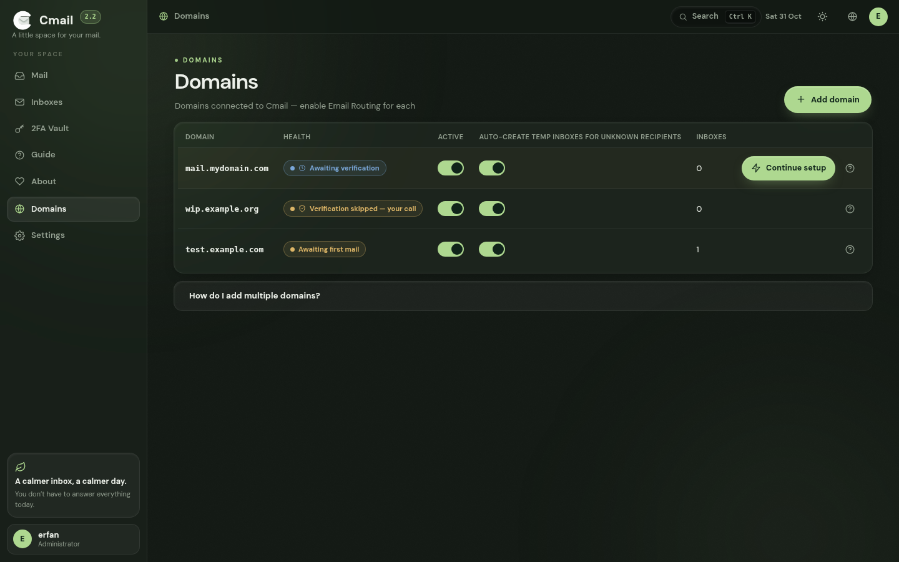
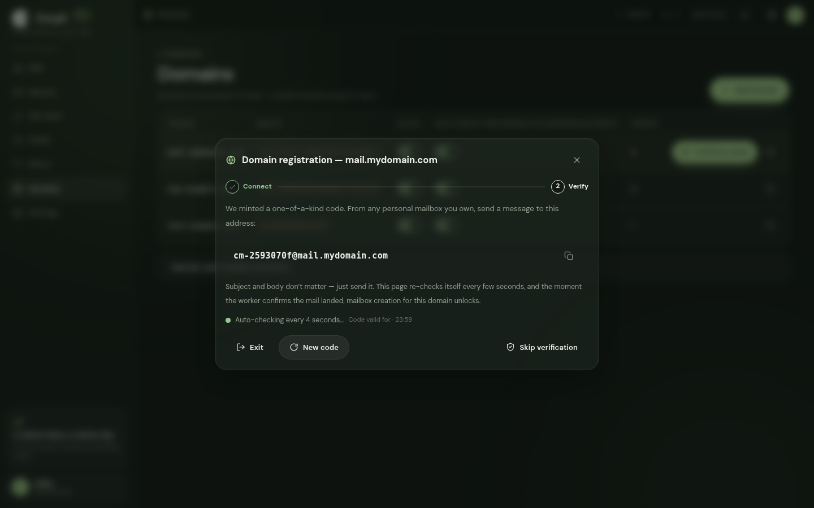
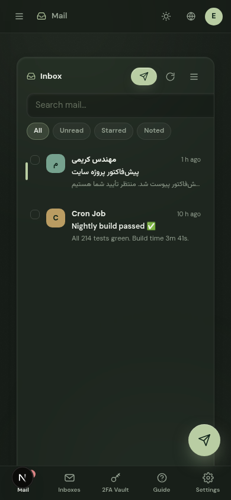

<div align="center" dir="rtl">

<picture>
  <source media="(prefers-color-scheme: dark)" srcset="docs/logo-white.png">
  
</picture>

# Cmail

**یک اکوسیستم ایمیل کامل و آرام، که تماماً داخل حساب Cloudflare خودِ تو زندگی می‌کند.**

صندوق موقت و دائمی · یادداشت روی هر ایمیل · گاوصندوق 2FA داخلی · دامنهٔ نامحدود · ارسال ایمیل · بدون سرور، بدون قبض ماهانه

[](https://github.com/Erfan-8910/Cmail/releases)
[](#نصب)
[](#راه-۲--کاملاً-گرافیکی-بدون-حتی-یک-دستور)
[](LICENSE)
[](https://workers.cloudflare.com)

[English](README.md) · **فارسی**

</div>

<div dir="rtl">

---

## چرا Cmail ساخته شد؟

Cmail از یک سؤال ساده شروع شد: **چرا برای یک صندوق ایمیل باید اجاره‌بها بدهیم؟**

پاسخ همیشگی این است: یک سرور اجاره‌ای، یک دیتابیس که باید مراقبش باشی و صورتحسابی که یادت می‌رود. Cmail همهٔ این‌ها را دور انداخته. کل اکوسیستم داخل همان حساب Cloudflareای اجرا می‌شود که از قبل داری: ایمیل‌های ورودی با **Email Routing** می‌رسند، داده‌ها در **D1** (همان SQLite در لبهٔ شبکه) می‌مانند و کل رابط کاربری را یک **Worker** سرو می‌کند. نه سروری برای زنده نگه‌داشتن، نه قبض، نه پنل اجاره‌ای.

نتیجه یک فضای شخصی است که واقعاً مالکش خودت هستی — دامنه‌اش، داده‌اش، کلیدهایش. هر وقت خواستی پاکش کن، هر وقت خواستی ببرش جای دیگر. کل ماجرا همین است.

و چون یک «صندوق» تنها هرگز کافی نیست، Cmail خودش را یک **اکوسیستم** می‌داند نه یک اینباکس: آدرس یک‌بارمصرف برای ثبت‌نام‌ها، صندوق دائمی برای کارهای واقعی، یادداشت رنگی زیر هر پیام، گاوصندوق 2FA داخلی، و ارسال ایمیل از دامنهٔ خودت — همه در یک پنل شیشه‌ای و آرام.

## چه چیزهایی دارد؟

| | |
|---|---|
| 📬 **صندوق موقت + دائمی** | آدرس موقت با شمارش معکوس زنده و TTL دلخواه؛ آدرس دائمی که برای همیشه مال خودت است. |
| 🌐 **ویزارد ثبت دامنه** | دامنه را که اضافه کردی، خودش دستت را می‌گیرد: راهنمای وصل کردن، بعد یک کد صحت‌سنجی که خودت به دامنه‌ات می‌فرستی — تا تأیید نشود، برایش صندوق قفل است. |
| 🔎 **بازرس D1** | در صفحهٔ راه‌اندازی، همهٔ جداول را با شمار ردیف‌هایشان می‌بینی؛ جاافتاده را با یک دکمه می‌سازی و جدول‌های بی‌گزینه را حذف می‌کنی. |
| 🗒️ **یادداشت روی هر ایمیل** | یادداشت رنگی شخصی زیر هر پیام — شماره سفارش، لینک پیگیری، هر چیزی. جستجو همان‌جا پیدایش می‌کند. |
| 👤 **هر صندوق، یک حساب** | هر صندوق مثل یک حساب مستقل رفتار می‌کند: نامه‌ها، یادداشت‌های خصوصی و کدهای 2FA همان سرویس فقط داخل همان حساب می‌مانند. |
| 🔐 **گاوصندوق 2FA** | احرازکنندهٔ داخلی: کدهای ۶ رقمی زنده با حلقهٔ شمارش معکوس، رمزنگاری‌شده با AES-256-GCM، ۷۷ نشان آماده، پوشه‌سازی و اتصال هر کلید به یک صندوق. |
| 🛡️ **ورود دومرحله‌ای حساب** | خودِ ورود به پنل هم می‌تواند TOTP داشته باشد. |
| 📤 **ارسال ایمیل — اختیاری** | اگر خواستی با یک کلید API به Brevo یا Resend وصل شو و از دامنهٔ خودت بفرست؛ با دکمهٔ تست، همان‌جا امتحانش می‌کنی. نداشتنش هیچ دری را قفل نمی‌کند. |
| ➡️ **ارجاع (Forwarding)** | کپی لحظه‌ای هر صندوق به آدرسی که واقعاً چک می‌کنی. |
| ⌘ **پالت فرمان** | با <kbd>Ctrl/⌘</kbd>+<kbd>K</kbd> هر جا که هستی، بپر هر جا می‌خواهی؛ هم‌زمان جستجوی زندهٔ ایمیل‌ها هم نتیجه می‌دهد. |
| ⌨️ **کیبورد‌محور** | `j`/`k` حرکت، `Enter` بازکردن، `x` انتخاب، `s` ستاره — نقشهٔ کامل داخل خود اپ هست. |
| 🧹 **پاک‌سازی خودکار** | کرون ساعتی، صندوق‌های منقضی و نامه‌های قدیمی را خودش جمع می‌کند — جدول کاملش پایین‌تر هست. |
| 🌙 **رابط شیشه‌ای** | تم شب و روز، شفافیت قابل تنظیم شیشه، ۱۳ پالت رنگ نام‌دار، فارسی (راست‌به‌چپ) و انگلیسی. |
| 📱 **کاملاً واکنش‌گرا** | از ۳۲۰ پیکسل موبایل تا دسکتاپ ۱۹۲۰ — ستون‌ها به دراور و شیت تبدیل می‌شوند. |
| 🔒 **داده‌ات، قانون تو** | D1 مال توست، کلیدها مال توست. هیچ‌کس دیگری نامه‌هایت را ندارد. |

## گالری

<div align="center">

| **اتاق فرمان** — سه ستون، صفر شلوغی، هر حساب با یک لمس |
|---|
|  |

| **خواننده** — ایمیل HTML کامل، داخل قاب سندباکس، با تشخیص خودکار راست‌به‌چپ |
|---|
|  |

| **گاوصندوق** — کدهای ۶ رقمی زنده، پوشه‌ها، یک نشان برای هر کلید |
|---|
|  |

| **مرکز فرماندهی** — هر دامنه، یک نگاه، وضعیتِ ثبتِ صادقانه |
|---|
|  |

| **ویزارد ثبت دامنه** — یک کد، یک نامهٔ حلقه‌ای، و دامنه خودش را ثابت می‌کند |
|---|
|  |

| **یک کلید از هر جا، به هر جا** |
|---|
|  |

| **سیزده حالت و حال، یک اسلایدر** |
|---|
|  |

| **تم روز، همان آرامش** |
|---|
|  |

| **کل اتاق فرمان، در جیب پیراهن** |
|---|
|    |

| **درِ ورودی** |
|---|
|  |

</div>

## تازه‌های ۲.۲ — نسخه‌ای که دامنه‌ها را جدی گرفت

- **ویزارد ثبت دامنه، از صفر تا صد.** دامنه را که می‌نویسی و «افزودن» را می‌زنی، ویزارد باز می‌شود: اول یک راهنمای تمیز برای وصل کردن در Cloudflare (فعال‌کردن Email Routing، Catch-all روی Worker)، با دکمهٔ آخر کار: **«دامنه را وصل کردم»**. بعد مرحلهٔ صحت‌سنجی: یک کد یکتا می‌گیری که از هر صندوق شخصی‌ات به دامنهٔ خودت می‌فرستی؛ صفحه هر چند ثانیه خودش را چک می‌کند و به‌محض اینکه نامه رسید و ورکر تأییدش کرد، ساخت ایمیل با آن دامنه باز می‌شود.
- **خروج همیشه آزاد است.** در هر مرحله از ثبت دامنه دکمهٔ خروج هست؛ موقع خروج خودش می‌پرسد: **ذخیره به‌عنوان پیش‌نویس، یا خروج؟** پیش‌نویس در جدول دامنه‌ها می‌ماند، دکمهٔ «ادامهٔ ثبت» دارد و از همان‌جایی که رها کرده بودی ادامه پیدا می‌کند.
- **دامنهٔ ناتمام، صندوق نمی‌شود.** تا وقتی صحت‌سنجی کامل نشده، ساخت ایمیل با آن دامنه قفل است. اگر خودت می‌دانی و قبول ریسکی، دکمهٔ «رد کردن صحت‌سنجی» با یک هشدار صریح مسئولیت را می‌پذیرد.
- **مرحلهٔ D1 در صفحهٔ راه‌اندازی، قبل از ساخت حساب.** همهٔ جداول موردانتظار را با شمار ردیف می‌بینی؛ جدول جاافتاده با یک دکمه ساخته می‌شود (تکی یا همه‌با هم)، جدول‌های ناشناخته‌ای که به درد این برنامه نمی‌خورند با دکمهٔ حذف جمع می‌شوند — و جداول اصلی محافظت‌شده‌اند و حذف نمی‌شوند.
- **ارسال ایمیل رسماً اختیاری شد.** ردیفش در صفحهٔ راه‌اندازی برچسب «اختیاری» دارد و هیچ‌وقت جلوی ورودت به صندوق را نمی‌گیرد. دکمهٔ تست هم اضافه شد: یک نامهٔ واقعی به هر آدرسی بفرست و مطمئن شو سیم‌کشی ارسال سالم است.
- **SQL ضدخطای Console.** گزارش‌ها رسید که پیست کردن فایل‌ها در Console دیتابیس خطا می‌دهد. ریشه‌اش این بود که کامنت‌های فایل نقطه‌ویرگول داشتند و جداکنندهٔ دستورها را گمراه می‌کرد. حالا [`schema.sql`](schema.sql) رسماً Console-proof است: هیچ نقطه‌ویرگولی داخل کامنت‌ها نیست، همهٔ دستورها `IF NOT EXISTS` دارند و دوبار اجرایش — تست‌شده — صفر خطا می‌دهد. فایل‌های `migrations/` فقط مال ترمینال‌اند و روی هدرشان هم نوشته شده.

<details>
<summary><b>۲.۱ و ۲.۰ چه کردند؟ (برای کنجکاوها)</b></summary>

- **۲.۱** — [`schema.sql`](schema.sql) شاخص جاافتادهٔ پاک‌سازی ساعتی را گرفت، هر جدول و شاخص کامنت «چرا» پیدا کرد، راهنماها به دو فایل مستقل (انگلیسی + فارسی) تقسیم شدند و همهٔ اسکرین‌شات‌ها از بیلد فعلی از نو گرفته شدند.
- **۲.۰** — کل اپ یک فایل شد: صفحات، استایل‌ها، اسکریپت‌ها، فونت‌ها و آیکون‌ها همه داخل `worker.js`. نه «آپلود پوشهٔ ظاهر» و نه «Attach assets» — فقط **Edit Code + یک Binding**. دکمهٔ ساخت خودکار جداول به صفحهٔ راه‌اندازی آمد و هر خطا به جای خام بودن، به یک صفحهٔ راهنمای دوزبانه تبدیل شد.

</details>

## برای چه کسی است؟

- **برای کسی که از اسپم خسته شده** — به‌جای دادن آدرس اصلی‌ات به هر سایتی، برای هر ثبت‌نام یک آدرس یک‌ساعته بساز؛ آدرس واقعی‌ات همیشه تمیز می‌ماند.
- **برای توسعه‌دهنده‌ها و تسترها** — ده‌ها صندوق تست بساز، ایمیل‌های سیستم را بگیر، واریانت‌های آدرس را امتحان کن و وقتی کار تمام شد بگذار منقضی شوند.
- **برای کسی که حریم خصوصی برایش مهم است** — بدون آمار، بدون اسکریپت ثالث، بدون CDN؛ همه‌چیز داخل حساب خودت، با کلیدهای خودت.
- **برای مالکان دامنه** — دامنه‌هایی که روی Cloudflare نشسته‌اند را با یک ویزارد واقعی به اکوسیستم ایمیل کامل تبدیل کن. هر دامنه، هر تعداد آدرس.
- **برای هر کسی که دوست دارد ابزارش واقعاً «مال او» باشد** — یک بار راه می‌اندازی‌اش، برای همیشه مال خودت است.

## دانلود — بدون کلون کردن ریپو

- **فایل آمادهٔ [`worker.js`](https://github.com/Erfan-8910/Cmail/releases/download/v2.2.0/worker.js)** — کل برنامه در یک فایل (~۱.۱ مگابایت، ~۴۷۰ کیلوبایت gzip). برای راه ۲ فقط همین یکی کافی است.
- **بستهٔ کامل v2.2.0:** [`CMail-v2.2.0.zip`](https://github.com/Erfan-8910/Cmail/releases/download/v2.2.0/CMail-v2.2.0.zip) — سورس، `schema.sql`، مایگریشن‌ها و اسکریپت‌ها. همهٔ نسخه‌ها: [Releases](https://github.com/Erfan-8910/Cmail/releases)

## نصب

> پیش‌نیاز: فقط یک **حساب Cloudflare** (پلن رایگان کاملاً کافی است). برای راه‌های ترمینالی: Node.js نسخهٔ ۱۸ به بالا.

### راه ۱ — یک دستور (ترمینال)

<div dir="ltr">

```bash
git clone https://github.com/Erfan-8910/CMail.git
cd CMail
bash deploy.sh
```

</div>

نصب‌کننده خودش همه‌چیز را انجام می‌دهد: دیتابیس D1 را می‌سازد، شِما را اعمال می‌کند، یک `APP_SECRET` قوی و تصادفی تولید می‌کند، Worker را منتشر می‌کند و آخرش آدرس پنل را برایت چاپ می‌کند.

### راه ۲ — کاملاً گرافیکی، بدون حتی یک دستور

پنج قدم. نه SQL، نه آپلود پوشه — فقط مرورگر و داشبورد Cloudflare:

**۱) دیتابیس را بساز**
- وارد [dash.cloudflare.com](https://dash.cloudflare.com) شو ← **Storage & Databases ← D1 SQL Database ← Create**
- اسمش را بگذار `cmail-db` و Create بزن. همین! ساختن جدول‌ها حالا کارِ خودِ Cmail است.

**۲) Worker را بساز و کد را جای‌گذاری کن**
- **Workers & Pages ← Create ← Workers ← Create Worker**
- اسمش را بگذار `cmail` و یک بار با کد پیش‌فرض **Deploy** بزن.
- روی **Edit code** بزن؛ تمام کد پیش‌فرض را پاک کن، محتوای کامل [`worker.js`](https://github.com/Erfan-8910/Cmail/releases/download/v2.2.0/worker.js) را جای آن پیست کن و **Deploy** بزن.

**۳) تنها اتصالی که لازم داری: D1**
- برگرد به Worker: **Settings ← Bindings ← Add**
- نوع **D1 database** ← نام متغیر: `DB` ← دیتابیس: `cmail-db` ← Save / Deploy.
- (اختیاری ولی توصیه‌شده) در همان‌جا یک **Secret** هم بساز: نام `APP_SECRET` ← مقدار: یک رشتهٔ طولانی و تصادفی. این کلید رمزنگاری داخلی اپ است؛ یک بار می‌سازی و دیگر عوضش نمی‌کنی.

**۴) زمان‌بندی پاک‌سازی**
- **Settings ← Trigger Events ← Cron Triggers ← Add** و این را وارد کن: `17 * * * *`

**۵) تمام!** آدرس `https://cmail.<زیر-دامنه-تو>.workers.dev` را باز کن:
- مرحلهٔ **D1** باز می‌شود: همهٔ جداول را با وضعیت‌شان می‌بینی. اگر چیزی جا افتاده، دکمهٔ **«ساخت جداول جاافتاده»** یا دکمهٔ تک‌تک هر جدول را بزن؛ جدول اضافه و بی‌گزینه هم دکمهٔ حذف دارد.
- بعد از خودت **نام کاربری و رمز** می‌سازد، و برای دامنه، ویزارد وصل‌کردن و صحت‌سنجی را خودش باز می‌کند. ارسال ایمیل هم اختیاری است — هر وقت خواستی با دکمهٔ تست راهش می‌اندازی.

> 💡 میان‌بر: در **Workers & Pages ← Create** می‌توانی به‌جای ساخت دستی، فورک گیت‌هابت را وصل کنی (Connect to Git) تا Cloudflare خودش بسازد و منتشر کند. فقط قبلش در `wrangler.jsonc` مقدار `REPLACE_WITH_D1_ID` را با شناسهٔ واقعی دیتابیس عوض کن.

### راه ۳ — ترمینال، قدم‌به‌قدم

<details>
<summary><b>برای کسانی که ترمینال دوست دارند</b> (باز کن)</summary>

<div dir="ltr">

```bash
git clone https://github.com/Erfan-8910/CMail.git
cd CMail
npm install
npx wrangler login

npx wrangler d1 create cmail-db
#   paste the returned database_id into wrangler.jsonc (REPLACE_WITH_D1_ID)
npx wrangler d1 migrations apply cmail-db --remote
npx wrangler secret put APP_SECRET     # a long random string
npx wrangler deploy
```

</div>

مسیر CLI جدول‌ها را به‌صورت مایگریشن اعمال می‌کند (`0001` تا `0005`)؛ اگر همه را یک‌جا می‌خواهی: `npx wrangler d1 execute cmail-db --remote --file=schema.sql`.

بعد در داشبورد: دامنه‌ات ← **Email ← Email Routing** را فعال کن ← **Catch-all address ← Action: Send to Worker ← cmail**.

</details>

### ساخت دستی جدول‌ها — فقط یک فایل، ضدخطا

<details>
<summary><b>ساخت دستی جداول با Console دیتابیس</b> (باز کن)</summary>

اگر خواستی شِما را بیرون از اپ بسازی، دقیقاً یک فایل وجود دارد: [`schema.sql`](schema.sql). چرا امن است؟

- **کامنت‌هایش نقطه‌ویرگول و کوتیشن ندارند** — همان چیزی که جداکنندهٔ دستورها در Console را گمراه می‌کرد و گزارش «ارور می‌دهد و وارد نمی‌شود» را می‌ساخت؛
- **همهٔ دستورها `IF NOT EXISTS` دارند** — روی دیتابیس تازه، نیمه‌کاره یا حتی قبلاً کامل‌شده، پیست دوباره هیچ خطایی نمی‌دهد؛
- شکل نهایی هر ۱۱ جدول و ۱۵ شاخص را دارد؛ ستون‌های ویزارد دامنه هم از قبل داخلشان است.

اجرا: داشبورد ← **Storage & Databases ← D1 ← cmail-db ← Console** ← کل فایل را پیست کن ← Execute. تمام. اگر وسط کار قطع شد، دوباره پیست کن — از همان‌جا که مانده بود ادامه می‌دهد.

<div dir="ltr">

```bash
npx wrangler d1 execute cmail-db --remote --file=schema.sql
```

</div>

⚠️ فایل‌های پوشهٔ `migrations/` فقط برای ترمینال‌اند (روی هدرشان هم نوشته شده) — آنها را در Console پیست نکن؛ دستورهای `ALTER` روی دیتابیسِ قبلاً به‌روزشده خطا می‌دهند و کل دسته را متوقف می‌کنند.

</details>

## دامنه‌ها: از «افزودن» تا «تأیید شده»

ثبت هر دامنه حالا یک مسیر روشن دارد — با ویزاردی که هر لحظه می‌توانی رهایش کنی و بعداً از همان‌جا ادامه بدهی:

1. **افزودن** — در بخش دامنه‌ها (یا صفحهٔ راه‌اندازی) دامنه یا ساب‌دامنه را بنویس، مثلاً `mail.yourdomain.com`، و «افزودن» را بزن.
2. **وصل کردن** — ویزارد قدم‌به‌قدم می‌گوید کجا چه چیزی را فعال کنی: Email Routing، رکوردهای MX (خودکار)، و Catch-all روی Send to Worker. آخرش دکمهٔ **«دامنه را وصل کردم»**.
3. **صحت‌سنجی** — یک کد یکتا می‌گیری؛ از هر صندوق شخصی خودت یک نامه به آن آدرس بفرست (موضوع و متن مهم نیست). صفحه هر چند ثانیه خودش را چک می‌کند؛ نامه که رسید و ورکر تأییدش کرد، دامنه سبز می‌شود.
4. **باز شدن قفل** — از این لحظه ساخت صندوق با این دامنه آزاد است؛ هم دائمی، هم موقت.

در همهٔ این مسیر: **خروج** دکمهٔ دارد و موقع زدنش می‌پرسد «ذخیره به‌عنوان پیش‌نویس یا خروج؟». پیش‌نویس‌ها با نشان «پیش‌نویس — ثبت ناتمام» در جدول دامنه‌ها می‌مانند و دکمهٔ «ادامهٔ ثبت» همان مرحله را باز می‌کند. تا وقتی ثبت ناتمام است، ساخت ایمیل با آن دامنه قفل است؛ مگر با «رد کردن صحت‌سنجی» و پذیرفتن مسئولیتش.

وضعیت هر دامنه با نشان زنده‌اش مشخص است: سالم، در انتظار اولین نامه، در انتظار صحت‌سنجی، پیش‌نویس، یا بدون صحت‌سنجی. فعال‌کردن Email Routing باعث می‌شود Cloudflare این رکوردها را خودش بگذارد:

| رکورد | مقدار | توضیح |
|---|---|---|
| MX | `route1.mx.cloudflare.net` (اولویت ۱۰) | خودکار |
| MX | `route2.mx.cloudflare.net` (اولویت ۲۰) | خودکار |
| MX | `route3.mx.cloudflare.net` (اولویت ۳۰) | خودکار |
| TXT (SPF) | `v=spf1 include:_spf.mx.cloudflare.net ~all` | خودکار |

قدمِ نهایی و تعیین‌کننده در داشبورد: **Email Routing ← Routing rules ← Catch-all address ← Action: Send to Worker ← cmail**. از آن لحظه **هر** آدرسی روی دامنه‌ات به Cmail می‌رسد.

## ارسال ایمیل — اختیاری، با دکمهٔ تست

ارسال، مکمل است نه پیش‌نیاز؛ ردیفش در صفحهٔ راه‌اندازی برچسب **اختیاری** دارد و نبودنش هیچ دری قفل نمی‌کند. اگر خواستی: با **Brevo** (۳۰۰ ایمیل در روز، رایگان) یا **Resend** (۱۰۰ در روز، رایگان) وصل شو — در سرویس انتخابی حساب بساز، دامنهٔ فرستنده را تأیید کن، بعد در Cmail سرویس و کلید و آدرس فرستنده را بگذار. بعد دکمهٔ **تست ارسال**: یک نامهٔ واقعی به هر آدرسی که بنویسی راه می‌افتد و سالم بودن مسیر را همان‌جا ثابت می‌کند. کلید API فقط در D1 خودت ذخیره می‌شود و از Cloudflare‌ات بیرون نمی‌رود.

## ورود، دسترسی و رمز

پنل **تک‌کاربره** است؛ ثبت‌نام و حساب دوم وجود ندارد. بار اول که آدرس پنل را باز کنی، از خودت یک **نام کاربری و رمز** می‌سازد و از آن به بعد فقط با همان‌ها وارد می‌شوی. اگر دوست نداری هر بار نام کاربری را تایپ کنی، از **تنظیمات ← امنیت ← «ورود با نام کاربری»** آن را خاموش کن — از آن به بعد فقط رمز کافی است.

امنیتش جدی است: رمزها با PBKDF2-SHA256 (۱۰۰ هزار دور) هش می‌شوند، نشست‌ها روی کوکی httpOnly می‌مانند، خود حساب از TOTP پشتیبانی می‌کند و حدس‌زدن رمز با محدودیت نرخ روی هر IP و هر مسیر عملاً بی‌فایده است.

### 🔑 اگر رمز یا نام کاربری را گم کردی

لازم نیست دنبال سند بگردی — **راهنمای بازیابی همان صفحهٔ ورود است**: زیر فرم ورود، «راهنما و بازیابی دسترسی» را باز کن و دستورهای SQL آماده را کپی کن:

1. وارد [dash.cloudflare.com](https://dash.cloudflare.com) شو ← **Storage & Databases ← D1 ← cmail-db** ← تب **Console**.
2. پیدا کردن **نام کاربری**:

<div dir="ltr">

```sql
SELECT username FROM users;
```

</div>

3. **ریست رمز** به مقدار موقت `Recover-Cmail-2026`:

<div dir="ltr">

```sql
UPDATE users SET password_hash = 'pbkdf2$100000$Y21haWwtcmVjb3Zlci1zYWx0MQ==$lvVylyVdxsS9Ji19drxw9ko72vDhlyHCDf5dSIC9Z/c=' WHERE role = 'admin';
```

</div>

4. با نام کاربری و رمز `Recover-Cmail-2026` وارد شو و **بلافاصله** از تنظیمات ← امنیت رمز را عوض کن. به هیچ ایمیلی دست نمی‌خورد؛ این دستور فقط رمز را عوض می‌کند.

> ⚠️ **هرگز `DELETE FROM users` نزن** — حذف کاربر طبق زنجیرهٔ کلید خارجی، همهٔ صندوق‌ها و نامه‌هایش را هم پاک می‌کند. همین UPDATE کافی و بی‌خطر است؛ رمز موقت را هم فوراً عوض کن.

## استفادهٔ روزمره

- **صندوق بساز:** دامنه را انتخاب کن، هر اسمی جلوی @ بگذار (یا بزن تصادفی) و عمرش را تعیین کن — یک ساعت، ۲۴ ساعت یا همیشگی. موقت‌ها شمارش معکوس زنده دارند و می‌توانی عمرشان را تمدید کنی.
- **یادداشت بگذار:** هر ایمیلی را که باز کنی پایینش کادر «یادداشت شخصی» است — پنج رنگ، ذخیرهٔ خودکار، قابل جستجو.
- **⌘K:** پالت بین صفحات می‌پرد، اقدام اجرا می‌کند و هم‌زمان نامه‌ها را زنده جستجو می‌کند.
- **گاوصندوق:** در «2FA Vault» هر کد را با اسمش اضافه کن — رمز `otpauth://` را پیست کن یا QR ایمپورت کن، از ۷۷ نشان آماده یکی بردار و پوشه‌سازی کن. کدها هر ۳۰ ثانیه تازه می‌شوند و با یک لمس کپی می‌شوند.
- **میان‌برها:** `/` جستجو، `j`/`k` حرکت، `Enter` بازکردن، `x` انتخاب، `s` ستاره، `Esc` برگشت — نقشهٔ کامل داخل «راهنما».
- **شخصی‌سازی:** تم شب/روز، شفافیت شیشه، ۱۳ پالت رنگ نام‌دار و زبان فارسی/انگلیسی — همه در تنظیمات.

## عیب‌یابی

| نشانه | معنی | درمان |
|---|---|---|
| صفحهٔ راهنمای دوزبانه با عنوان «اتصال دیتابیس برقرار نیست» | اتصال D1 با نام `DB` ست نشده | قدم ۳ راهنمای نصب: Settings ← Bindings ← D1 ← نام متغیر `DB` |
| مرحلهٔ D1 جدولی را «ساخته نشده» نشان می‌دهد | اتصال هست، آن جدول هنوز ساخته نشده | همان دکمهٔ «ساخت» کنارش — یا دکمهٔ «ساخت جداول جاافتاده» بالای لیست |
| ایمیل‌ها نمی‌آیند | معمولاً Catch-all | داشبورد ← دامنه ← Email Routing ← Catch-all ← Send to Worker ← `cmail`؛ نشان دامنه در اپ باید سبز شود |
| «این دامنه هنوز ثبتش کامل نشده» موقع ساخت صندوق | ثبت دامنه ناتمام است | بخش دامنه‌ها ← دکمهٔ «ادامهٔ ثبت» — ویزارد از همان مرحله باز می‌شود |
| کد صحت‌سنجی نمی‌رسد | مسیر میل هنوز بسته است | مرحلهٔ ۲ ویزارد: Email Routing و Catch-all را در داشبورد چک کن؛ بعد «کد تازه» بگیر |
| ایمیل ارسال نمی‌شود | کلید/فرستنده | تنظیمات ← ارسال ایمیل ← دکمهٔ تست؛ دامنهٔ فرستنده باید در همان سرویس تأیید شده باشد |
| خطای خام Worker (`1101`) | نباید اتفاق بیفتد | هر خطایی به صفحهٔ راهنما تبدیل می‌شود؛ اگر خام دیدی، متن داخل همان صفحه برای گزارش کافی است — `npx wrangler tail` لاگ زنده می‌دهد |
| صفحه اصلاً باز نمی‌شود | مشکل داشبورد/سرویس | وضعیت [cloudflarestatus.com](https://www.cloudflarestatus.com) را چک کن |

## سوالات پرتکرار

<details>
<summary><b>چطور Cmail را به‌روز کنم؟</b></summary>

دو حالت. اگر با **راه ۲** نصب کرده‌ای، فقط `worker.js` جدید را در Edit Code پیست کن و Deploy بزن — ساختار دیتابیس را مرحلهٔ D1 در صفحهٔ راه‌اندازی ترمیم می‌کند (فقط ستون و شاخص جاافتاده اضافه می‌کند؛ به داده‌هایت دست نمی‌زند). اگر با **راه ۱/۳** نصب کرده‌ای: `git pull` و `npx wrangler deploy` (مایگریشن‌ها با `npx wrangler d1 migrations apply cmail-db --remote` اعمال می‌شوند).
</details>

<details>
<summary><b>دامنه‌ای را نیمه‌کاره رها کردم؛ چه می‌شود؟</b></summary>

هیچ چیز گم نمی‌شود. دامنه در جدول دامنه‌ها با نشان «پیش‌نویس» می‌ماند؛ دکمهٔ «ادامهٔ ثبت» ویزارد را از همان مرحله باز می‌کند. اگر پیش‌نویس هم نخواستی، موقع خروج گزینهٔ «خروج بدون ذخیره» ردّش می‌کند. تا تأیید نشدن، برایش صندوق ساخته نمی‌شود.
</details>

<details>
<summary><b>چند دامنه می‌توانم داشته باشم؟</b></summary>

بله — هر دامنه را در Cloudflare فعال کن، زیر «دامنه‌ها» اضافه‌اش کن و ویزاردش را تا صحت‌سنجی جلو ببر. صندوق‌ها روی همهٔ دامنه‌های تأییدشده همان لحظه کار می‌کنند.
</details>

<details>
<summary><b>داده‌هایم کجا هستند؟ بکاپ چطور؟</b></summary>

همه‌چیز در همان یک دیتابیس D1 خودت است. از داشبورد هر لحظه می‌توانی خروجی کامل SQL بگیری — بکاپ یعنی همان.
</details>

<details>
<summary><b>حجم worker.js زیاد است؛ مشکلی ندارد؟</b></summary>

نه. حدود ۱.۱ مگابایت است چون کل رابط کاربری (لوگوها و فونت‌ها هم) داخلش جاسازی شده؛ بعد از gzip خودکاری که Cloudflare اعمال می‌کند به ~۴۷۰ کیلوبایت می‌رسد و در سقف پلن رایگان راحت جا می‌گیرد. در عوض هیچ فایل جدا و اتصال اضافه‌ای وجود ندارد.
</details>

## زیر کاپوت

<div dir="ltr">

```
                     ┌──────────────────────────────────────────┐
                     │               Cloudflare                  │
 incoming mail       │                                           │
 SMTP ──────────►  Email Routing (MX)                            │
                     │        │ catch-all                        │
                     │        ▼                                  │
 browser ────────►  Worker ── serves embedded UI (single file)   │
                     │   │  │                                    │
                     │   │  └── Brevo / Resend ──► outgoing mail │
                     │   ▼                                       │
                     │  D1 (SQLite) — mail · inboxes · account   │
                     │               · notes · TOTP · settings   │
                     └──────────────────────────────────────────┘
```

</div>

یک Worker رابط کاربری، API، دریافت‌کنندهٔ ایمیل و کرون ساعتی را سرو می‌کند. یک دیتابیس D1 همه‌چیز را نگه می‌دارد. و خودِ رابط کاربری هم بخشی از باندل Worker است؛ یعنی انتشار اتمی است: یک فایل پیست کن، رابط و بک‌اند همیشه هم‌خوان‌اند.

**کرون ساعتی — `17 * * * *`**

هر ساعت، دقیقهٔ ۱۷، چهار جمع‌وجور بدون سر و صدا:

| چه چیزی | کجا | قانون |
|---|---|---|
| صندوق‌های موقت منقضی | نامه‌هایشان + خود آدرس | TTL گذشته باشد، همه‌چیز پاک می‌شود |
| نگهداری (Retention) | نامه‌های قدیمی | فقط اگر روزِ نگهداری در تنظیمات عددی باشد |
| نشست‌ها | توکن‌های منقضی | ورودهای مانده جمع می‌شوند |
| محدودیت نرخ | پنجره‌های قدیمی | شمارنده‌های یک‌ساعته خالی می‌شوند |

**صحت‌سنجی دامنه در مسیر نامه** — نامه‌ای که ورکر می‌گیرد اول از وضعیت دامنه باخبر می‌شود: اگر دامنه در حال صحت‌سنجی باشد و گیرنده دقیقاً همان کد یکتا باشد، نامه ذخیره نمی‌شود؛ خودش همان تأیید است و دامنه سبز می‌شود. بقیهٔ نامه‌های دامنهٔ ناتمام بی‌صدا رد می‌شوند — چون هنوز صندوقی وجود ندارد که بگیردشان.

**نقشهٔ دیتابیس** — هر جدول صاحب چیست:

| جدول | نقش |
|---|---|
| `users` | حساب مدیر، هش PBKDF2 رمز، راز TOTP اختیاری (سیل‌شده) |
| `sessions` | نشست‌های ورود (توکن، انقضا، UA/IP برای لیست نشست‌ها) |
| `domains` | دامنه‌های متصل + ماشین وضعیت ثبت (پیش‌نویس، در حال صحت‌سنجی، تأیید، بدون صحت‌سنجی) و کد حلقهٔ صحت‌سنجی |
| `addresses` | صندوق‌ها — دائمی یا موقت (با TTL)، ارجاع اختیاری، یادداشت هر صندوق |
| `emails` | پیام‌های کامل (متن + HTML)، پرچم خوانده/ستاره، نگهداری |
| `attachments` | پیوست‌های باینری به‌صورت base64 داخل ردیف نامه |
| `email_notes` | یادداشت‌های رنگی چسبان روی نامه‌ها |
| `totp_entries` | کلیدهای 2FA — سیل‌شده با AES-256-GCM، نشان اختیاری، اتصال به صندوق، پوشه |
| `totp_folders` | پوشه‌های گاوصندوقِ مدیریت‌شده توسط کاربر |
| `settings` | پیکربندی اپ (سرویس ارسال، حالت ورود، رمز اپ) |
| `auth_attempts` | شمارنده‌های محدودیت نرخ برای هر IP و هر مسیر |

**نکات چرخهٔ درخواست**

- `GET /` و `/assets/*` — مستقیم از باندل با ETag جواب می‌گیرند؛ هیچ‌وقت هیچ‌چیز بیرونی fetch نمی‌شود (CSP فقط `self` را اجازه می‌دهد).
- `GET /api/setup/tables` — بازرس D1: جدول‌های موردانتظار با شمار ردیف، جاافتاده‌ها و ناشناخته‌ها. ساخت تک‌جدول، ساخت همه‌ی جاافتاده‌ها و حذفِ ناشناخته‌ها هر سه دکمه‌اند، نه دستور.
- `POST /api/addresses/domains/:id/wizard` — ماشین وضعیت ثبت دامنه: وصل کردن، کد تازه، ذخیرهٔ پیش‌نویس، ادامه، رد کردن با مسئولیت.
- `POST` روی Worker (Email Routing) — اول کد صحت‌سنجی را چک می‌کند، بعد MIME را تجزیه می‌کند، نامه را ذخیره می‌کند و گیرنده‌های ناشناختهٔ catch-all را صندوق موقت می‌سازد.

## مجوز

MIT © [Erfan-8910](https://github.com/Erfan-8910)

---

<div align="center" dir="rtl">

**Cmail** — *صندوق ایمیلت، قوانینش را هم خودت می‌نویسی.* 🌿

[English](README.md) · [Releases](https://github.com/Erfan-8910/Cmail/releases) · [License](LICENSE)

</div>

</div>
