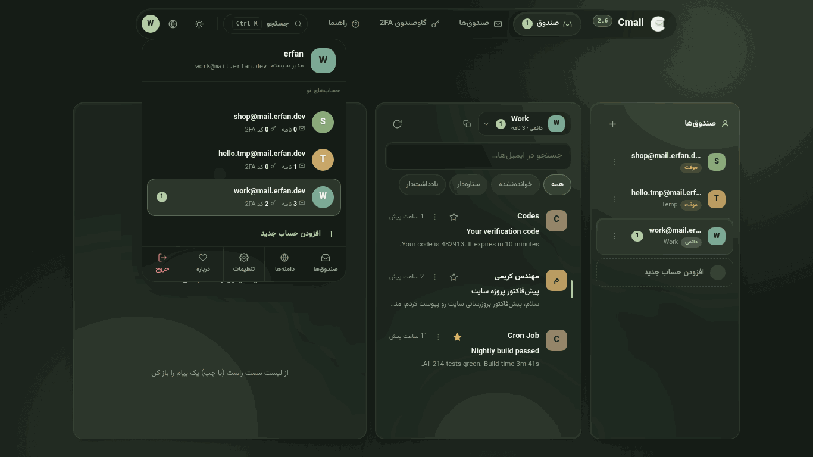
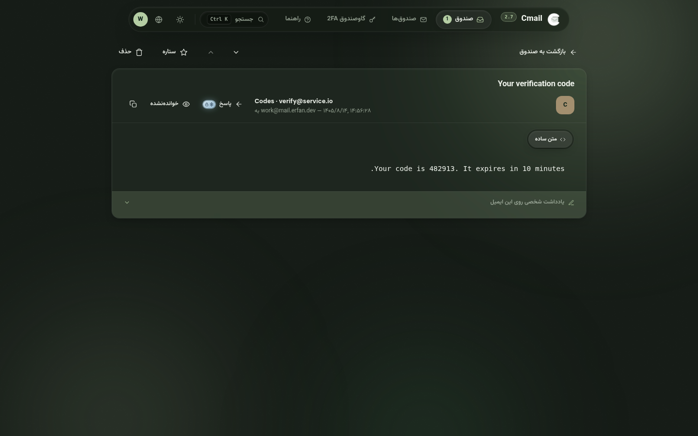
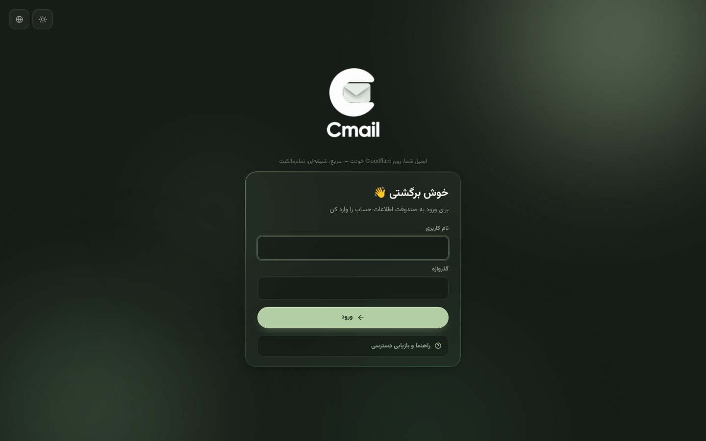

<div align="center" dir="rtl">


# Cmail

[](https://github.com/Erfan-8910/Cmail/releases)
[](https://workers.cloudflare.com)
[](#کل-سیستم-در-یک-نگاه)
[](LICENSE)

**یک اکوسیستم کامل ایمیل که تماماً داخل حساب Cloudflare خودت زندگی می‌کند — یک فایل ورکر، یک دیتابیس، صفر سرور، صفر قبض ماهانه.**

[راهنمای نصب](docs/DEPLOY.fa.md) · [راهنمای استفاده](docs/USAGE.fa.md) · [نسخه‌ها](https://github.com/Erfan-8910/Cmail/releases) · English — [README](README.md)

</div>

---

## Cmail چیست؟

Cmail پاسخ یک سؤال ساده است: **چرا برای یک صندوق ایمیل اجاره بدهیم؟**

تمام این اکوسیستم داخل همان حساب Cloudflareای اجرا می‌شود که از قبل داری. ایمیل‌های ورودی از مسیر **Email Routing** می‌رسند، همه‌چیز در **D1** (همان SQLite لبهٔ شبکه) ذخیره می‌شود و کل رابط کاربری — صفحه‌ها، استایل‌ها، اسکریپت‌ها، فونت‌ها و آیکون‌ها — توسط **یک فایل Worker** سرو می‌شود. نه سروری هست که نگه‌داری، نه دیتابیسی که تنظیم بخواهد، نه پنل اشتراکی، و هیچ‌چیزِ قابل‌گرفتن از دستت.

به‌جایش یک فضای ایمیل شخصی می‌گیری که واقعاً مال خودت است: دامنه، داده، کلید. آدرس‌های یک‌بارمصرف برای ثبت‌نام‌ها، صندوق‌های دائمی برای کارهای جدی، یادداشت رنگی زیر هر نامه، گاوصندوق 2FA داخلی، ارسال ایمیل از دامنهٔ خودت — همه در یک پنل شیشه‌ای که فارسی و انگلیسی حرف می‌زند.

## دیوار امکانات

| | |
|---|---|
| ⭕ **دایرهٔ حساب‌ها** | هر صندوق، یک حساب مستقل است. دایرهٔ بالا-راست را که بزنی — دقیقاً مثل سرویس‌های بزرگ — هر حساب جزئیات ریز خودش را قبل از ورود نشان می‌دهد: چند نامه گرفته، چند کد 2FA نگه می‌دارد، چند نخوانده دارد. از همان پنل **حساب جدید** هم اضافه می‌شود؛ بین حساب‌ها بدون ترک صفحه‌ات جابه‌جا شو. |
| 📄 **هر ایمیل، صفحهٔ خودش** | بازکردن نامه دیگر پاپ‌آپ روی فهرست نیست — به یک صفحهٔ واقعی با آدرس خودش می‌روی: دکمهٔ بازگشت، فلش‌های قدیمی‌تر/جدیدتر، نوار کامل اقدامات. ایمیل HTML سندباکس‌شده و ضدِدستکاری رندر می‌شود؛ متن ساده هم کلید نمایش خودش را دارد. |
| ⏱️ **صندوق خودش نفس می‌کشد** | هر ۱۰ ثانیه یک بار بی‌صدا نامه‌های تازه را چک می‌کند، نامهٔ تازه را هایلایت می‌کند و نشان‌های خوانده‌نشده را همگام نگه می‌دارد — دیگر لازم نیست محکم‌کاری دکمهٔ به‌روزرسانی را بزنی. |
| 🩺 **سلامت سامانه، روی صحنه** | گزارش کامل سلامت در تنظیمات: اتصال D1 با تأخیر لحظه‌ای، تک‌تک جدول‌ها با تعداد ردیف و وضعیت ستون‌ها، ضربان کرون، و جریان ایمیل — هرکدام با دکمهٔ ترمیم خودش. |
| 🚨 **مشکل‌ها خودشان را اعلام می‌کنند** | وقتی چیز جدی‌ای می‌شکند — D1 قطع، جدول ناقص، ساختار قدیمی، توقف جریان ایمیل — بنری بالای برنامه ظاهر می‌شود که علت و راه‌حل یک‌کلیکی را کنار هم می‌گوید. خبر را اول از برنامهٔ خودت می‌شنوی، نه از صندوقی که کار نمی‌کند. |
| 🌐 **ویزارد وصل‌کردن دامنه** | دامنه را که اضافه کردی دستت را می‌گیرد: اول راهنمای تمیز اتصال در Cloudflare، بعد یک کد صحت‌سنجی که خودت به دامنه‌ات می‌فرستی. صفحه هر چند ثانیه خودش را دوباره چک می‌کند تا حلقه ثابت شود — و بعد صندوق‌ها باز می‌شوند. وسط کار رفتی؟ پیش‌نویس با نشان وضعیت و دکمهٔ **ادامهٔ اتصال** هم در صفحهٔ راه‌اندازی می‌ماند هم در صفحهٔ دامنه‌ها — هیچ‌وقت لازم نیست دامنه را دوباره بنویسی. |
| 🎨 **اتاقی که با رنگ تو هم‌رنگ می‌شود** | کل محیط با پالتی که انتخاب می‌کنی یک‌جا رنگ عوض می‌کند: **سبز · آبی · بنفش · کهربایی** — هر پالت با نام خودِ رنگ، نه تشبیه و نه اسم چیز دیگر — هرکدام درخشش پس‌زمینه، شیشه، اکسنت‌ها و هایلایت‌ها را در یک نفس هم‌رنگ خودشان می‌کنند. سه حالت حضور — **متحرک**، **ساکن**، **ساده** — انتخاب می‌کنند پس‌زمینه چقدر جان داشته باشد. |
| 🔎 **بازرس D1** | صفحهٔ راه‌اندازی هر جدول مورد انتظار را با تعداد ردیفش نشان می‌دهد؛ ناقص‌ها را با یک دکمه بساز، جدول‌های بیگانه را پاک کن، دیتابیس‌ات منظم بماند. همین بازرس برای همیشه در تب سلامت هم هست. |
| 🗒️ **یادداشت روی ایمیل‌ها** | یک یادداشت شخصیِ رنگی زیر هر نامه — شماره سفارش، لینک رهگیری، هرچه. جست‌وجو فوری پیدایش می‌کند. |
| 👤 **هر صندوق یک حساب است** | هر میل‌باکس مثل یک حساب مستقل رفتار می‌کند: نامه‌هایش، یادداشت‌هایش و کدهای 2FA خودش، همه داخل همان فضا می‌مانند. |
| 🔐 **گاوصندوق 2FA** | یک احرازکنندهٔ داخلی: کدهای ۶ رقمی زنده با حلقهٔ شمارش، رمزنگاری‌شده با AES-256-GCM، ۷۷ نشان آماده، پوشه‌بندی و اتصال به هر صندوق. |
| ❄️ **یخ‌زده تا وقتی خودت تصمیم بگیری** | دکمهٔ ارسال ایمیل و گاوصندوق آدرس‌های موقت تا وقتی مجوزشان تنظیم نشده، کنار لوگوی خودشان نشانِ یخ‌زدهٔ برف‌وِقفل دارند — لوگو سر جایش می‌ماند، نشان حقیقت را می‌گوید. مجوز را یک بار بدهی، نشان به شعلهٔ باز تبدیل می‌شود و پنجرهٔ مسئولیت دیگر تکرار نمی‌شود. |
| 🛡️ **2FA حساب** | خودِ ورود هم می‌تواند با TOTP محافظت شود. |
| 📤 **ارسال ایمیل — اختیاری** | با یک کلید API به Brevo یا Resend وصل شو و از دامنهٔ خودت بفرست؛ با یک تست واقعی. هیچ‌وقت راه بقیهٔ برنامه را نمی‌بندد. |
| ⌘ **پالت فرمان** | همه‌جا <kbd>Ctrl/⌘</kbd>+<kbd>K</kbd> بزن: بپر هر جا، اجرا کن هر کاری، همزمان با تایپ نامه‌ها را جست‌وجو کن. |
| 🧹 **پاک‌سازی خودکار** | یک کرون ساعتی صندوق‌های موقت را منقضی و نامه‌های قدیمی را پاک می‌کند — و ضربانش در تب سلامت دیده می‌شود. |
| 🌙 **رابط شیشه‌ای** | پوستهٔ تاریک و روشن، ۴ پالت رنگی با نام خودِ رنگ، حالت‌های حضور پس‌زمینه، فارسی (راست‌چین) و انگلیسی. |
| 📱 **واقعاً واکنش‌گرا** | از گوشی ۳۲۰ پیکسلی تا دسکتاپ ۱۹۲۰ — پنل‌ها به کشو و برگهٔ پایین تبدیل می‌شوند. |
| 🔒 **داده‌ی تو، قانون تو** | D1 خودت، کلیدهای خودت، دامنهٔ خودت. نامه‌هایت پیش هیچ‌کس دیگری نیست. |

## گالری

<div align="center" dir="rtl">

| **کابین فرمان** — صندوقِ حسابِ فعال با چیپ تعویض حساب در سرستون |
|---|
|  |

| **دایرهٔ حساب‌ها** — هر صندوق یک حساب، با جزئیاتش قبل از ورود |
|---|
|  |

| **یک ایمیل، یک صفحه** — آدرس خودش، دکمهٔ بازگشت و نوار اقدامات؛ نه پاپ‌آپ |
|---|
|  |

| **اتاق فرمان دیتابیس** — اتصال، جدول‌ها، ضربان کرون و جریان ایمیل؛ هر مشکل دکمهٔ ترمیم خودش را دارد |
|---|
|  |

| **گاوصندوق هر حساب** — کدهای زنده، جدا برای هر حساب؛ آدرس موقت قفل است |
|---|
|  |

| **هر دامنه، یک کارت** — مسیر ثبت، نوار آمار، کلیدهای Active و Catch-all |
|---|
|  |

| **هر حساب، یک کارت** — نوار آمار، شمارش معکوس انقضا، ورود به صندوق با یک کلیک |
|---|
|  |

| **یک کلید، از هر جا به هر جا** |
|---|
|  |

| **پوستهٔ روشن** |
|---|
|  |

| **کل کابین، در جیب پیراهن** |
|---|
|  |

| **در ورودی** — کارت وسط‌چین، شفق زنده، راهنمای بازیابی سر جایش |
|---|
|  |

| **درباره — کارت سازنده** |
|---|
|  |

</div>

## تازه‌های ۲.۷ — نسخه‌ای که رنگ‌ها را با نام خودشان صدا می‌زند و هر چه را باید، قفل می‌کند

- **پالت‌ها با نام خودِ رنگ. نقطه.** مریم‌گلی، آرامش و بقیهٔ شاعرانگی بازنشسته شدند — انتخاب‌گر حالا می‌گوید **سبز · آبی · بنفش · کهربایی**، و حالت‌های پس‌زمینه هم کاری را که می‌کنند می‌گویند: **متحرک · ساکن · ساده**. انتخاب‌های قدیمی خودکار به رنگ خودشان می‌روند. تعویض پالت همچنان کل اتاق را همان لحظه و بدون رفرش رنگ می‌کند.
- **قفلِ یخ‌زده هر جا که مسئولیت است.** تا وقتی هیچ سرویس ارصالی وصل نیست، دکمهٔ ارسال (سرستون + دکمهٔ شناور) با هواپیمای کاغذی‌اش و یک نشان یخ‌زدهٔ برف‌وقفل روی صحنه می‌ماند — لمسش می‌کنی بگوید چه چیز کم است، نه اینکه بی‌صدا غیبش بزند. دکمهٔ پاسخ در صفحهٔ خواندن هم همین قانون را دارد. سرویس وصل شد، نشان به قفلِ باز تبدیل می‌شود و همه‌چیز کار می‌کند.
- **گاوصندوق آدرس موقت: اول یخ، بعد شعله.** افزودن کد به حساب موقت همان اول قفل است — برف و قفل کنار + معمول. شمارش معکوس حذف را یک بار بپذیری، مجوز برای همان حساب به خاطر سپرده می‌شود: نشان به یک شعلهٔ نفس‌کش 🔥 تبدیل می‌شود، پنجرهٔ مسئولیت دیگر تکرار نمی‌شود، و بقیهٔ حساب‌های موقت مستقل و همچنان یخ‌زده می‌مانند.
- **صندوقی جمع‌وجورتر و آرام‌تر.** ردیف‌ها لاغرتر شدند (آواتار کوچک‌تر، فاصله‌های تنگ‌تر، پیش‌نمایش نزدیک‌تر) — نامهٔ بیشتری در همان فضا، با همان لطافت شیشه‌ای. نفس خودکار صندوق هم حالا هر ۱۰ ثانیه است.
- **کلیک‌های پشت‌سرهم دیگر نمی‌توانند بشکنند.** تب‌های تنظیمات، کارت‌های پالت، فیلترهای صندوق و تعویض حساب همه مقاوم به ریسک شدند: هر رندر ناهمگام توکن می‌گیرد و رندر کهنه کنار می‌رود تا دو بخش همزمان نقاشی نشوند. دابل‌کلیک روی ارسال دیگر دو پنجرهٔ همزمان نمی‌سازد. و منوهای بازشو به یک لایهٔ ثابت روی خود صفحه رفتند — به‌روزرسانی پس‌زمینه هرگز منوی باز را از زیر دستت نمی‌قاپد.
- **نوار کناری فقط وقتی چیزی عوض شده دوباره نقاشی می‌شود**؛ جای اسکرول و هر منوی باز از نفس خودکار سالم می‌ماند.
- **وضعیت که دیده می‌شود:** تنظیمات ارسال با چیپ زندهٔ «ارسال قفل است / ارسال آماده است» باز می‌شود — حالت ایمیل خروجی قبل از خواندن یک فیلد معلوم است.
- **هیرو و نشان نسخهٔ تازه**، انیمیشنی، برای هر دو زبان.

<details>
<summary><b>تازه‌های ۲.۶ — نسخه‌ای که هر حساب را مثل یک حساب واقعی جدا می‌کند</b></summary>

- **صندوق جمع‌وجور، با چیپ حساب در سرستون.** سرستون صندوق حالا خودِ حساب فعال را نشان می‌دهد — آواتار رنگی، آدرس، نوع حساب و شمار نامه‌ها در یک چیپ. بازش کنی کارت شیشه‌ای همهٔ حساب‌ها با نشانِ نخواندهٔ هرکدام باز می‌شود و همان‌جا، بدون ترک صندوق، بین حساب‌ها جابه‌جا می‌شوی؛ «افزودن حساب جدید» هم همان پایین است.
- **هر حساب، یک کارت.** صفحهٔ صندوق‌ها از جدول خشک به کارت‌های واقعی تبدیل شد: نوار آمار بالا (حساب‌ها · نامه‌ها · موقت‌ها · حساب فعال) و برای هر حساب یک کارت با آواتار، نشان نوع (دائمی/موقت)، سه عدد (نامه‌ها، آخرین نامه، انقضا با شمارش معکوس) و اقدامات (کپی · بازگردانی · +۱ روز · بازکردن صندوق · حذف). کارتِ حساب فعال با حلقهٔ رنگی و نشان «همین حساب» دیده می‌شود.
- **دامنه‌ها خفن شدند.** صفحهٔ دامنه‌ها حالا با نوار آمار (دامنه‌ها · تأییدشده · در جریان · صندوق‌ها) شروع می‌شود و هر دامنه کارت خودش را دارد: مسیر ثبت «ذخیره شد ← کد صحت ← زنده»، نشان وضعیت واقعی (سالم/منتظر نامه/بدون Catch-all/خاموش)، کلیدهای **Active** و **Catch-all** با توضیح یک‌خطی، و اعداد (صندوق‌ها، آخرین نامه) — با همان لطافت شیشه‌ای.
- **گاوصندوق 2FA مال خودِ حساب است.** گاوصندوق روی حساب فعال باز می‌شود، نه روی «همه»؛ کدهای هر حساب از بقیه جدا می‌مانند و دکمهٔ «کد جدید» هم پیش‌فرض به همان حساب وصل می‌شود.
- **قفل گاوصندوق برای آدرس‌های موقت.** دکمهٔ افزودن کد برای آدرس موقت با علامت 🔒 قفل است. تنها راه باز کردنش پنجرهٔ مسئولیت است که دقیقاً می‌گوید: این آدرس تا چند ساعت دیگر حذف می‌شود و هر کدی که به آن وصل کنی همراهش حذف خواهد شد. «می‌پذیرم» بزنی کد اضافه می‌شود؛ نپذیری قفل سر جایش می‌ماند. کارت کدهای متصل به آدرس موقت هم همیشه شمارش معکوس حذف را نشان می‌دهد.
- **باگ‌های ظاهری بسته شدند.** بستن اعلان‌ها با × حالا فقط همان اعلان را تمیز حذف می‌کند و لغو تایمرش هم ضمانت شده است؛ بستن پنجره‌ها با × دیگر شنوندهٔ Escape را پشت سر جا نمی‌گذارد (دیگر فشردن Escape پنجرهٔ بسته‌شده را دوباره اجرا نمی‌کند و صفحه به‌هم نمی‌ریزد)؛ و کلیک‌های پشت‌سرهم روی منو دیگر دو بخش را همزمان باز نمی‌کنند — هر ناوبری توکن می‌گیرد و رندر کهنه در اولین فرصت کنار می‌رود.
- **نشانگر منو سُر می‌خورد.** قرص صفحهٔ فعال حالا یک نشانگر شیشه‌ای واقعی دارد که با فنر نرم از صفحه‌ای به صفحهٔ دیگر حرکت می‌کند — حس تعویض تب در سرویس‌های بزرگ.
- **عکس‌های تازه برای هر دو زبان** از بیلد ۲.۶ — صندوق، کارت حساب‌ها، کارت دامنه‌ها و گاوصندوقِ قفل‌شده.

</details>

<details>
<summary><b>تازه‌های ۲.۵ — نسخه‌ای که مثل سرویس‌های بزرگ کار می‌کند</b></summary>

- **دایرهٔ حساب‌ها.** آواتار بالا-راست حالا یک سوییچر حساب واقعی را باز می‌کند، همان‌طور که از سرویس‌های بزرگ می‌شناسی: تک‌تک صندوق‌ها با جزئیات ریزشان — چند نامه گرفته‌اند، چند کد 2FA دارند، چند نخوانده — به‌علاوهٔ **افزودن حساب جدید** و ردیف مدیریت/تنظیمات/خروج زیرش. یک حساب را بزن تا کل برنامه داخل فضای همان حساب فرود بیاید؛ خود دایره هم رنگ و حرف همان حساب را می‌پوشد.
- **هر ایمیل، صفحهٔ مخصوص خودش.** بازکردن نامه دیگر پاپ‌آپ روی فهرست نیست — به یک صفحهٔ اختصاصی با آدرس خودش (`#/mail/m/:id`) می‌رود: دکمهٔ واقعی **بازگشت به صندوق**، فلش‌های قدیمی‌تر/جدیدتر، نوار کامل اقدامات (پاسخ، ستاره، خوانده‌نشده، حذف) و پنل یادداشت شخصی. یک نامه، یک صفحه، صفر باگ پاپ‌آپی.
- **در هر لحظه یک حساب.** فهرست صندوق‌ها و جریان یکپارچه در یک مدل صادق ادغام شدند: برنامه صندوقِ حسابِ فعال را نشان می‌دهد و جابه‌جایی — از دایره، از نوار کناری یا از پالت فرمان — کل فضا را عوض می‌کند. دیگر برچسب «این نامه به کدام صندوق رسید؟» وجود ندارد.
- **ناوبری قرص شد.** کل پوسته حالا یک قرص شیشه‌ای شناور است: لوگو و نسخه یک‌طرف، چهار صفحه (صندوق · صندوق‌ها · گاوصندوق 2FA · راهنما) وسط، و جستجو/پوسته/زبان/حساب آن‌طرف — دقیقاً چیدمان طرح مرجع.
- **چهار حال‌وهوا، با اسم صادق.** پالت روی همان چهار حال‌وهوایی که واقعاً به کار می‌آیند نشست و انتخاب هرکدام حالا کل اتاق را رنگ می‌کند: پس‌زمینه، تینت شیشه‌ها، اکسنت‌ها، هایلایت‌ها و حتی رنگ خود مرورگر. انتخاب‌های قدیمی خودکار به نزدیک‌ترین حال‌وهوا می‌روند. *(از ۲.۷ نام‌شان خودِ رنگ‌شان است.)*
- **پنل سلامت درِ خودش را خودش باز می‌کند.** نصب‌هایی که از بیلدهای قدیمی ارتقا یافته بودند ممکن بود بی‌سروصدا حقوق مدیر را از دست بدهند (پیش‌فرض ستون نقش) و سلامت سامانه، دامنه‌ها و همهٔ بخش‌های مدیریتی ناپدید شوند. برنامه حالا خودش می‌فهمد و نقش مدیرِ تک‌کاربر را هنگام بوت برمی‌گرداند — پنل همان دوباره ظاهر می‌شود، بدون هیچ SQL.
- **عکس‌های تازه همه‌جا، برای هر زبان**، از بیلد ۲.۵ — با دو صحنهٔ جدید: دایرهٔ حساب‌ها و صفحهٔ اختصاصی ایمیل.

</details>

<details>
<summary><b>تازه‌های ۲.۴</b></summary>

- **پس‌زمینهٔ زنده، مال خودت.** محیط پشت برنامه با رنگ فعال می‌درخشد — رنگ را عوض کن، کل فضا هم‌رنگ می‌شود. سه حالت حضور در تنظیمات → ظاهر. *(از ۲.۷ با نام کارکردی: متحرک، ساکن، ساده.)*
- **صفحهٔ راه‌اندازی بزرگ شد.** فرم‌ها در دسکتاپ در هر اندازهٔ پنجره واقعاً وسط‌اند. دامنه‌ای که وسط کار رهایش کردی با نشان وضعیت و دکمهٔ **ادامهٔ اتصال** همان‌جا می‌ماند — و اضافه‌کردن دوبارهٔ همان دامنه هرگز خطا نیست.
- **نوار کناری پُرگویی را گذاشت گذاشت.** کارت نقل‌قول حذف شد؛ جایش به صندوق‌ها و حساب‌های خودت رسید.
- **کارت سازنده.** صفحهٔ درباره آدمِ پشت پروژه را با یک کارت واقعیِ حلقهٔ گرادیانی معرفی می‌کند.

</details>

<details>
<summary><b>تازه‌های ۲.۳</b></summary>

- **صندوق یکپارچه.** «همهٔ صندوق‌ها» نامه‌های همهٔ میل‌باکس‌ها را در یک فهرست می‌ریزد و هر ردیف نشان کوچکی از صندوق مقصد دارد.
- **صندوق نفس می‌کشد.** هر ۱۵ ثانیه بی‌صدا نامهٔ تازه را چک می‌کند، تازه‌رسیده را هایلایت می‌کند و نشان‌های خوانده‌نشده را تازه نگه می‌دارد.
- **پنل سلامت در تنظیمات.** اتصال D1 با تأخیر لحظه‌ای، هر جدول با تعداد ردیف و وضعیت ستون‌هایش، ضربان کرون، و جریان ایمیل با فهرست بررسیِ «نامه نمی‌رسی؟».
- **مشکل‌های جدی بالای صفحه ظاهر می‌شوند.** بنری با زبان آدمیزاد بالای برنامه می‌آید و راه‌حلش یک دکمه است.
- **دریافت ایمیل در برابر ناسازگاری مقاوم شد.** هندلر با هر شکلی از دیتابیس کنار می‌آید و تحویل را متوقف نمی‌کند — و پنل سلامت ناسازگاری را نشانه‌گذاری می‌کند.

</details>

## برای چه کسی است؟

- **هرکس از اسپم خسته است** — برای هر ثبت‌نام یک آدرس یک‌ساعته بساز و صندوق واقعی‌ات تمیز بماند.
- **برنامه‌نویس‌ها و تسترها** — ده‌ها صندوق تست بساز، ایمیل‌های سیستمی را بگیر، تمام که شد بگذار منقضی شوند.
- **آدم‌های حرمت‌خصوصی** — بدون آنالیتیکس، بدون اسکریپت ثالث؛ همه‌چیز در حسابت است، زیر کلیدهای خودت.
- **صاحبان دامنه** — دامنه‌هایی که همین حالا روی Cloudflare نشسته‌اند را به یک اکوسیستم کامل ایمیل تبدیل کن؛ با یک ویزارد واقعی، نه دانش سینه‌به‌سینه.
- **هرکس می‌خواهد ابزارش واقعاً مال خودش باشد** — یک بار راه بینداز، برای همیشه مالک باش.

## دانلود — بدون کلون کردن

- **[`worker.js`](https://github.com/Erfan-8910/Cmail/releases/download/v2.7.0/worker.js) آماده** — کل برنامه در یک فایل (حدود ۱٫۲ مگابایت، ~۴۷۰ کیلوبایت gzip). برای نصب گرافیکی همین یک فایل کافی است.
- **بستهٔ کامل v2.7.0:** [`CMail-v2.7.0.zip`](https://github.com/Erfan-8910/Cmail/releases/download/v2.7.0/CMail-v2.7.0.zip) — سورس‌ها، [`schema.sql`](schema.sql)، [`migrations/`](migrations) و اسکریپت‌ها.
- همهٔ نسخه‌ها: [Releases](https://github.com/Erfan-8910/Cmail/releases)
- فقط شکل دیتابیس را می‌خواهی؟ یک فایل است: [`schema.sql`](schema.sql) — آمادهٔ کنسول و قابل اجرای دوباره.

## راهنماها — برای هر زبان

| | نصب | استفاده |
|---|---|---|
| **فارسی** | [راهنمای نصب](docs/DEPLOY.fa.md) | [راهنمای استفاده](docs/USAGE.fa.md) |
| **English** | [Deployment](docs/DEPLOY.md) | [Usage](docs/USAGE.md) |

## کل سیستم در یک نگاه

```
                     ┌──────────────────────────────────────────┐
                     │               Cloudflare                  │
 incoming mail       │                                           │
 SMTP ──────────►  Email Routing (MX)                            │
                     │        │ catch-all                        │
                     │        ▼                                  │
 browser ────────►  Worker ── serves embedded UI (single file)   │
                     │   │  │                                    │
                     │   │  └── Brevo / Resend ──► outgoing mail │
                     │   ▼                                       │
                     │  D1 (SQLite) — mail · inboxes · account   │
                     │               · notes · TOTP · settings   │
                     └──────────────────────────────────────────┘
```

یک Worker رابط کاربری، API، هندلر ایمیل ورودی و پاک‌سازی ساعتی را سرو می‌کند. یک دیتابیس D1 همه‌چیز را نگه می‌دارد. رابط کاربری بخشی از باندل Worker است، پس دیپلوی اتمی است: یک فایل جای‌گذاری کن، رابط و بک‌اند همیشه با هم هم‌نسخه‌اند.

**فقط ذخیره نیست؛ مهروموم شده.** هر رمز 2FA قبل از رسیدن به دیتابیس با AES-256-GCM رمزنگاری می‌شود، رمزها از PBKDF2 با ۱۰۰٬۰۰۰ دور و نمک اختصاصی می‌گذرند، نشست‌ها توکن امضاشده‌اند و ایمیل HTML رندرشده داخل قاب سندباکس و بدون اسکریپت زندگی می‌کند. رمزنگاری اینجا تیکِ چک‌لیست نیست — جنسِ همان چیزی است که گاوصندوق از آن ساخته شده.

**ساخته‌شده برای روز بد** — هندلر ایمیل ورودی روی دیتابیس‌های قدیمی به‌جای برگشت‌زدن نامه‌ها، محتاطانه عقب می‌نشیند و تحویل را ادامه می‌دهد؛ هر کرش به یک صفحهٔ راهنمای دوزبانه تبدیل می‌شود نه یک خطای خام؛ و پنل سلامت فرق «همه‌چیز مرتب است» با «این دقیقاً همان چیزی است که باید بزنی» را می‌داند.

## مجوز

MIT © [Erfan-8910](https://github.com/Erfan-8910)

---

<div align="center" dir="rtl">

**Cmail** — *صندوق خودت، قانون خودت.* 🌿

[راهنمای نصب](docs/DEPLOY.fa.md) · [راهنمای استفاده](docs/USAGE.fa.md) · [نسخه‌ها](https://github.com/Erfan-8910/Cmail/releases) · [English](README.md)

</div>
