<div align="center">


# Cmail

[](https://github.com/Erfan-8910/Cmail/releases)
[](https://workers.cloudflare.com)
[](#the-whole-system-one-diagram)
[](LICENSE)

**A complete mail ecosystem that lives entirely inside your own Cloudflare account — one worker file, one database, zero servers, zero monthly bills.**

[Deploy guide](docs/DEPLOY.md) · [Usage guide](docs/USAGE.md) · [Releases](https://github.com/Erfan-8910/Cmail/releases) · **فارسی** — [نمایش پروژه](README.fa.md)

</div>

---

## What is Cmail?

Cmail answers a simple question: **why pay rent for a mailbox?**

The whole ecosystem runs inside the Cloudflare account you already own. Incoming mail arrives through **Email Routing**, everything is stored in **D1** (SQLite at the edge), and the entire interface — pages, styles, scripts, fonts, icons — is served by a **single Worker file**. There is no server to babysit, no database to tune, no panel subscription, and nothing that can be taken away from you.

What you get is a personal mail space you genuinely own: the domain, the data, the keys. Burner addresses for signups, permanent boxes for real work, a colored note under any message, a built-in 2FA vault, outgoing mail from your own domain — all in one liquid-glass panel that speaks Persian and English.

## The feature wall

| | |
|---|---|
| 📬 **All inboxes, one view** | The unified inbox streams every mailbox into a single live list — each row tags the mailbox it landed in. Switching spaces is one tap in the sidebar, exactly like the mail clients you already know. |
| ⏱️ **The inbox breathes on its own** | Every 15 seconds the inbox quietly pulls for new mail, highlights what just landed and syncs the unread badges — no refresh button rituals. |
| 🩺 **System health, on stage** | A full health report in Settings: D1 connection with live latency, every table with its row count and column state, the cron heartbeat, and the mail flow — each with its own fix button. |
| 🚨 **Problems announce themselves** | When something serious breaks — D1 unreachable, tables missing, schema outdated, mail stalled — a banner appears above the app with the cause and the one-press fix. You hear it from your app first, never from a broken inbox. |
| 🌐 **Domain connect wizard** | Add a domain and it takes your hand: a crisp connect guide, then a verification code you mail to your own domain. The screen re-checks itself every few seconds until the loop proves itself — and mailboxes unlock. Walked away mid-way? The draft waits in the setup screen and on the domains page with a **Continue** button — nobody ever retypes a domain. |
| 🎨 **A room that matches your mood** | The whole environment breathes with the color you pick: 13 named moods (Sage, Serene, Violet, Amber…) tint the ambient glow behind the app. Three presence modes — **Aurora** (alive), **Halo** (still), **Pure** (flat) — pick how much life the background has. |
| 🔎 **D1 inspector** | The setup screen lists every expected table with its row count; build the missing ones with a button, drop the strays, keep your database honest. The health tab carries the same inspector, forever. |
| 🗒️ **Notes on emails** | A colored personal note under any message — order numbers, tracking links, anything. Search finds it instantly. |
| 👤 **Every inbox is an account** | Each mailbox behaves like a standalone account: its mail, its private notes and its own 2FA codes stay inside that space. |
| 🔐 **2FA vault** | A built-in authenticator: live 6-digit codes with a countdown ring, sealed with AES-256-GCM, 77 built-in marks, folders, per-inbox binding. |
| 🛡️ **Account 2FA** | Signing in itself can be protected with TOTP. |
| 📤 **Outgoing mail — optional** | Connect Brevo or Resend with one API key and send from your own domain, with a real test probe. It never gates the rest of the app. |
| ⌘ **Command palette** | Press <kbd>Ctrl/⌘</kbd>+<kbd>K</kbd> anywhere: jump to anything, run actions, search mail live as you type. |
| 🧹 **Auto-cleanup** | An hourly cron expires temporary inboxes and purges old mail — and its heartbeat shows up in the health tab. |
| 🌙 **Liquid-glass UI** | Dark & Daylight themes, 13 named color moods, background presence modes, Persian (RTL) + English. |
| 📱 **Truly responsive** | From a 320px phone to a 1920px desktop — panes fold into drawers and bottom sheets. |
| 🔒 **Your data, your rules** | Your D1, your keys, your domain. Nobody else holds your mail. |

## The gallery

<div align="center">

| **The cockpit** — all inboxes in one live stream, every row tagged with its mailbox |
|---|
| 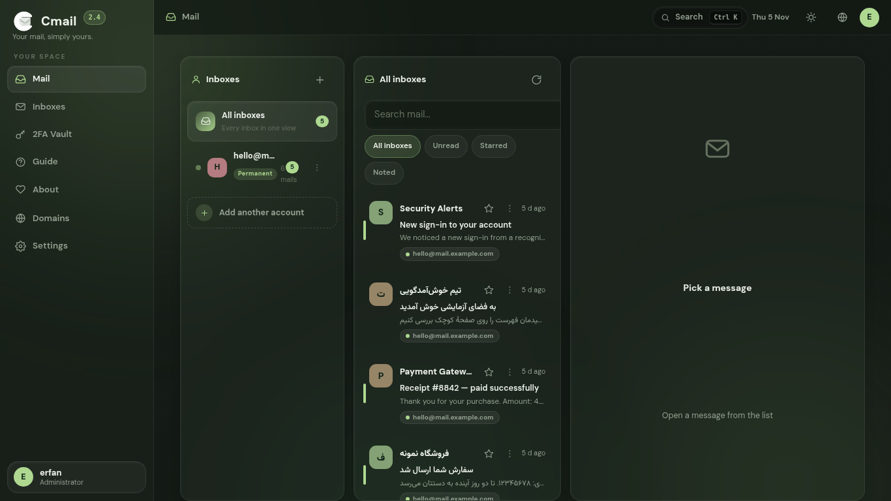 |

| **Mission control for your database** — connection, tables, cron heartbeat, mail flow; every problem carries its own fix button |
|---|
| 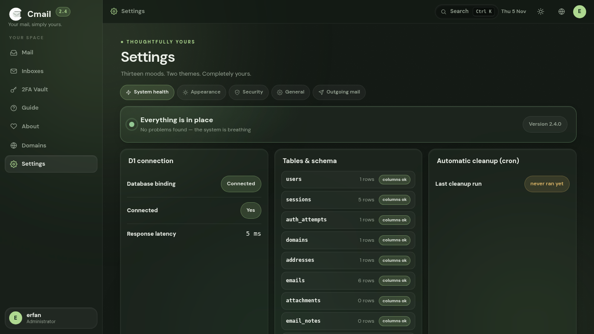 |

| **The vault** — live 6-digit codes, folders, a mark for every key |
|---|
| 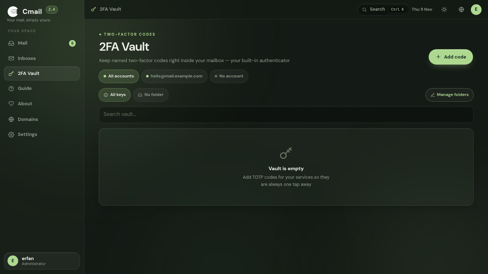 |

| **Every domain, one glance** — honest registration states, health chips, catch-all switches |
|---|
| 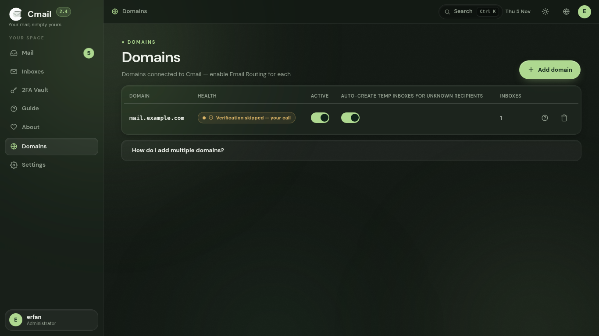 |

| **The address book** — permanent and temporary spaces, TTL countdowns, forwarding |
|---|
| 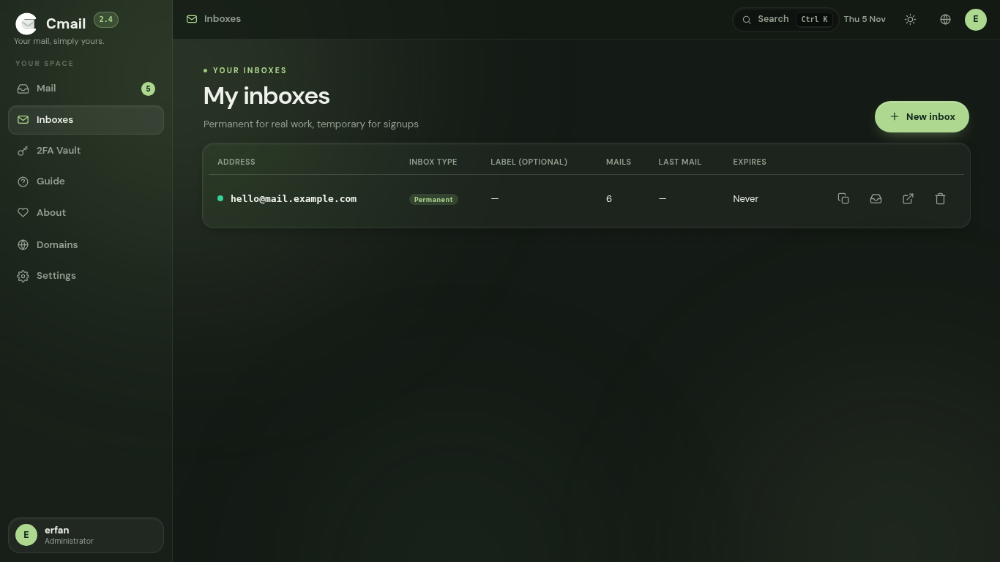 |

| **One keystroke from anywhere to everywhere** |
|---|
| 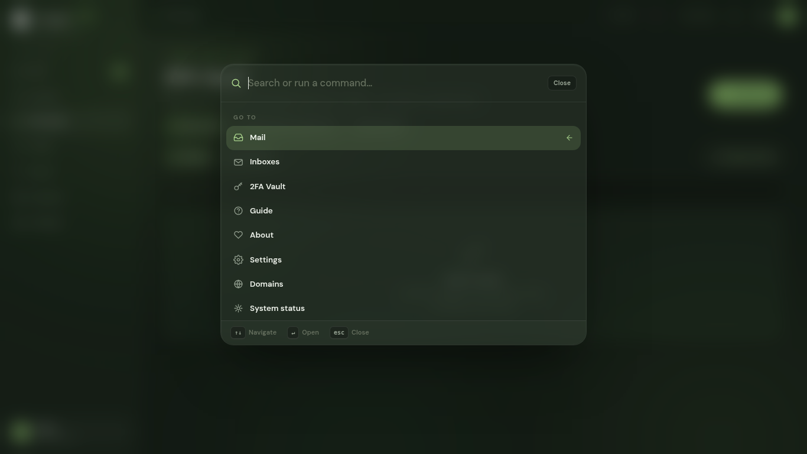 |

| **Daylight mode** |
|---|
| 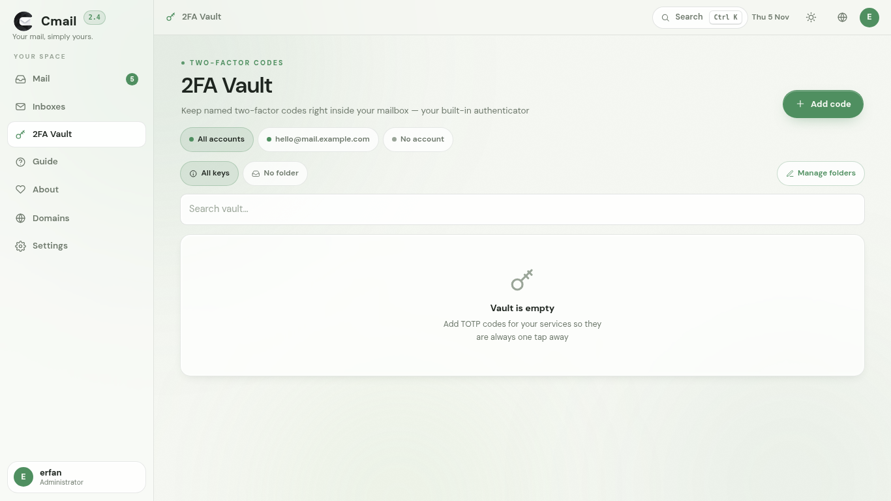 |

| **The whole cockpit, in a shirt pocket** |
|---|
| 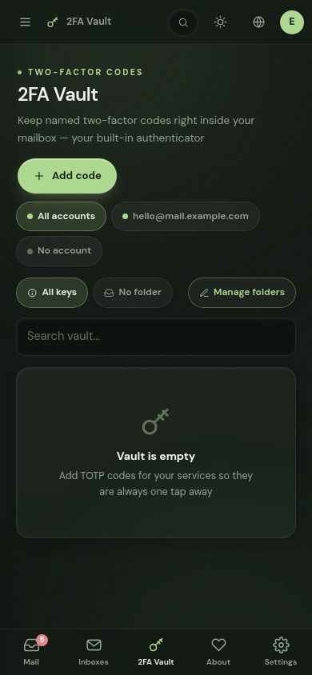 |

| **The front door** — centered card, living aurora, recovery guide built in |
|---|
| 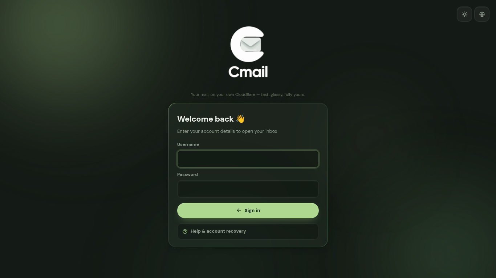 |

| **About — the maker card** |
|---|
| 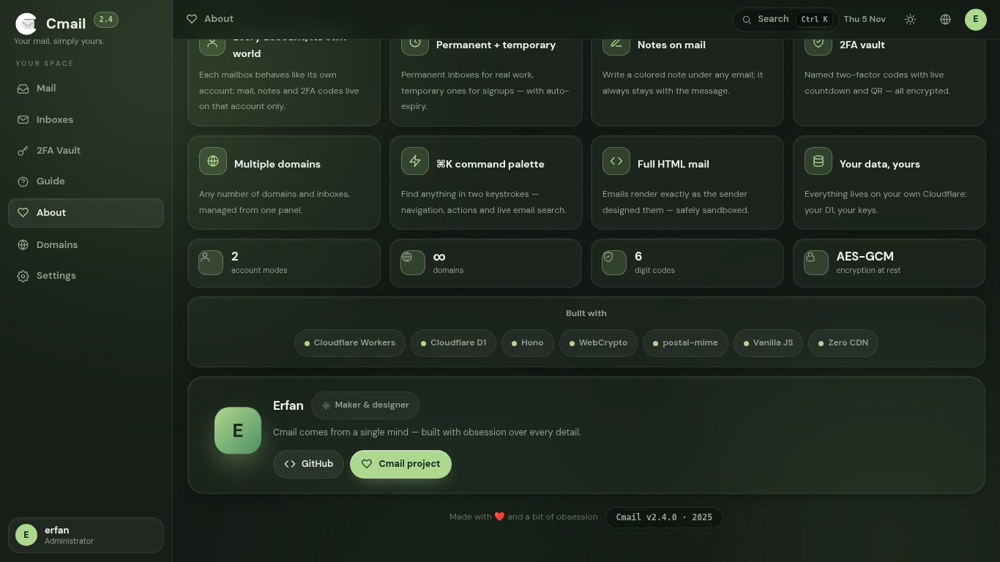 |

</div>

## What's new in 2.4 — the release that polishes the edges

- **A living background, yours to tune.** The ambient room behind the app now glows with the active mood — switch from Sage to Serene and the whole environment re-tints. Three presence modes in Settings → Appearance: **Aurora** (slow drifting light), **Halo** (still glow), **Pure** (flat). All named, all instant.
- **The setup screen grew up.** Forms are truly centered on desktop at any window size. A domain you left mid-registration now sits in the setup screen with its status and a **Continue setup** button — and re-adding it is never an error: the wizard just opens. Skipped verification? Come back later and verify with a code whenever you like.
- **The sidebar lost the filler.** The quote card is gone; the space goes to your inboxes and your accounts.
- **The maker card.** The About page now introduces the person behind the project with a proper gradient-ring card — and the background story stays in one honest paragraph.
- **Fresh screenshots everywhere.** Every image in this README was retaken from the 2.4 build, per language.

<details>
<summary><b>What 2.3 changed</b></summary>

- **The unified inbox.** "All inboxes" streams every mailbox into one list; each row wears a small chip naming the mailbox it landed in. The sidebar switches spaces like the big clients do — one tap, zero page reloads.
- **The inbox breathes.** Every 15 seconds it silently checks for new mail, highlights what just arrived and refreshes the unread badges.
- **A health panel in Settings.** D1 connection with live latency, every expected table with its row count **and its column state**, the cron heartbeat, and the mail flow with a not-receiving-mail checklist. Missing table? Build button right there. Old schema? Repair button right there.
- **Serious problems surface at the top.** D1 down, tables missing, schema outdated, cron gone quiet, mail stalled — a banner appears above the app, in plain language, with the fix one press away.
- **Incoming mail became drift-proof.** After upgrading the worker without migrating the database, the handler degrades gracefully to whatever columns exist and keeps delivering — and the health panel flags the drift for a one-press repair.

</details>

## Who is it for?

- **Anyone tired of spam** — mint a one-hour address for every signup and keep your real inbox spotless.
- **Developers and testers** — spin up dozens of test inboxes, catch system emails, let them expire when done.
- **Privacy-minded people** — no analytics, no third-party scripts; everything lives in your account, under your keys.
- **Domain owners** — turn the domains already sitting on your Cloudflare into a complete mail ecosystem, with a real wizard instead of tribal knowledge.
- **Anyone who wants their tools to actually belong to them** — set it up once, own it forever.

## Downloads — no clone needed

- **Prebuilt [`worker.js`](https://github.com/Erfan-8910/Cmail/releases/download/v2.4.0/worker.js)** — the entire application in one file (~1.2 MB, ~470 KB gzipped). This is all the graphical install needs.
- **Full package v2.4.0:** [`CMail-v2.4.0.zip`](https://github.com/Erfan-8910/Cmail/releases/download/v2.4.0/CMail-v2.4.0.zip) — sources, `schema.sql`, migrations and scripts.
- All versions: [Releases](https://github.com/Erfan-8910/Cmail/releases)

## The guides — per language

| | Deployment | Everyday use |
|---|---|---|
| **English** | [docs/DEPLOY.md](docs/DEPLOY.md) | [docs/USAGE.md](docs/USAGE.md) |
| **فارسی** | [راهنمای نصب](docs/DEPLOY.fa.md) | [راهنمای استفاده](docs/USAGE.fa.md) |

## The whole system, one diagram

```
                     ┌──────────────────────────────────────────┐
                     │               Cloudflare                  │
 incoming mail       │                                           │
 SMTP ──────────►  Email Routing (MX)                            │
                     │        │ catch-all                        │
                     │        ▼                                  │
 browser ────────►  Worker ── serves embedded UI (single file)   │
                     │   │  │                                    │
                     │   │  └── Brevo / Resend ──► outgoing mail │
                     │   ▼                                       │
                     │  D1 (SQLite) — mail · inboxes · account   │
                     │               · notes · TOTP · settings   │
                     └──────────────────────────────────────────┘
```

One Worker serves the UI, the API, the incoming-mail handler and the hourly cleanup. One D1 database holds everything. The UI is part of the Worker bundle, so deployments are atomic: paste one file, and interface and backend always match.

**Built to survive a bad day** — the incoming-mail handler degrades gracefully on older databases instead of bouncing your mail, every crash turns into a bilingual guide page instead of a raw error, and the health panel knows the difference between "nothing is wrong" and "here is exactly what to press".

## License

MIT © [Erfan-8910](https://github.com/Erfan-8910)

---

<div align="center">

**Cmail** — *your mailbox, your rules.* 🌿

[Deploy guide](docs/DEPLOY.md) · [Usage guide](docs/USAGE.md) · [Releases](https://github.com/Erfan-8910/Cmail/releases) · [فارسی](README.fa.md)

</div>
