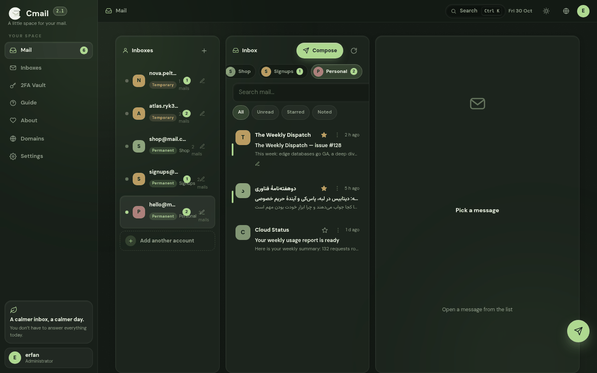
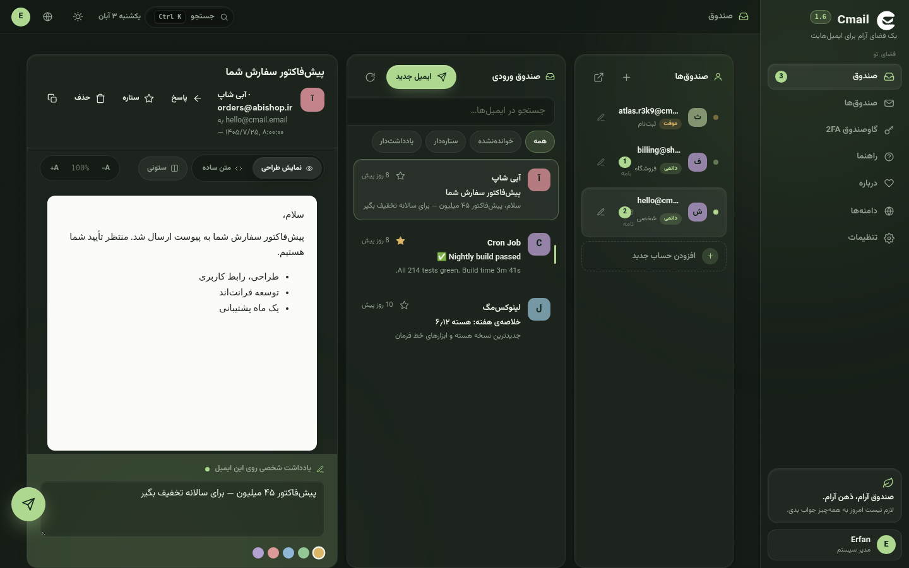
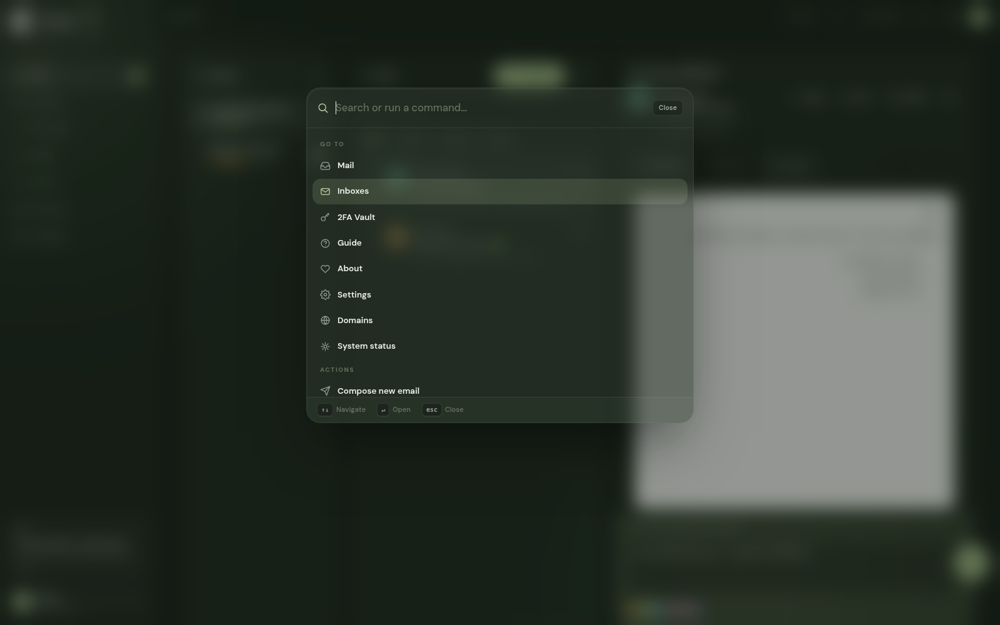
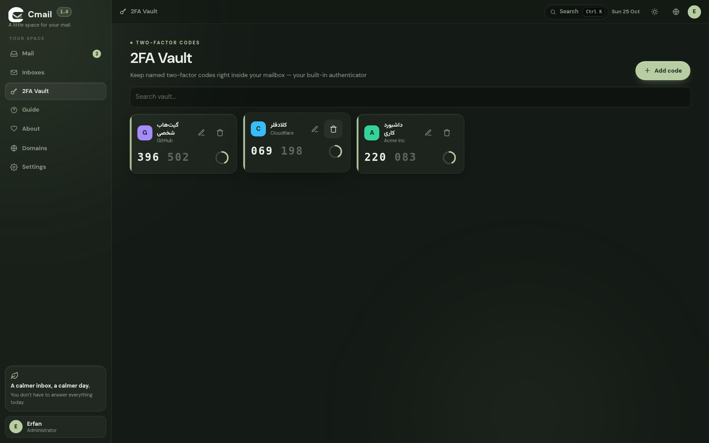
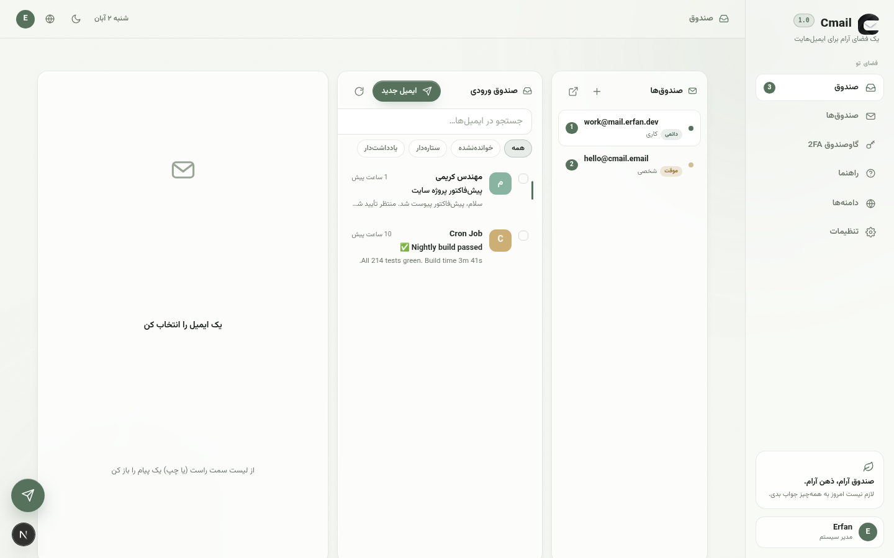
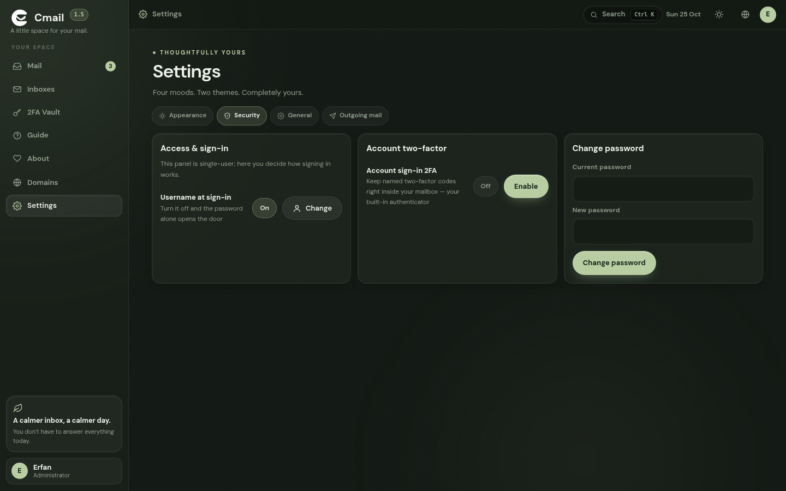
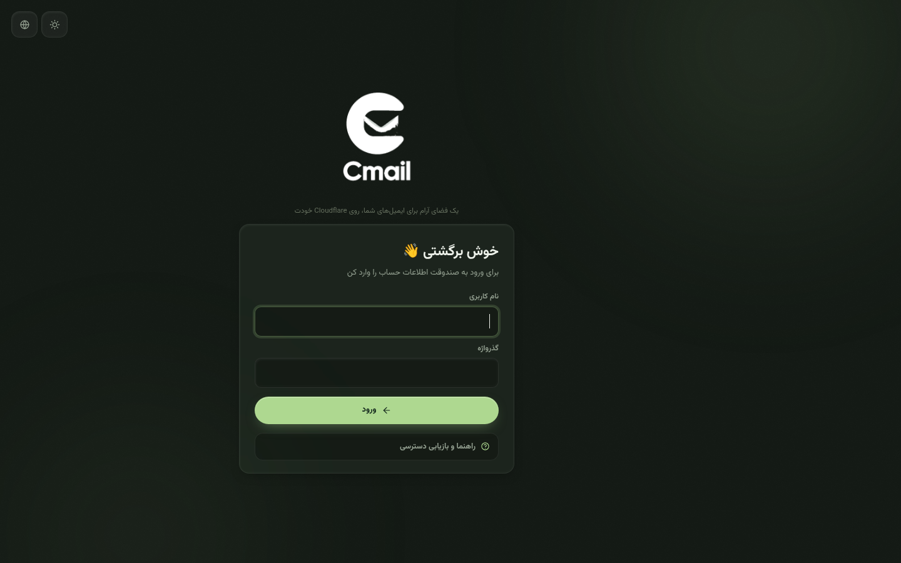
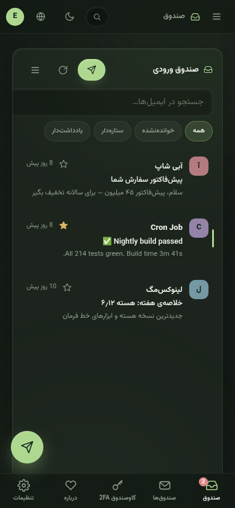
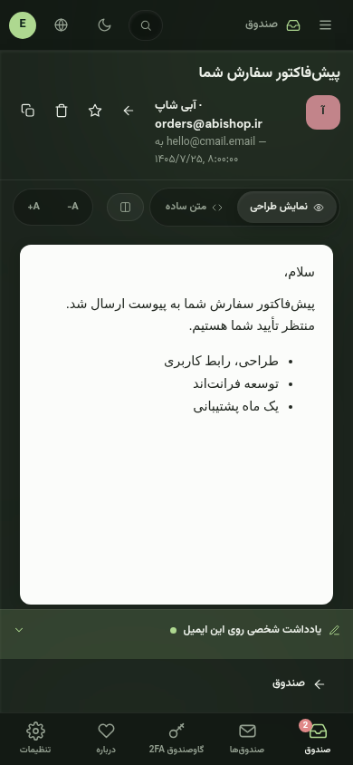

<div align="center">

<picture>
  <source media="(prefers-color-scheme: dark)" srcset="docs/logo-white.png">
  
</picture>

# Cmail

**A calm, complete mail ecosystem that lives entirely inside your own Cloudflare account.**

Temporary & permanent inboxes · notes on every email · built-in 2FA vault · unlimited domains · outgoing mail · zero servers, zero monthly bills

[](https://github.com/Erfan-8910/CMail/releases)
[](LICENSE)
[](https://workers.cloudflare.com)
[](https://github.com/Erfan-8910/CMail/pulls)

**فارسی** — [English](#english)

</div>

<a id="farsi"></a>

---

<div align="center">

## 🇮🇷 راهنمای فارسی

</div>

### Cmail چیه؟

Cmail از یک سؤال ساده شروع شد: **چرا برای یک صندوق ایمیل باید اجاره‌بها بدهیم؟**

ایمیل معمول یعنی یک سرور اجاره‌ای، یک دیتابیس که خودت باید نگه‌اش داری، و صورتحساب ماهانه‌ای که یادت می‌رود. Cmail همه‌ی این‌ها را دور انداخته. کل این اکوسیستم روی همان حساب Cloudflare‌ای که از قبل داری اجرا می‌شود: ایمیل‌های ورودی با **Email Routing** می‌رسند، داده‌ها در **D1** (همان SQLite لبه‌ی Cloudflare) می‌مانند و کل رابط کاربری توسط یک **Worker** سرو می‌شود. نه سروری داری، نه فاکتوری، نه پنل اجاره‌ای.

نتیجه‌اش یک فضای شخصی است که مالکش خودت هستی؛ از دامنه‌اش تا آخرین بایت داده‌اش. هر وقت خواستی پاکش کنی، خواستی ببری‌اش جایی دیگر — اختیار کامل دست خودت است.

و چون یک «صندوق» بیشتر نیست، Cmail خودش را فقط یک اینباکس نمی‌داند؛ یک اکوسیستم است: صندوق موقت برای ثبت‌نام‌ها، صندوق دائمی برای کارهای واقعی، یادداشت رنگی زیر هر ایمیل، گاوصندوق کدهای دومرحله‌ای، و ارسال ایمیل از دامنه‌ی خودت — همه در یک پنل شیشه‌ای و آرام.

### این پروژه برای چه کسی است؟

- **برای کسی که از اسپم خسته شده** — به‌جای دادن آدرس اصلی‌ات به هر سایتی، برای هر ثبت‌نام یک آدرس یک‌ساعته بساز؛ آدرس واقعی‌ات همیشه تمیز می‌ماند.
- **برای توسعه‌دهنده‌ها و تسترها** — ده‌ها صندوق تست بساز، ایمیل‌های سیستم را بگیر، درصدهای مختلف دامنه امتحان کن و هر کدام را که تمام شد بگذار منقضی شود.
- **برای کسی که حریم خصوصی برایش مهم است** — هیچ آماری، هیچ اسکریپت ثالث، هیچ CDN؛ همه‌چیز روی حساب خودت، با کلیدهای خودت.
- **برای مالکان دامنه** — دامنه‌هایت را که روی Cloudflare نشسته‌اند به یک اکوسیستم ایمیل کامل تبدیل کن؛ هر دامنه، هر تعداد آدرس.
- **برای هر کسی که دوست دارد ابزارش «مال او» باشد** — یک بار راه می‌اندازی‌اش و برای همیشه مال خودت است.

### چه چیزهایی دارد؟

| | |
|---|---|
| 📬 **صندوق موقت + دائمی** | آدرس موقت با TTL (یک‌ساعته، یک‌روزه، هر چیزی) و شمارش معکوس زنده؛ آدرس دائمی که برای همیشه مال توست. |
| 🌐 **دامنه‌های نامحدود** | هر دامنه‌ای که روی Cloudflare داری را وصل کن؛ یک Worker همه را دریافت می‌کند. |
| 🗒️ **یادداشت روی هر ایمیل** | یادداشت رنگی شخصی زیر هر پیام — شماره سفارش، لینک جلسه، هر چیزی. جستجو همان‌جا پیدایش می‌کند. |
| 👤 **هر حساب، یک دنیا** | هر صندوق مثل یک حساب مستقل رفتار می‌کند: نامه‌ها، یادداشت‌های اختصاصی و کدهای 2FA همان سرویس فقط روی همان حساب می‌مانند؛ از کنار لیست حساب‌ها اضافه‌اش می‌کنی، مثل اضافه‌کردن یک حساب تازه. |
| 🔐 **گاوصندوق 2FA با لوگو** | احراز‌کننده‌ی داخلی: کدهای ۶ رقمی زنده با حلقه‌ی شمارش معکوس، رمزنگاری‌شده با AES-256-GCM؛ برای هر کد یک لوگو از کتابخانه‌ی ۴۸ نماد آماده انتخاب کن یا حسابش را به یک صندوق وصل کن. |
| 🗒️ **یادداشت روی هر حساب** | برای هر صندوق یک یادداشت امن بنویس: اطلاعات ورود سرویس، یادداشت‌های استفاده — ذخیره‌ی خودکار، همان‌جا که صندوق است. |
| 🛡️ **ورود دومرحله‌ای حساب** | خودِ ورود به پنل هم می‌تواند 2FA داشته باشد. |
| 📤 **ارسال ایمیل** | با یک کلید API به Brevo یا Resend وصل شو و از دامنه‌ی خودت ایمیل بفرست. |
| ➡️ **ارجاع (Forwarding)** | هر صندوق می‌تواند کپی ایمیل‌هایش را به یک آدرس واقعی هم بفرستد. |
| ⌘ **پالت فرمان** | با <kbd>Ctrl/⌘</kbd>+<kbd>K</kbd> هر جا که هستی بپر هر جا می‌خواهی؛ همزمان نتیجه‌ی جستجوی ایمیل‌ها هم زنده می‌آید. |
| ⌨️ **کیبورد‌محور** | `j`/`k` حرکت، `Enter` بازکردن، `x` انتخاب، `s` ستاره — نقشه‌ی کامل میان‌برها داخل خود اپ هست. |
| 🧹 **پاک‌سازی خودکار** | یک کرون ساعتی صندوق‌های منقضی و ایمیل‌های قدیمی را خودش جمع می‌کند. |
| 🌙 **رابط شیشه‌ای** | تم شب و روز، شفافیت شیشه‌ی قابل تنظیم، ۵ پالت رنگ زنده، فارسی (راست‌به‌چپ) و انگلیسی. |
| 📱 **کاملاً واکنش‌گرا** | از ۳۲۰ پیکسل موبایل تا دسکتاپ ۱۹۲۰ — ستون‌ها به دراور و شیت تبدیل می‌شوند. |
| 🔒 **داده‌ات، قانون تو** | D1 مال توست، کلیدها مال توست. هیچ‌کس دیگری داده‌ات را ندارد. |

### نگاهی به داخل

<div align="center">

| صندوق ورودی | خواندن ایمیل فارسی، راست‌به‌چپ |
|---|---|
|  |  |

| پالت فرمان ⌘K | گاوصندوق 2FA با کد زنده |
|---|---|
|  |  |

| تم روشن (فارسی) | تنظیمات — دسترسی و ورود |
|---|---|
|  |  |

| صفحه‌ی ورود | موبایل |
|---|---|
|  |   |

</div>

### نصب — سه راه، همه از روی همین ریپو

> پیش‌نیازها: یک **حساب Cloudflare** (پلن رایگان کاملاً کافی است). برای راه خودکار: Node.js نسخه ۱۸ به بالا.

### ⬇️ دانلود آماده — بدون کلون کردن ریپو

- **بستهٔ کامل v1.8.0:** [`CMail-v1.8.0.zip`](https://github.com/Erfan-8910/Cmail/releases/download/v1.8.0/CMail-v1.8.0.zip) — شامل همه‌ی فایل‌ها، پوشه‌ی `public/` برای آپلود ظاهر و پوشه‌ی `migrations/` برای ساخت جدول‌ها. فهرست همه‌ی نسخه‌ها: [Releases](https://github.com/Erfan-8910/Cmail/releases)
- **فایل آماده‌ی [`worker.js`](https://github.com/Erfan-8910/Cmail/releases/download/v1.8.0/worker.js)** — همان کد کامپایل‌شده‌ای که در «راه ۲» داخل ادیتور Cloudflare پیست می‌کنی؛ یک کلیک، ذخیره، تمام.

#### راه ۱ — خودکار با یک دستور (ترمینال)

```bash
git clone https://github.com/Erfan-8910/CMail.git
cd CMail
bash deploy.sh
```

نصب‌کننده خودش همه‌چیز را انجام می‌دهد: دیتابیس D1 را می‌سازد، جدول‌ها را می‌سازد، یک `APP_SECRET` تصادفی محکم تولید می‌کند، Worker را منتشر می‌کند و آخرش آدرس پنل را برایت چاپ می‌کند.

#### راه ۲ — کاملاً گرافیکی، روی dash.cloudflare.com، بدون حتی یک دستور

تمام کاری که باید بکنی همین است — فقط مرورگر و داشبورد Cloudflare:

**۱) دیتابیس را بساز**
- وارد [dash.cloudflare.com](https://dash.cloudflare.com) شو ← از منوی کنار: **Storage & Databases ← D1 SQL Database ← Create**
- اسمش را بگذار `cmail-db` و Create را بزن.
- حالا از تب‌های بالای دیتابیس، **Console** را باز کن. در همین ریپو فایل [`migrations/0001_init.sql`](migrations/0001_init.sql) را باز کن، همه‌ی محتوایش را کپی کن و داخل Console پیست کن ← **Execute**. جدول‌ها ساخته می‌شوند. تمام؛ دیگر با دیتابیس کاری نداری.

**۲) Worker را بساز**
- از منو: **Workers & Pages ← Create ← Workers ← Create Worker**
- اسمش را بگذار `cmail` و یک بار با همان کد پیش‌فرض **Deploy** بزن.
- روی **Edit code** بزن؛ تمام کد پیش‌فرض را پاک کن، محتوای کامل فایل [`worker.js`](worker.js) (همین ریپو، ریشه‌ی پروژه — یا مستقیم از [دانلود آماده](https://github.com/Erfan-8910/Cmail/releases/download/v1.8.0/worker.js)) را جای آن پیست کن و **Deploy** بزن.

**۳) فایل‌های ظاهر (UI) را به Worker وصل کن**
- برگرد به Worker و **Settings ← Domains & Routes ← Attach assets** (یا در صفحه‌ی اول ساخت Worker گزینه‌ی **Upload assets** را انتخاب کن) و محتویات پوشه‌ی [`public/`](public/) را آپلود کن. نام binding باید همان `ASSETS` بماند.

**۴) پیوندها (Bindings) را بزن**
- **Settings ← Bindings ← Add:**
  - نوع **D1 database** ← نام متغیر: `DB` ← دیتابیس: `cmail-db`
  - نوع **Secret** (در بخش Variables and Secrets) ← نام: `APP_SECRET` ← مقدار: یک رشته‌ی طولانی و تصادفی (هر پسورد‌جنراتوری کافی است؛ این کلید رمزنگاری داخلی اپ است — فقط یک بار می‌سازی و دیگر نباید عوضش کنی).

**۵) زمان‌بندی پاک‌سازی**
- **Settings ← Trigger Events ← Cron Triggers ← Add** و این را وارد کن: `17 * * * *`

**۶) تمام!** آدرس `https://cmail.<زیر-دامنه-تو>.workers.dev` را باز کن — صفحه‌ی ورود باز می‌شود و چون بار اول است، از خودت **نام کاربری و رمز** می‌سازد. بعد از ورود، صفحه‌ی «راه‌اندازی سامانه» نشان می‌دهد دقیقاً چه چیزهایی مانده (دامنه، سرویس ارسال) و برای هر کدام آموزش قدم‌به‌قدم دارد.

> 💡 راه میان‌بر دوم برای گام ۲ و ۳: در همان صفحه‌ی **Workers & Pages ← Create** می‌توانی به‌جای ساخت دستی، ریپوی گیت‌هاب خودت را متصل کنی (Connect to Git ← انتخاب ریپوی CMail) تا خودِ Cloudflare هر بار از روی ریپو بسازد و منتشر کند. فقط قبلش در فایل `wrangler.jsonc` مقدار `REPLACE_WITH_D1_ID` را با شناسه‌ی واقعی دیتابیس قدم ۱ عوض کن.

#### راه ۳ — ترمینال، قدم‌به‌قدم

<details>
<summary><b>برای کسانی که ترمینال دوست دارند</b> (باز کن)</summary>

```bash
git clone https://github.com/Erfan-8910/CMail.git
cd CMail
npm install
npx wrangler login

npx wrangler d1 create cmail-db
#   شناسه‌ی برگشتی (database_id) را در wrangler.jsonc جای REPLACE_WITH_D1_ID بگذار
npx wrangler d1 migrations apply cmail-db --remote
npx wrangler secret put APP_SECRET     # یک رشته‌ی تصادفی طولانی
npx wrangler deploy
```

بعد در داشبورد: دامنه‌ات ← **Email ← Email Routing** را فعال کن ← **Catch-all address ← Action: Send to Worker ← cmail**.

</details>

### دریافت ایمیل: دامنه و Email Routing

دامنه‌ات باید روی DNS کلادفلر باشد (پلن رایگان کافی است). یک زیردامنه مثل `mail.yourdomain.com` هم عالی جواب می‌دهد. بعد در Cmail از بخش **دامنه‌ها** آن را اضافه کن. برای هر دامنه، وقتی Email Routing را فعال کنی Cloudflare خودش این رکوردها را می‌گذارد:

| رکورد | مقدار | توضیح |
|---|---|---|
| MX | `route1.mx.cloudflare.net` (اولویت ۱۰) | خودکار |
| MX | `route2.mx.cloudflare.net` (اولویت ۲۰) | خودکار |
| MX | `route3.mx.cloudflare.net` (اولویت ۳۰) | خودکار |
| TXT (SPF) | `v=spf1 include:_spf.mx.cloudflare.net ~all` | خودکار |

آخرین قدم، مهم‌ترین قدم: **Email Routing ← Routing rules ← Catch-all address ← Action: Send to Worker ← cmail**. از این لحظه **هر** آدرسی روی دامنه‌ات (هر چیزی که جلوی @ بنویسی) به Cmail می‌رسد؛ با قابلیت ساخت خودکار صندوق موقت، همان آدرس‌های ناشناخته فوراً یک صندوق یک‌ساعته می‌شوند — یعنی ماشین ایمیل‌های یک‌بارمصرف تو روشن است.

### ارسال ایمیل (اختیاری، ولی به‌صرفه)

Cmail از طریق **Brevo** (۳۰۰ ایمیل در روز، رایگان) یا **Resend** (۱۰۰ در روز، رایگان) ارسال می‌کند: در سرویس انتخابی حساب بساز، دامنه‌ی فرستنده را تأیید کن، بعد در Cmail برو به **تنظیمات ← ارسال ایمیل**، سرویس و کلید و آدرس فرستنده را بگذار و با دکمه‌ی تست امتحان کن. کلید API فقط در دیتابیس خودت ذخیره می‌شود و هیچ‌جای دیگری نمی‌رود.

### ورود، دسترسی و رمز

پنل **تک‌کاربره** است؛ ثبت‌نام و حساب دوم وجود ندارد. بار اول که آدرس پنل را باز کنی، از تو یک **نام کاربری و رمز** می‌سازد و از آن به بعد فقط با همان‌ها می‌توانی وارد شوی. اگر دوست نداری هر بار نام کاربری را تایپ کنی، از **تنظیمات ← امنیت ← «ورود با نام کاربری»** آن را خاموش کن — از آن به بعد فقط رمز کافی است.

امنیتش هم جدی است: رمزها به‌صورت PBKDF2-SHA256 هش می‌شوند، نشست‌ها با کوکی httpOnly امن می‌مانند، ورود دومرحله‌ای (TOTP) هم برای خود حساب داری، و حدس‌زدن رمز هم با محدودیت نرخ روی هر IP عملاً بی‌فایده است.

### 🔑 اگر رمز یا نام کاربری را گم کردی

خبر خوب: لازم نیست دنبال راهنما بگردی — **راهنمای بازیابی همان صفحه‌ی ورود است**؛ زیر فرم ورود، بخش «راهنما و بازیابی دسترسی» را باز کن. دستورهای SQL آماده‌ی کپی هم همان‌جاست. توضیح کامل در بخش راهنمای داخل اپ هم هست:

هیچ‌کس — حتی خود Cmail — نمی‌تواند رمز هش‌شده را بخواند؛ اما دسترسی‌ات را با دو دستور ساده در **Console دیتابیس** برمی‌گردانی:

1. وارد [dash.cloudflare.com](https://dash.cloudflare.com) شو ← **Storage & Databases ← D1 ← cmail-db** ← تب **Console**.
2. برای پیدا کردن **نام کاربری**:

```sql
SELECT username FROM users;
```

3. برای **ریست کردن رمز** به مقدار موقت `Recover-Cmail-2026`:

```sql
UPDATE users SET password_hash = 'pbkdf2$100000$Y21haWwtcmVjb3Zlci1zYWx0MQ==$lvVylyVdxsS9Ji19drxw9ko72vDhlyHCDf5dSIC9Z/c=' WHERE role = 'admin';
```

4. حالا با نام کاربری و رمز `Recover-Cmail-2026` وارد شو و **بلافاصله** از «تنظیمات ← امنیت» رمز را عوض کن. به هیچ ایمیلی دست نخورده؛ این دستور فقط رمز را عوض می‌کند.

> ⚠️ **هرگز `DELETE FROM users` نزن** — با حذف کاربر، همه‌ی صندوق‌ها و ایمیل‌هایش هم طبق زنجیره‌ی کلید خارجی پاک می‌شوند. همین UPDATE کافی و بی‌خطر است. رمز موقت را هم بلافاصله عوض کن.

### استفاده‌ی روزمره

- **صندوق بساز:** از بخش «صندوق‌ها» دامنه را انتخاب کن، هر اسمی که دوست داری جلوی @ بگذار (یا بزن تصادفی) و عمرش را انتخاب کن: یک ساعت، ۲۴ ساعت، یا همیشگی. موقت‌ها شمارش معکوس زنده دارند و می‌توانی عمرشان را تمدید کنی.
- **یادداشت بگذار:** هر ایمیل را که باز کنی پایینش کادر «یادداشت شخصی» است؛ پنج رنگ دارد، خودش ذخیره می‌شود و در جستجو هم پیدا می‌شود.
- **⌘K:** با <kbd>Ctrl/⌘</kbd>+<kbd>K</kbd> پالت باز می‌شود؛ بنویس تا بین صفحات و ایمیل‌ها زنده جستجو کند، با ↑↓ انتخاب و با ↵ برو.
- **گاوصندوق:** در «2FA Vault» هر کد را با اسمش اضافه کن؛ راز `otpauth://` را پیست کن یا QR را ایمپورت کن. کدها هر ۳۰ ثانیه تازه می‌شوند و با یک کلیک کپی می‌شوند.
- **میان‌برها:** `/` جستجو، `j`/`k` حرکت، `Enter` بازکردن، `x` انتخاب، `s` ستاره، `Esc` برگشت — نقشه‌ی کامل داخل «راهنما».
- **شخصی‌سازی:** تم شب/روز، شفافیت شیشه، ۴ پالت رنگ (Sage، Blue، Violet، Amber) و زبان فارسی/انگلیسی از تنظیمات.

### سوالات پرتکرار

<details>
<summary><b>ایمیل‌ها نمی‌آیند</b></summary>

سه چیز را چک کن: دامنه واقعاً روی DNS کلادفلر است؟ Email Routing فعال و status آن Active است؟ و Catch-all روی «Send to Worker ← cmail» است؟ در ۹۹٪ موارد مشکل همان Catch-all است.
</details>

<details>
<summary><b>ایمیل ارسال نمی‌شود</b></summary>

در «تنظیمات ← ارسال ایمیل» سرویس و کلید را دوباره چک کن؛ دامنه‌ی فرستنده باید در همان سرویس (Brevo/Resend) تأیید شده باشد. با دکمه‌ی «ارسال ایمیل تست» امتحان کن.
</details>

<details>
<summary><b>چطور چند دامنه داشته باشم؟</b></summary>

هر دامنه را در Cloudflare فعال کن، در بخش «دامنه‌ها»ی Cmail اضافه‌اش کن و Catch-all همان دامنه را به همین Worker وصل کن. ساخت صندوق روی همه‌ی دامنه‌ها همان لحظه فعال می‌شود.
</details>

<details>
<summary><b>چطور Cmail را به‌روز کنم؟</b></summary>

ریپو را pull کن و `npx wrangler deploy` را دوباره بزن (یا اگر ریپو را به Workers وصل کرده‌ای، خودش می‌سازد). مایگریشن‌ها فقط چیزهای کم‌شده را اضافه می‌کنند و به داده‌هایت دست نمی‌زنند.
</details>

<details>
<summary><b>داده‌هایم کجا ذخیره می‌شوند و چطور بکاپ بگیرم؟</b></summary>

همه‌چیز در همان یک دیتابیس D1 خودت است. از داشبورد کلادفلر می‌توانی در هر لحظه برای D1 خروجی SQL بگیری — بکاپ یعنی همان.
</details>

---
<a id="english"></a>

---

<div align="center">

## 🇬🇧 English Guide

</div>

### What is Cmail?

Cmail started from a simple question: **why should anyone pay rent for a mailbox?**

The usual answer involves a rented server, a database you have to babysit, and a monthly invoice you keep forgetting. Cmail throws all of that away. The whole ecosystem runs inside the Cloudflare account you already own: incoming mail arrives through **Email Routing**, everything is stored in **D1** (SQLite at the edge), and the entire interface is served by a single **Worker**. No server, no invoice, no rented panel.

What you get instead is a personal space you genuinely own — the domain, the data, the keys. Delete it whenever you like, move it whenever you like. That is the whole point.

And because a mailbox alone is never enough, Cmail behaves like an **ecosystem** rather than an inbox: burner addresses for signups, permanent boxes for real work, a colored note under any message, a built-in 2FA vault, and outgoing mail from your own domain — all inside one calm, glassy panel.

### Who is it for?

- **Anyone tired of spam** — instead of handing your real address to every website, mint a one-hour address for each signup and keep your real inbox spotless.
- **Developers and testers** — spin up dozens of test inboxes, catch system emails, try address variants, and let them expire when you are done.
- **Privacy-minded people** — no analytics, no third-party scripts, no CDN calls; everything lives in your account, under your keys.
- **Domain owners** — turn the domains already sitting on your Cloudflare into a complete mail ecosystem. Every domain, unlimited addresses.
- **Anyone who wants their tools to actually belong to them** — set it up once, own it forever.

### Everything it can do

| | |
|---|---|
| 📬 **Temporary + permanent inboxes** | Disposable addresses with a live countdown and adjustable TTL, and permanent ones that are simply yours forever. |
| 🌐 **Unlimited domains** | Attach every domain on your Cloudflare account — one Worker receives them all. |
| 🗒️ **Notes on emails** | A colored personal note under any message — order numbers, tracking links, anything. Search finds it instantly. |
| 🔐 **2FA vault** | A built-in authenticator: live 6-digit codes with a countdown ring, encrypted at rest with AES-256-GCM. |
| 🛡️ **Account 2FA** | Signing in itself can be protected with TOTP. |
| 📤 **Outgoing mail** | Connect Brevo or Resend with one API key and send from your own domain. |
| ➡️ **Forwarding** | Mirror copies of any inbox to an address you already check. |
| ⌘ **Command palette** | Press <kbd>Ctrl/⌘</kbd>+<kbd>K</kbd> anywhere: jump to anything, run actions, search mail live as you type. |
| ⌨️ **Keyboard-first** | `j`/`k` to move, `Enter` to open, `x` to select, `s` to star — the full map lives inside the app. |
| 🧹 **Auto-cleanup** | An hourly cron expires temporary inboxes and purges old mail on its own. |
| 🌙 **Liquid-glass UI** | Dark & Daylight themes, adjustable glass transparency, 4 accent palettes, Persian (RTL) + English. |
| 📱 **Truly responsive** | From a 320px phone to a 1920px desktop — panes fold into drawers and bottom sheets. |
| 🔒 **Your data, your rules** | Your D1, your keys. Nobody else holds your mail. |

### A look inside

<div align="center">

| Inbox | Reading RTL mail |
|---|---|
|  |  |

| ⌘K palette | Live 2FA vault |
|---|---|
|  |  |

</div>

### Installation — three ways

> Prerequisites: a **Cloudflare account** (the free plan is plenty). For the terminal routes: Node.js 18+.

### ⬇️ Ready-made downloads — no clone needed

- **Full package v1.8.0:** [`CMail-v1.8.0.zip`](https://github.com/Erfan-8910/Cmail/releases/download/v1.8.0/CMail-v1.8.0.zip) — every file, the `public/` folder for the UI assets and `migrations/` for the schema. All versions: [Releases](https://github.com/Erfan-8910/Cmail/releases)
- **Prebuilt [`worker.js`](https://github.com/Erfan-8910/Cmail/releases/download/v1.8.0/worker.js)** — the compiled code you paste into the Cloudflare editor in Route 2; one click, save, done.

#### Route 1 — one command (terminal)

```bash
git clone https://github.com/Erfan-8910/CMail.git
cd CMail
bash deploy.sh
```

The installer handles everything: creates the D1 database, applies the schema, generates a strong random `APP_SECRET`, deploys the Worker, and prints your panel URL.

#### Route 2 — fully graphical, on dash.cloudflare.com, with zero commands

Everything happens in your browser, inside the Cloudflare dashboard:

**1) Create the database**
- Sign in to [dash.cloudflare.com](https://dash.cloudflare.com) ← **Storage & Databases ← D1 SQL Database ← Create**
- Name it `cmail-db` and create it.
- Open the **Console** tab of the database. In this repo, open [`migrations/0001_init.sql`](migrations/0001_init.sql), copy its entire content, paste it into the Console ← **Execute**. The tables are ready and you never touch SQL again.

**2) Create the Worker**
- **Workers & Pages ← Create ← Workers ← Create Worker**
- Name it `cmail` and **Deploy** once with the default code.
- Click **Edit code**, delete the default code, paste the full content of [`worker.js`](worker.js) (the repo root — or grab it straight from the [downloads](https://github.com/Erfan-8910/Cmail/releases/download/v1.8.0/worker.js)) and **Deploy**.

**3) Attach the UI files**
- Back on the Worker: **Settings ← Domains & Routes ← Attach assets** (or pick **Upload assets** when creating the Worker) and upload the contents of the [`public/`](public/) folder. The binding name must stay `ASSETS`.

**4) Add the bindings**
- **Settings ← Bindings ← Add:**
  - **D1 database** ← variable name: `DB` ← database: `cmail-db`
  - **Secret** (under Variables and Secrets) ← name: `APP_SECRET` ← value: a long random string (any password generator works; this is the app's internal encryption key — create it once and never change it).

**5) Schedule the cleanup**
- **Settings ← Trigger Events ← Cron Triggers ← Add** and enter: `17 * * * *`

**6) Done!** Open `https://cmail.<your-subdomain>.workers.dev` — the sign-in screen appears, and since this is the very first visit it asks you to **choose a username and password**. After signing in, the system status page shows exactly what is still missing (domain, sending service) with a step-by-step fix guide for each item.

> 💡 A shortcut for steps 2–3: on the **Workers & Pages ← Create** screen you can instead connect your own GitHub fork of this repo (Connect to Git) and let Cloudflare build and deploy it automatically. Just replace `REPLACE_WITH_D1_ID` in `wrangler.jsonc` with the real database id from step 1 first.

#### Route 3 — terminal, step by step

<details>
<summary><b>For terminal people</b> (open)</summary>

```bash
git clone https://github.com/Erfan-8910/CMail.git
cd CMail
npm install
npx wrangler login

npx wrangler d1 create cmail-db
#   paste the returned database_id into wrangler.jsonc (REPLACE_WITH_D1_ID)
npx wrangler d1 migrations apply cmail-db --remote
npx wrangler secret put APP_SECRET     # a long random string
npx wrangler deploy
```

Then in the dashboard: your domain ← **Email ← Email Routing** ← enable it ← **Catch-all address ← Action: Send to Worker ← cmail**.

</details>

### Receiving mail: domains & Email Routing

Your domain must use Cloudflare DNS (free plan is fine); a dedicated subdomain like `mail.yourdomain.com` works great. Add the domain in Cmail's **Domains** panel. For each domain, enabling Email Routing makes Cloudflare add these records for you:

| Record | Value | Notes |
|---|---|---|
| MX | `route1.mx.cloudflare.net` (priority 10) | automatic |
| MX | `route2.mx.cloudflare.net` (priority 20) | automatic |
| MX | `route3.mx.cloudflare.net` (priority 30) | automatic |
| TXT (SPF) | `v=spf1 include:_spf.mx.cloudflare.net ~all` | automatic |

The final and most important step: **Email Routing ← Routing rules ← Catch-all address ← Action: Send to Worker ← cmail**. From that moment **every** address on your domain lands in Cmail — and with catch-all auto-create, unknown recipients instantly become one-hour inboxes. That is your disposable-mail machine, always on.

### Sending mail (optional, but worth it)

Cmail sends through **Brevo** (300 mails/day free) or **Resend** (100/day free): create an account on the provider, verify your sending domain, then in Cmail go to **Settings ← Outgoing mail**, pick the provider, paste the key, set the sender address, and press Test. The API key is stored only in your own D1 — it never leaves your Cloudflare.

### Sign-in, access & your credentials

The panel is **single-user**; there is no registration and no second account. On the very first visit you choose a **username and password**, and from then on they are the only key. If you prefer not to type the username every time, switch **Username at sign-in** off in **Settings ← Security** — from then on the password alone is enough.

Security is taken seriously: passwords are hashed with PBKDF2-SHA256, sessions ride on httpOnly cookies, the account itself supports TOTP two-factor, and brute-force attempts are rate-limited per IP.

### 🔑 If you lose your password or username

No hunting for docs — **the recovery guide lives right on the sign-in page**: open "Help & account recovery" under the login form and copy the ready SQL statements. The in-app Guide repeats the same steps:

Nobody — not even Cmail — can read a hashed password back, but you can restore access with two simple statements in the **database Console**:

1. Open [dash.cloudflare.com](https://dash.cloudflare.com) ← **Storage & Databases ← D1 ← cmail-db** ← the **Console** tab.
2. Find your **username**:

```sql
SELECT username FROM users;
```

3. **Reset the password** to the temporary value `Recover-Cmail-2026`:

```sql
UPDATE users SET password_hash = 'pbkdf2$100000$Y21haWwtcmVjb3Zlci1zYWx0MQ==$lvVylyVdxsS9Ji19drxw9ko72vDhlyHCDf5dSIC9Z/c=' WHERE role = 'admin';
```

4. Sign in with your username and `Recover-Cmail-2026`, then **immediately** change the password in Settings ← Security. No mail is touched — the statement only replaces the password.

> ⚠️ **Never run `DELETE FROM users`** — deleting the user cascades and wipes all of their inboxes and mail. The UPDATE above is all you need, and change the temporary password right away.

### Everyday use

- **Create an inbox:** pick a domain, type any local part (or hit Random), choose its lifetime — 1 hour, 24 hours, or permanent. Temporary ones show a live countdown and can be extended.
- **Take notes:** open any mail and write into the personal note — five colors, auto-saved, searchable.
- **⌘K:** the palette jumps between pages, runs actions and searches your mail live while you type.
- **The vault:** add codes by name in the 2FA Vault — paste an `otpauth://` secret or import a QR. Codes refresh every 30 seconds and copy with one tap.
- **Shortcuts:** `/` search, `j`/`k` move, `Enter` open, `x` select, `s` star, `Esc` back — the full map lives in the Guide.
- **Make it yours:** Dark/Daylight theme, glass transparency, four accent palettes, and Persian/English — all in Settings.

### FAQ

<details>
<summary><b>Mail never arrives</b></summary>

Check three things: is the domain actually on Cloudflare DNS, is Email Routing Active, and is Catch-all set to Send to Worker ← cmail? 99% of the time it is the catch-all.
</details>

<details>
<summary><b>Outgoing mail fails</b></summary>

Re-check the provider and key in Settings ← Outgoing mail; the sender domain must be verified on the provider itself. Use the Test button.
</details>

<details>
<summary><b>Can I use several domains?</b></summary>

Yes — enable each domain on Cloudflare, add it under Domains, point its catch-all to the worker. Inboxes across all domains work instantly.
</details>

<details>
<summary><b>How do I update Cmail?</b></summary>

Pull the repo and run `npx wrangler deploy` again (or push and let your connected Git build handle it). Migrations only add what is missing and never touch your data.
</details>

<details>
<summary><b>Where does my data live? Can I back it up?</b></summary>

Everything is in your single D1 database. You can export a full SQL snapshot from the dashboard at any time — that is your backup.
</details>

## Architecture

```
                     ┌─────────────────────────────────────────┐
                     │              Cloudflare                  │
 incoming mail       │                                          │
 SMTP ──────────►  Email Routing (MX)                           │
                     │        │ catch-all                       │
                     │        ▼                                 │
 browser ────────►  Worker  ────────  static UI (glass app)     │
                     │   │  │                                   │
                     │   │  └── Brevo / Resend ──► outgoing mail│
                     │   ▼                                      │
                     │  D1 (SQLite) — mail · inboxes · account  │
                     │               · notes · TOTP · settings  │
                     └─────────────────────────────────────────┘
```

One Worker serves the UI and the API, receives incoming mail, sends outgoing mail, and runs the cleanup cron. One D1 database holds everything. That is the whole system.

## License

MIT © [Erfan-8910](https://github.com/Erfan-8910)

---

<div align="center">

**Cmail** — صندوق ایمیلت، قوانینش را هم خودت می‌نویسی. 🌿

*Build it. Own it. Never pay rent for an inbox again.* ✨

</div>
