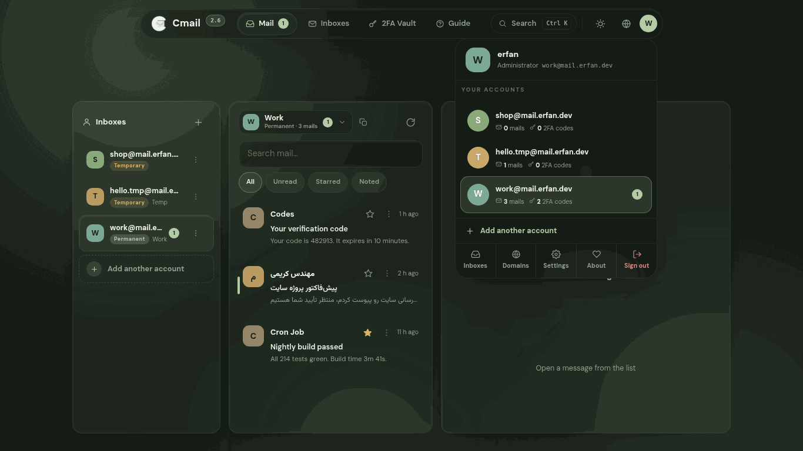
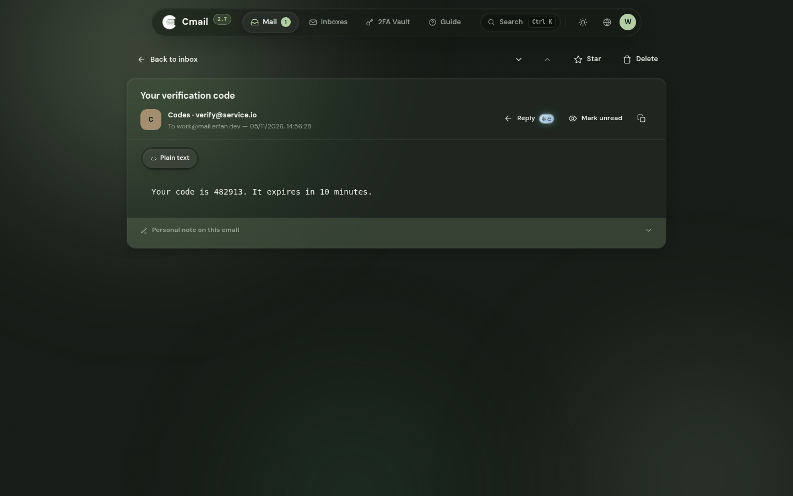

<div align="center">


# Cmail

[](https://github.com/Erfan-8910/Cmail/releases)
[](https://workers.cloudflare.com)
[](#the-whole-system-one-diagram)
[](LICENSE)

**A complete mail ecosystem that lives entirely inside your own Cloudflare account — one worker file, one database, zero servers, zero monthly bills.**

[Deploy guide](docs/DEPLOY.md) · [Usage guide](docs/USAGE.md) · [Releases](https://github.com/Erfan-8910/Cmail/releases) · [فارسی](README.fa.md)

</div>

---

## What is Cmail?

Cmail answers a simple question: **why pay rent for a mailbox?**

The whole ecosystem runs inside the Cloudflare account you already own. Incoming mail arrives through **Email Routing**, everything is stored in **D1** (SQLite at the edge), and the entire interface — pages, styles, scripts, fonts, icons — is served by a **single Worker file**. There is no server to babysit, no database to tune, no panel subscription, and nothing that can be taken away from you.

What you get is a personal mail space you genuinely own: the domain, the data, the keys. Burner addresses for signups, permanent boxes for real work, a colored note under any message, a built-in 2FA vault, outgoing mail from your own domain — all in one liquid-glass panel that speaks Persian and English.

## The feature wall

| | |
|---|---|
| ⭕ **The account circle** | Every mailbox is its own account. Click the circle at the top right — exactly like the big mail clients — and each account shows its tiny details before you even enter: how many mails it received, how many 2FA codes it holds, what's unread. Add another account from the same panel; jump between accounts without ever leaving your page. |
| 📄 **Every email gets its own page** | Opening a message navigates to a real page of its own — its own URL, its own back button, older/newer arrows — never a popup floating over your list. HTML mail renders sanitized inside a sandboxed frame; plain text has its own toggle. |
| ⏱️ **The inbox breathes on its own** | Every 10 seconds the inbox quietly pulls for new mail, highlights what just landed and syncs the unread badges — no refresh button rituals. |
| 🩺 **System health, on stage** | A full health report in Settings: D1 connection with live latency, every table with its row count and column state, the cron heartbeat, and the mail flow — each with its own fix button. |
| 🚨 **Problems announce themselves** | When something serious breaks — D1 unreachable, tables missing, schema outdated, mail stalled — a banner appears above the app with the cause and the one-press fix. You hear it from your app first, never from a broken inbox. |
| 🌐 **Domain connect wizard** | Add a domain and it takes your hand: a crisp connect guide, then a verification code you mail to your own domain. The screen re-checks itself every few seconds until the loop proves itself — and mailboxes unlock. Walked away mid-way? The draft waits in the setup screen and on the domains page with a **Continue** button — nobody ever retypes a domain. |
| 🎨 **A room that matches your color** | The whole environment repaints with the palette you pick — **Green · Blue · Purple · Amber**, each named after its actual color, each one re-tinting the background glow, the glass and every accent in one breath. Three presence modes — **Animated**, **Still**, **Plain** — pick how much life the background has. |
| 🔎 **D1 inspector** | The setup screen lists every expected table with its row count; build the missing ones with a button, drop the strays, keep your database honest. The health tab carries the same inspector, forever. |
| 🗒️ **Notes on emails** | A colored personal note under any message — order numbers, tracking links, anything. Search finds it instantly. |
| 👤 **Every inbox is an account** | Each mailbox behaves like a standalone account: its mail, its private notes and its own 2FA codes stay inside that space. |
| 🔐 **2FA vault** | A built-in authenticator: live 6-digit codes with a countdown ring, sealed with AES-256-GCM, 77 built-in marks, folders, per-inbox binding. |
| ❄️ **Frozen until you decide** | The compose button and the temp-address vault wear an icy snowflake-and-padlock badge while their authorization is missing — the logo stays, the badge tells the truth. Grant the responsibility once and the badge flips to an open flame; the dialog never asks twice. |
| 🛡️ **Account 2FA** | Signing in itself can be protected with TOTP. |
| 📤 **Outgoing mail — optional** | Connect Brevo or Resend with one API key and send from your own domain, with a real test probe. It never gates the rest of the app. |
| ⌘ **Command palette** | Press <kbd>Ctrl/⌘</kbd>+<kbd>K</kbd> anywhere: jump to anything, run actions, search mail live as you type. |
| 🧹 **Auto-cleanup** | An hourly cron expires temporary inboxes and purges old mail — and its heartbeat shows up in the health tab. |
| 🌙 **Liquid-glass UI** | Dark & Daylight themes, 4 color palettes named by their color, background presence modes, Persian (RTL) + English. |
| 📱 **Truly responsive** | From a 320px phone to a 1920px desktop — panes fold into drawers and bottom sheets. |
| 🔒 **Your data, your rules** | Your D1, your keys, your domain. Nobody else holds your mail. |

## The gallery

<div align="center">

| **The cockpit** — the active account's inbox, the account chip in its header, a pick-a-message reading pane |
|---|
|  |

| **The account circle** — every mailbox is an account, with its details before you even enter |
|---|
|  |

| **One email, one page** — its own URL, back button and action bar; never a popup |
|---|
|  |

| **Mission control for your database** — connection, tables, cron heartbeat, mail flow; every problem carries its own fix button |
|---|
|  |

| **The account's own vault** — live codes scoped per account; temp addresses stay locked |
|---|
|  |

| **Every domain, one card** — lifecycle trail, stat strip, Active & Catch-all keys |
|---|
|  |

| **One account, one card** — stat strip, expiry countdown, one-click entry |
|---|
|  |

| **One keystroke from anywhere to everywhere** |
|---|
|  |

| **Daylight mode** |
|---|
|  |

| **The whole cockpit, in a shirt pocket** |
|---|
|  |

| **The front door** — centered card, living aurora, recovery guide built in |
|---|
|  |

| **About — the maker card** |
|---|
|  |

</div>

## What's new in 2.7 — the release that names its colors and locks what needs locking

- **Palettes are named by their color. Period.** Sage, Serene and the rest of the poetry retired — the picker now says **Green · Blue · Purple · Amber**, and the background modes say what they do: **Animated · Still · Plain**. Old picks fold into their color automatically. Switching a palette still repaints the entire room — instantly, live, without a reload.
- **Frozen locks where responsibility is due.** While no sending provider is connected, the compose button (header + floating action button) stays on stage with its paper plane wearing an icy snowflake-and-padlock badge — tapping it explains what is missing instead of vanishing in silence. The reader's reply button obeys the same rule. Once a provider is configured, the badge becomes an open shackle and everything just works.
- **The temp-address vault: frozen, then flame.** Adding a 2FA code to a temporary account still starts locked — snowflake and padlock beside the usual plus. Accept the deletion countdown once and the grant is remembered for that address: the badge flips to a small breathing flame 🔥, the dialog never asks again, and the other temporary accounts stay independently frozen.
- **A tighter, calmer inbox.** Rows slimmed down (smaller avatars, tighter padding, closer preview lines) — more mail visible, same glass softness. The auto-refresh now breathes every 10 seconds.
- **Rapid-clicking can't break it anymore.** Settings tabs, palette cards, inbox filters and account switches all race-proofed: every async paint carries a token, so the stale one steps aside instead of painting two sections at once. Double-clicking compose can no longer stack two composers. And dropdown menus moved to a fixed layer on the page itself — a background refresh can never yank an open menu away mid-tap.
- **The sidebar only repaints when something changed**, so your scroll position and any open menu survive the auto-refresh untouched.
- **Status you can see:** the Sending settings open with a live "Sending locked / Sending ready" chip, so the state of outgoing mail is visible before reading a single field.
- **Fresh hero and version badge**, animated, in both languages.

<details>
<summary><b>What 2.6 changed — the release that gives every account its own room</b></summary>

- **A tidy inbox with the account in its header.** The inbox header now carries the active account itself — colored avatar, address, kind and mail count in one chip. Open it and a glass card lists every account with its unread badge: switch accounts right there, without leaving the inbox; "Add another account" sits at the bottom of the same card.
- **One account, one card.** The Inboxes page traded its flat table for real cards: a stat strip up top (accounts · mails · temporary · active account) and one card per account — avatar, kind tag, three numbers (mails, last mail, expiry countdown) and the actions (copy · forwarding · +1 day · open inbox · delete). The live account wears an accent ring and a "this one" badge.
- **Domains got serious swagger.** The domains page now opens with a stat strip (domains · verified · in progress · mailboxes) and gives every domain a card of its own: the lifecycle trail (saved → verify code → live), the real status pill, **Active** and **Catch-all** switches with one-line explanations, and the numbers (mailboxes, last mail) — same glass softness, twice the information.
- **The 2FA vault belongs to the account.** The vault opens scoped to the account you are in, not "all" — every account's codes stay separate, and the "Add code" button defaults to that same account.
- **The vault locks itself for temporary addresses.** Adding a code to a temporary account shows a 🔒 on the button. The only way through is the responsibility dialog, which tells you exactly when the address — and every code linked to it — will be deleted. Accept, and the code goes in; decline, and it stays locked. Codes linked to a temp address wear a live deletion countdown on their card.
- **The visual bugs are closed.** Dismissing notifications with × now removes exactly that toast and cancels its timer; closing dialogs with × no longer leaves the Escape listener behind (Escape can no longer re-run a dead dialog and scramble the page); and rapid-fire clicks on the menu can no longer open two sections at once — every navigation takes a token and the stale render steps aside at its next await.
- **The menu indicator glides.** The active page pill is now a real glass indicator that springs from page to page — the tab-switch feel of the big clients.
- **Fresh screenshots in both languages** from the 2.6 build — the inbox, the account cards, the domain cards and the locked vault.

</details>

<details>
<summary><b>What 2.5 changed — the release that works like the big clients</b></summary>

- **The account circle.** The avatar at the top right now opens a real account switcher, the way you already know from the big mail clients: every mailbox listed with its tiny details — mails received, 2FA codes held, what's unread — plus **Add another account**, and the manage/settings/sign-out row underneath. Click an account and the whole app lands in its space; the circle itself wears that account's color and letter.
- **Every email gets its own page.** Opening a message no longer floats a popup over the list — it navigates to a dedicated page with its own URL (`#/mail/m/:id`), a real **Back to inbox** button, older/newer arrows, the full action bar (reply, star, mark unread, delete) and the personal note panel. One mail, one page, zero popup bugs.
- **One account at a time.** The mailbox list and the unified stream merged into one honest model: the app shows the active account's inbox, and switching — from the circle, the sidebar, or the command palette — changes the space entirely. No more “which mailbox did this land in?” labels.
- **Navigation grew a pill.** The whole shell is now one floating glass pill: brand and version on one side, the four pages (Mail · Inboxes · 2FA Vault · Guide) in the middle, search/theme/language/account on the other — exactly the layout of the reference design.
- **Four moods, honestly named.** The palette settled on four moods you actually use, and switching one now repaints the entire room: background, glass tints, accents, highlights, even the browser chrome color. Old picks fold into their nearest mood automatically. *(They carry their actual color names since 2.7.)*
- **The health panel heals its own gate.** Installs migrated from old builds could silently lose admin rights (the role column's default), which hid System health, Domains and every admin surface. The app now notices and restores the single user's admin role on boot — the panel simply appears again, no SQL required.
- **Fresh screenshots everywhere**, per language, from the 2.5 build — including two new ones: the account circle and the dedicated email page.

</details>

<details>
<summary><b>What 2.4 changed</b></summary>

- **A living background, yours to tune.** The ambient room behind the app glows with the active mood — switching moods re-tints the whole environment. Three presence modes in Settings → Appearance: **Aurora** (slow drifting light), **Halo** (still glow), **Pure** (flat).
- **The setup screen grew up.** Forms are truly centered on desktop at any window size. A domain left mid-registration sits in the setup screen with its status and a **Continue setup** button — and re-adding it is never an error: the wizard just opens. Skipped verification? Come back later and verify with a code whenever you like.
- **The sidebar lost the filler.** The quote card is gone; the space goes to your inboxes and your accounts.
- **The maker card.** The About page introduces the person behind the project with a gradient-ring card.

</details>

<details>
<summary><b>What 2.3 changed</b></summary>

- **The unified inbox.** "All inboxes" streams every mailbox into one list; each row wears a small chip naming the mailbox it landed in. The sidebar switches spaces like the big clients do — one tap, zero page reloads.
- **The inbox breathes.** Every 15 seconds it silently checks for new mail, highlights what just arrived and refreshes the unread badges.
- **A health panel in Settings.** D1 connection with live latency, every expected table with its row count **and its column state**, the cron heartbeat, and the mail flow with a not-receiving-mail checklist. Missing table? Build button right there. Old schema? Repair button right there.
- **Serious problems surface at the top.** D1 down, tables missing, schema outdated, cron gone quiet, mail stalled — a banner appears above the app, in plain language, with the fix one press away.
- **Incoming mail became drift-proof.** After upgrading the worker without migrating the database, the handler degrades gracefully to whatever columns exist and keeps delivering — and the health panel flags the drift for a one-press repair.

</details>

## Who is it for?

- **Anyone tired of spam** — mint a one-hour address for every signup and keep your real inbox spotless.
- **Developers and testers** — spin up dozens of test inboxes, catch system emails, let them expire when done.
- **Privacy-minded people** — no analytics, no third-party scripts; everything lives in your account, under your keys.
- **Domain owners** — turn the domains already sitting on your Cloudflare into a complete mail ecosystem, with a real wizard instead of tribal knowledge.
- **Anyone who wants their tools to actually belong to them** — set it up once, own it forever.

## Downloads — no clone needed

- **Prebuilt [`worker.js`](https://github.com/Erfan-8910/Cmail/releases/download/v2.7.0/worker.js)** — the entire application in one file (~1.2 MB, ~470 KB gzipped). This is all the graphical install needs.
- **Full package v2.7.0:** [`CMail-v2.7.0.zip`](https://github.com/Erfan-8910/Cmail/releases/download/v2.7.0/CMail-v2.7.0.zip) — sources, [`schema.sql`](schema.sql), [`migrations/`](migrations) and scripts.
- All versions: [Releases](https://github.com/Erfan-8910/Cmail/releases)
- Just here for the database shape? It is one file: [`schema.sql`](schema.sql) — console-proof and re-runnable.

## The guides — per language

| | Deployment | Everyday use |
|---|---|---|
| **English** | [docs/DEPLOY.md](docs/DEPLOY.md) | [docs/USAGE.md](docs/USAGE.md) |
| **فارسی** | [راهنمای نصب](docs/DEPLOY.fa.md) | [راهنمای استفاده](docs/USAGE.fa.md) |

## The whole system, one diagram

```
                     ┌──────────────────────────────────────────┐
                     │               Cloudflare                  │
 incoming mail       │                                           │
 SMTP ──────────►  Email Routing (MX)                            │
                     │        │ catch-all                        │
                     │        ▼                                  │
 browser ────────►  Worker ── serves embedded UI (single file)   │
                     │   │  │                                    │
                     │   │  └── Brevo / Resend ──► outgoing mail │
                     │   ▼                                       │
                     │  D1 (SQLite) — mail · inboxes · account   │
                     │               · notes · TOTP · settings   │
                     └──────────────────────────────────────────┘
```

One Worker serves the UI, the API, the incoming-mail handler and the hourly cleanup. One D1 database holds everything. The UI is part of the Worker bundle, so deployments are atomic: paste one file, and interface and backend always match.

**Sealed, not just stored.** Every 2FA secret is encrypted with AES-256-GCM before it touches the database, passwords run through PBKDF2 (100,000 iterations, per-user salt), sessions are signed tokens, and rendered HTML mail lives in a sandboxed frame with scripts stripped. Encryption here is not a checkbox — it is the material the vault is made of.

**Built to survive a bad day** — the incoming-mail handler degrades gracefully on older databases instead of bouncing your mail, every crash turns into a bilingual guide page instead of a raw error, and the health panel knows the difference between "nothing is wrong" and "here is exactly what to press".

## License

MIT © [Erfan-8910](https://github.com/Erfan-8910)

---

<div align="center">

**Cmail** — *your mailbox, your rules.* 🌿

[Deploy guide](docs/DEPLOY.md) · [Usage guide](docs/USAGE.md) · [Releases](https://github.com/Erfan-8910/Cmail/releases) · [فارسی](README.fa.md)

</div>
