<div align="center">


# Cmail

[](https://github.com/Erfan-8910/Cmail/releases)
[](https://workers.cloudflare.com)
[](#the-whole-system-one-diagram)
[](LICENSE)
[](https://deploy.workers.cloudflare.com/?url=https://github.com/Erfan-8910/Cmail)

**A complete mail ecosystem that lives entirely inside your own Cloudflare account — one worker file, one database, zero servers, zero monthly bills.**

[Deploy guide](docs/DEPLOY.md) · [Usage guide](docs/USAGE.md) · [Releases](https://github.com/Erfan-8910/Cmail/releases) · [فارسی](README.fa.md)

</div>

---

## What is Cmail?

Cmail answers a simple question: **why pay rent for a mailbox?**

The whole ecosystem runs inside the Cloudflare account you already own. Incoming mail arrives through **Email Routing**, everything is stored in **D1** (SQLite at the edge), and the entire interface — pages, styles, scripts, fonts, icons — is served by a **single Worker file**. There is no server to babysit, no database to tune, no panel subscription, and nothing that can be taken away from you.

What you get is a personal mail space you genuinely own: the domain, the data, the keys. Burner addresses for signups, permanent boxes for real work, a colored note under any message, a built-in 2FA vault, outgoing mail from your own domain — all in one liquid-glass panel that speaks Persian and English.

## The feature wall

| | |
|---|---|
| 🖨️ **The print studio — letters become paperwork** | Every letter wears a **Print / PDF** button. One press builds a real sheet: textured paper with grain and laid lines, a letterhead with **your own mark** (upload it in Settings), and an official round stamp drawn live in SVG — double ring, star arc, laurel, the ribbon, and a plaque carrying the **exact date and time from your device**. Wavy cancellation lines cross the corner; *Save as PDF* and it's paperwork. |
| 📎 **Real outgoing attachments** | The composer takes **files and images** — four files, ~650 KB each — with live image thumbnails and desktop-style drag-and-drop onto the body. They go out through your provider *and* stay in the sent copy, downloadable exactly like incoming mail. |
| ⭕ **The account circle — the only switcher** | Every mailbox is its own account. The circle at the top of the page is the one and only place accounts switch — each account shows its tiny details before you even enter: how many mails it received, how many 2FA codes it holds, what's unread. Add another account from the same panel. Nothing inside the inbox, the sidebar or the folders ever jumps accounts by accident. |
| 📂 **The identity oval and the one big card** | The inbox reads the way a grown-up mail client reads: the account's **identity oval** — its face, its name and its full address with a one-tap copy button — sits above one living card that holds the entire mailbox. A toolbar with a select-all box, a refresh and a breathing auto-refresh dot; single-line rows (face · sender · subject — preview · star · time); the folder rail beside it with **All · Unread · Starred · Noted** and live counts — plus **your own folders per account**, each with a color dot, a counter and an optional sender rule that files incoming mail by itself. |
| 📄 **Every email gets its own page** | Opening a message navigates to a real page of its own — its own URL, its own back button, older/newer arrows — never a popup floating over your list. HTML mail renders sanitized inside a sandboxed frame; plain text has its own toggle. |
| ⏱️ **The inbox breathes on its own** | Every 10 seconds the inbox quietly pulls for new mail, highlights what just landed and syncs the unread badges — no refresh button rituals. And nothing loads in silence: a thin living progress bar rides the top of the page the moment anything drags, and the inbox's own status strip says what is happening. |
| 🩺 **System health, on stage** | A full health report in Settings: D1 connection with live latency, every table with its row count and column state, the cron heartbeat, and the mail flow — each with its own fix button. |
| 🚨 **Problems announce themselves** | When something serious breaks — D1 unreachable, tables missing, schema outdated, mail stalled — a banner appears above the app with the cause and the one-press fix. You hear it from your app first, never from a broken inbox. |
| 🌐 **Domain connect wizard** | Add a domain and it takes your hand: a crisp connect guide, then a verification code you mail to your own domain. The screen re-checks itself every few seconds until the loop proves itself — and mailboxes unlock. Walked away mid-way? The draft waits in the setup screen and on the domains page with a **Continue** button — nobody ever retypes a domain. |
| 🎨 **A room that matches your color** | The whole environment repaints with the palette you pick — **twelve palettes named after their actual color**, each one re-tinting the stage glow, the beams, the glass and every accent in one breath. One living backdrop, always alive — no settings row needed. |
| 🔎 **D1 inspector** | The setup screen lists every expected table with its row count; build the missing ones with a button, drop the strays, keep your database honest. The health tab carries the same inspector, forever. |
| 🗒️ **Notes on emails** | A colored personal note under any message — order numbers, tracking links, anything. Search finds it instantly. |
| 👤 **Every inbox is an account** | Each mailbox behaves like a standalone account: its mail, its private notes and its own 2FA codes stay inside that space. |
| 🔐 **2FA vault — account by account** | A built-in authenticator: live 6-digit codes with a countdown ring, sealed with AES-256-GCM, 77 built-in marks. The vault always opens on the account you are in — and **folders belong to one account each**, so account B's groupings can never swallow account A's keys. |
| ❄️ **Frozen until you decide** | The compose button and the temp-address vault wear an icy snowflake-and-padlock badge while their authorization is missing — the logo stays, the badge tells the truth. Grant the responsibility once and the badge flips to an open flame; the dialog never asks twice. |
| 🤝 **Share a mailbox — or five** | Hand anyone a guest credential for **as many mailboxes as you pick**: its own username/password (always viewable again, **Regenerate** rolls a fresh pair), a permission list (read · star · archive · delete · send · notes), an expiry with presets, a device cap, even a welcome note the guest reads on arrival. Every credential carries its own **device list** and **session list** — disable any of them on the spot — plus live audit, one-press kick, instant revoke and a manual suspension switch with a **freeze-time / keep-counting** choice. Guests sign in through the **Shared access** door on the login card, live under a compact **Dynamic Island**, and see nothing but what you handed over — unauthorized controls never render at all. |
| 🛡️ **Account 2FA** | Signing in itself can be protected with TOTP. |
| 📤 **Outgoing mail — optional** | Connect Brevo or Resend with one API key and send from your own domain, with a real test probe. It never gates the rest of the app. |
| ⌘ **Command palette** | Press <kbd>Ctrl/⌘</kbd>+<kbd>K</kbd> anywhere: jump to anything, run actions, search mail live as you type. |
| 🧹 **Auto-cleanup** | An hourly cron expires temporary inboxes and purges old mail — and its heartbeat shows up in the health tab. |
| 🌙 **Liquid-glass UI** | Dark & Daylight themes, twelve color palettes named by their color, one living backdrop, Persian (RTL) + English. |
| 📱 **Truly responsive** | From a 320px phone to a 1920px desktop — panes fold into drawers and bottom sheets. |
| 🔒 **Your data, your rules** | Your D1, your keys, your domain. Nobody else holds your mail. |

## The gallery

<div align="center">

| **The cockpit** — the identity oval (name + address + copy) above one living card; single-line rows, folder rail with live counts — and a right-click management menu on every letter |
|---|
| 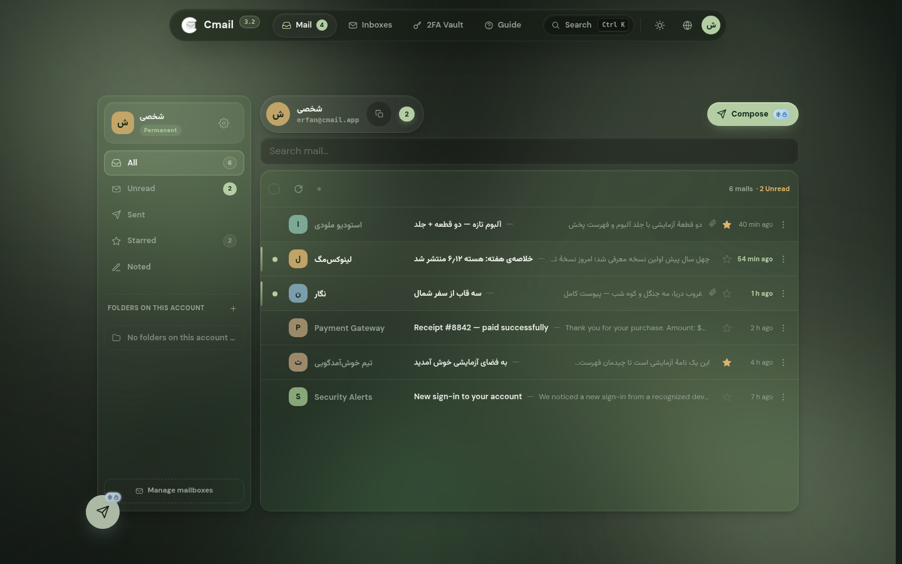 |

| **The right-click menu** — open, reply, star, read state, Print / PDF, copy the sender's address, move to folder, delete; it opens at the pointer, clamps inside the viewport and docks as a bottom sheet on phones |
|---|
| 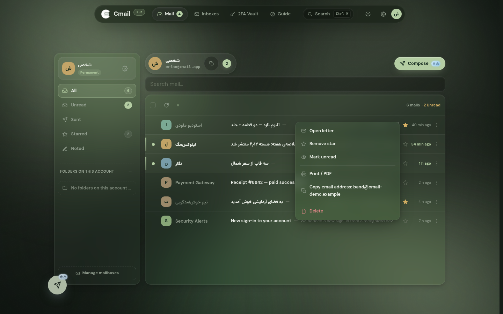 |

| **The account circle** — the one and only place accounts switch, with each account's details before you even enter |
|---|
| 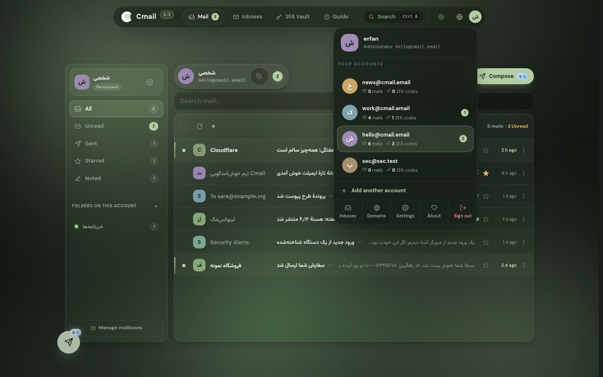 |

| **One email, one page** — its own URL, back button and action bar; never a popup |
|---|
| 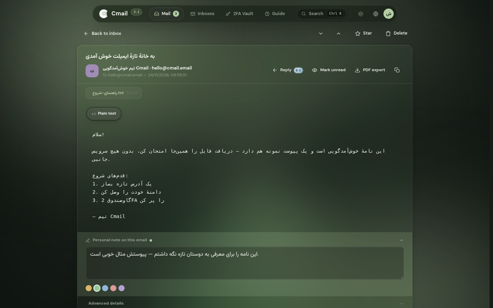 |

| **Mission control for your database** — a score ring that reads the database itself, connection, tables, cron heartbeat, mail flow; every problem carries its own fix button |
|---|
| 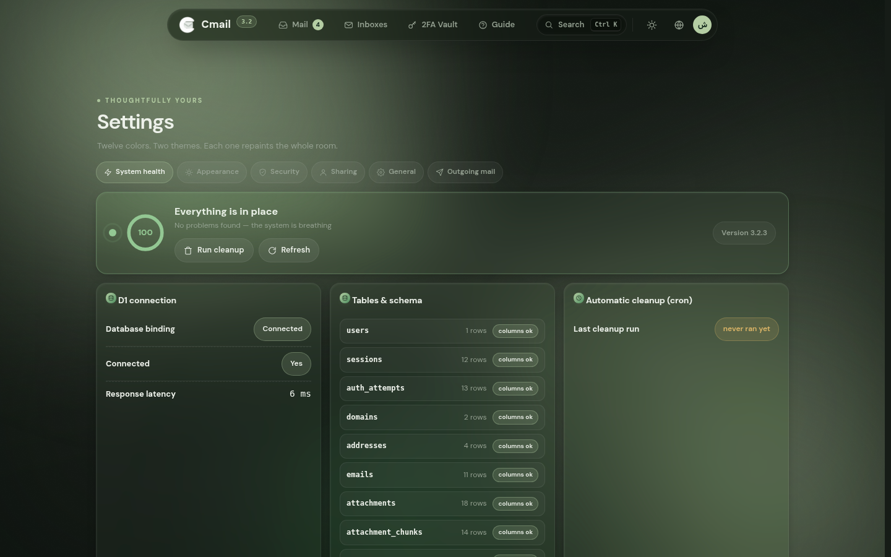 |

| **The account's own vault** — live codes scoped per account, **folders bound to that account**; temp addresses wear the frozen badge until you decide |
|---|
| 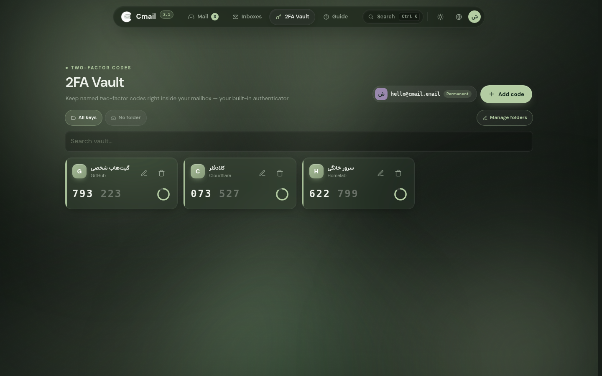 |

| **Every domain, one card** — lifecycle trail, stat strip, Active & Catch-all keys, a heartbeat ring when mail is flowing; the Details button opens the full dossier |
|---|
| 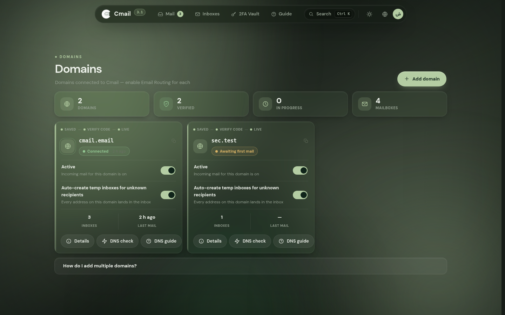 |

| **The domain dossier** — live DNS verdicts (MX, SPF), a troubleshooting list that names each problem with its fix, and the exact records to compare against |
|---|
| 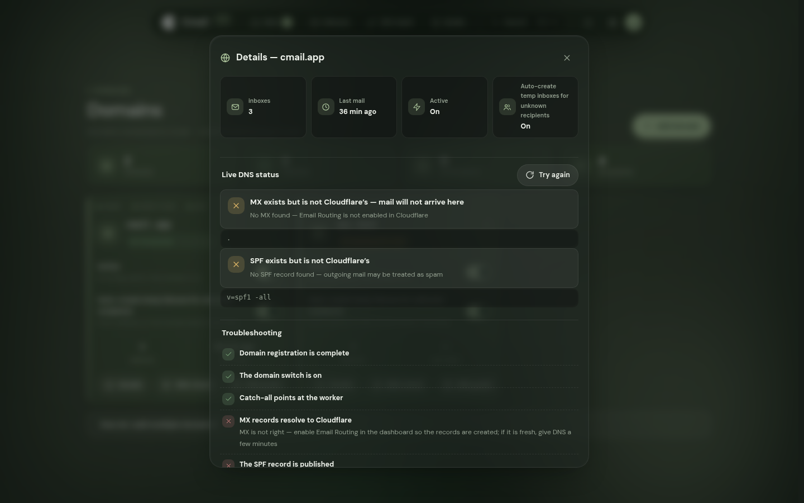 |

| **One account, one card** — stat strip, expiry countdown, one-click entry |
|---|
| 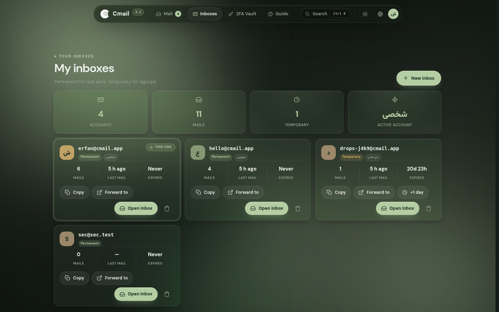 |

| **One keystroke from anywhere to everywhere** |
|---|
| 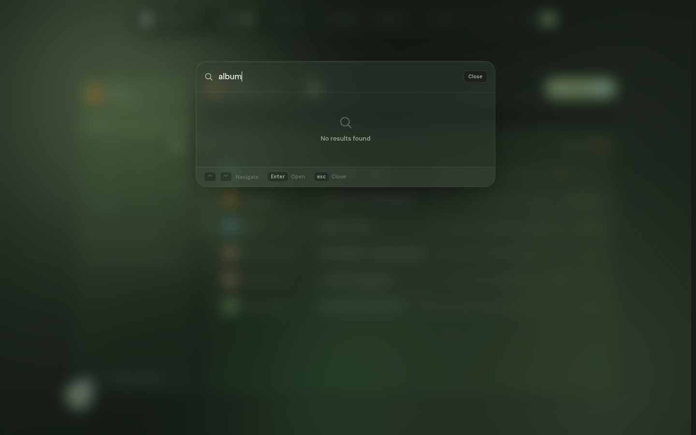 |

| **Daylight mode** |
|---|
| 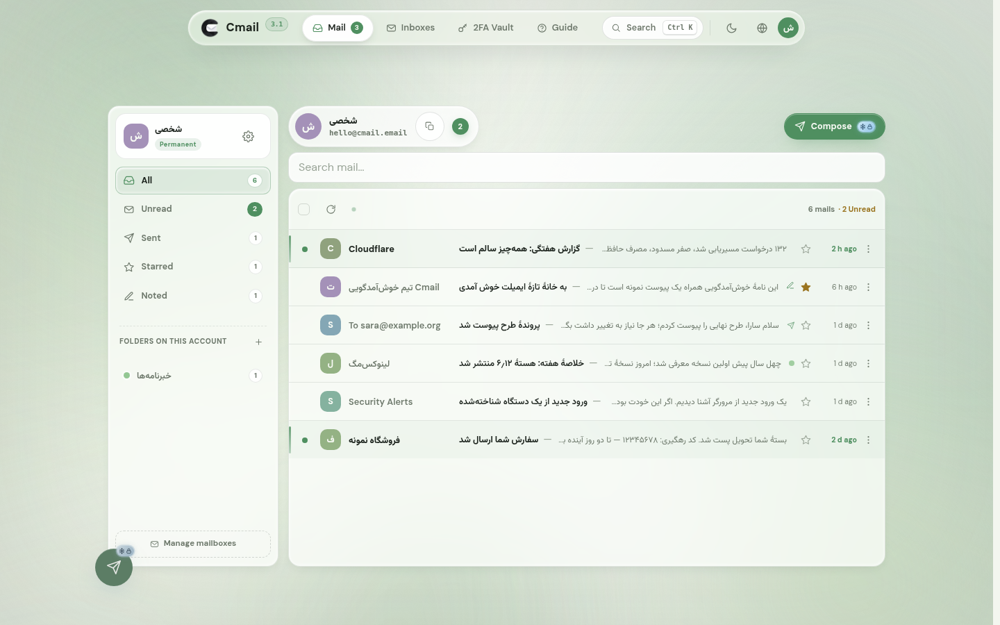 |

| **The whole cockpit, in a shirt pocket** |
|---|
|  |

| **The front door** — centered card, living aurora, recovery guide built in |
|---|
| 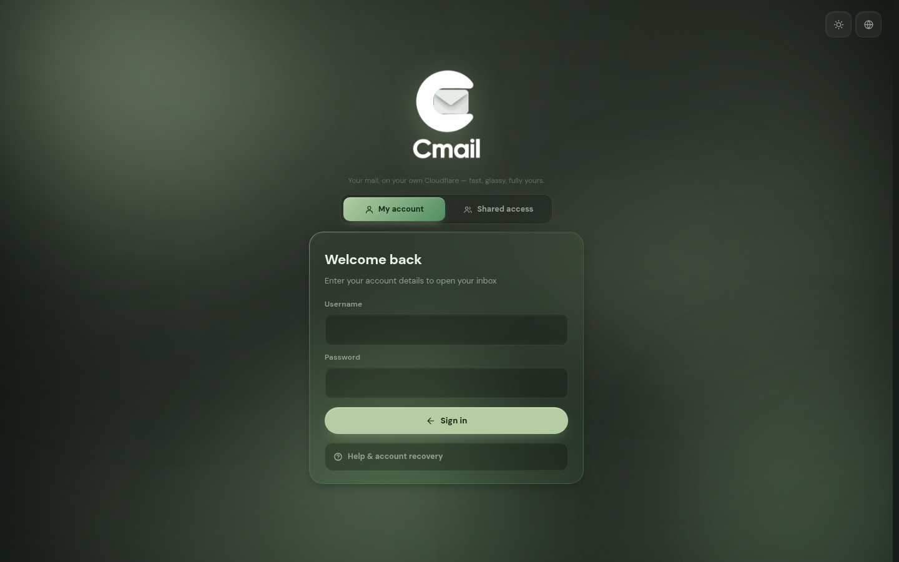 |

| **About** — the maker card, the update check and the Climind-W ribbon |
|---|
| 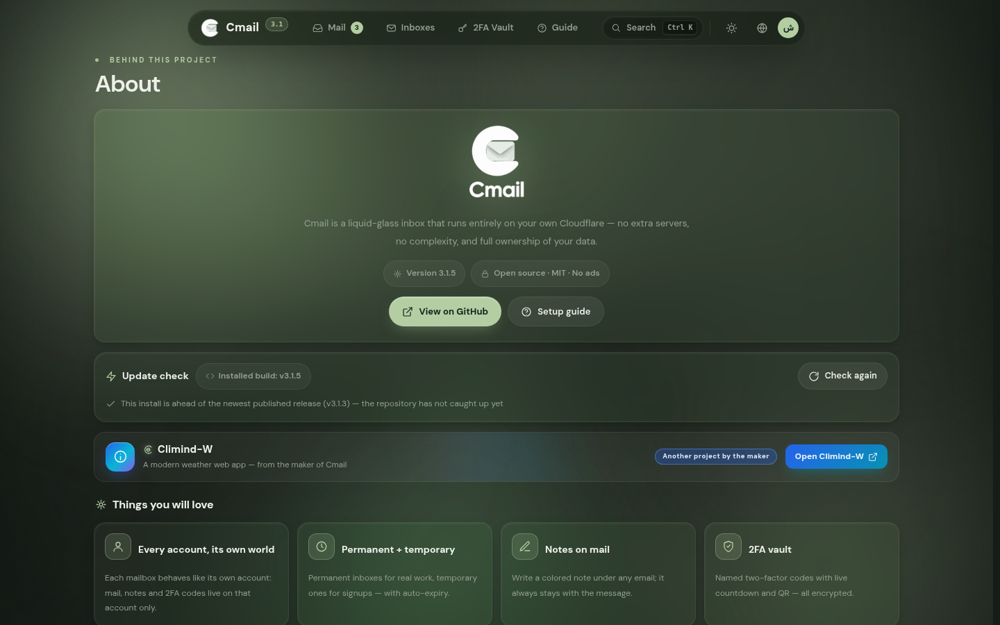 |

</div>

## What's new in 3.2.1 — the seal earns its face, the context menu returns, and the lock shuts tighter

3.2.1 answers three reports from the first days on paper — and all three turned out to be honest bugs worth telling in full.

- 🪧 **The context menu is back — it had been buried under one broken character.** Right-clicking a letter did open the menu, but the CSS rule that makes it float had been swallowed by the stylesheet parser: a merge had eaten the `/*` of a comment banner above it, and everything up to the next rule folded into one invalid selector. The menu existed in the DOM and rendered nowhere — exactly the "nothing happens" report. Found by diffing the browser's parsed stylesheet against the file on disk, fixed with one character, and verified by measuring the menu's `position: fixed` live on a real page.
- 🖨️ **The printed letter now wears the real insignia.** The hand-drawn round stamp is gone; in its corner sits the **official house seal** — the worn royal-blue rubber stamp with the Cmail mark inside, the name, the OFFICIAL ribbon, the laurel branches and the stars, exactly like the sample. The letterhead carries **Cmail's own logo** (or the admin's uploaded mark, as before). The certificate block grew a double frame, a ghost watermark of the mark, and the full paperwork: parties, mailbox, type, size, route, the SPF · DKIM · DMARC verdicts as ink chips, attachments with their sizes, and the letter's note. The date-and-time plaque is drawn in isolated HTML cells now, so Persian digits never reorder themselves, and the document speaks the panel's language on both sides — a Persian panel prints a fully RTL certificate even for an English letter.
- 🔒 **The lock stopped having a spare key under the mat.** The server gate was always solid — a locked session gets `403` on every data endpoint, re-verified 111/111 — but the browser side had two soft spots. The password field invited the browser to pour the **saved panel password** into the lock screen on its own (`current-password` autofill); it asks for `new-password` now, so autofill stays out and the inspect-reveal trick starves. And deleting the overlay in the inspector used to leave an empty shell until the next navigation — a `MutationObserver` puts the lock straight back now, and the shell around it goes dark: blurred, dead to the pointer, not even the unread count showing.
- 🧬 **The cache buster grew a fingerprint.** Every release stamped its asset URLs with the package version (`?v=3.2.0`) — and a rebuild under the same number could leave some browsers on the old css/js for good; that same-version cache was the quiet hand behind the first two reports. Asset URLs now carry a fingerprint of every embedded file's bytes — any content change anywhere mints a fresh URL by itself.

Tested: `tsc` clean, i18n parity **893/893**, the security matrix **111/111** on a fresh install, the v3.2 feature E2E **22/22**, and the print document walked live in both languages — seal, plaque, certificate, note and watermark all on the page.

<details>
<summary><b>3.2.0 — the paper release: letters become paperwork</b></summary>

## What's new in 3.2.0 — the paper release

This one began with a question nobody had answered for Cmail yet: **why does a letter have to stay glass?** Mail is paperwork. 3.2.0 lets it finally touch paper — and along the way it fixes the three things you actually reported, rebuilds the composer, and gives the app an honest answer about its own version.

- 🖨️ **The print studio** *(the 3.1.5 exporter, rebuilt on real paper)*. Every letter now has a **Print / PDF** button. It builds a real sheet of paper inside a hidden frame: warm textured stock with grain and laid lines, a letterhead with your mark, and — the ceremony — an **official round stamp** drawn live in SVG: double ring, star arc, laurel branches, the mark in the middle, a ribbon that says OFFICIAL, and a plaque that carries the **exact date and time from your device**, the second you press print. Wavy cancellation lines drag across the corner like the postman just left. Choose *Save as PDF* and the letter becomes paperwork.
- 🖋️ **Your mark, not ours.** Settings → Appearance → *Letter paper & stamp* takes any PNG/JPG and puts **your image** where the Cmail logo used to sit — in the center of the stamp and on the letterhead. No image? The drawn Cmail mark stands in.
- 📎 **Real attachments, outgoing.** The composer now takes **files and images** — up to four, ~650 KB each. Images ride as live thumbnails; drop a file straight onto the body like the desktop clients taught you. Attachments go out through Brevo/Resend *and* stay in the sent copy, downloadable exactly like incoming mail.
- ✈️ **The composer, rebuilt.** A gradient paper-plane sigil, icon rails beside the fields, a tool rail in the footer (attach · discard draft), a `Ctrl ↵` hint that says what it does, and errors inline instead of shouted.
- 🔄 **The Update center, rebuilt.** 3.1.5's small check line grew into a full update center: pills comparing the installed build against the latest GitHub release, live states, release notes, and the three steps to update when a new version lands — backed by the worker's own cached check. It celebrates when you're current.
- 🧭 **The version lie is dead.** Builds now carry their version **stamped into the bundle** (`scripts/build-worker.mjs` → esbuild `--define`). A worker pasted by hand into the Cloudflare dashboard — where `wrangler.jsonc` vars don't exist — used to fall back to a stale `3.0.0` in the UI. The build itself tells the truth now: deploy 3.2.0 and every surface says 3.2.0.
- ⭐ **The hover star tells the truth and stops flickering.** The quick-action star never showed a mail's starred state, and tapping it repainted the whole list under your pointer — the pill vanished mid-click. Stars flip in place now, filled amber when on, with a pop; the list only reloads when the Starred box really changes membership.
- 🎛️ **Appearance, tightened.** The background presence picker retired (the living stage is the one backdrop — it doesn't need a settings row), the theme/language cards are icon-led and tighter, and every settings pane shares one card language: gradient-tile headers, dashed row rules, less padding, more signal.

Tested: `tsc` clean, i18n parity **886/886**, the full security matrix green on a live worker, and the whole flow exercised through `wrangler dev` — version stamp, print doc, attachments in and out, the doors, the star.

</details>

<details>
<summary><b>3.1.5 — the right-click inbox, the first PDF export, the domain dossier, D1 errors as sentences</b></summary>

## What's new in 3.1.5

This release was assembled from a stack of real reports: the inbox wanted desktop-grade behavior (a right-click menu, like the clients people already know), the tables section kept surfacing raw `D1-Error: not authorized SQLITE_…` dumps, the sign-in page's tabs sat in the wrong place on desktop, the setup completion page pretended to update itself, and the domain wizard handed out a fresh verification address every time someone stepped away and came back. Beside them, the standing request to make several rooms read like a proper control panel: domain details, system health, the in-app guide, and the sharing and security settings. All of it went through one cycle:

- **The inbox got a real context menu.** Right-click any letter and the management menu opens at the pointer: open, reply, star, mark read/unread, PDF export, copy the sender's address, move to folder and delete. The menu clamps inside the viewport, closes on scroll or Escape, and docks as a bottom sheet on phones — where the row's three-dot button now opens the same menu instead of a modal. A guest sees exactly the items its credential allows.
- **Official PDF export.** Any letter — received or sent — can leave as an A4 document with the Cmail letterhead, a dated official seal, a details table (sender, recipient, mailbox, type, size, route, and the SPF/DKIM/DMARC verdicts), the body in its true direction, attachments and the note. The document speaks the panel's language — RTL Persian in Vazirmatn, English in Inter — and the browser's own print dialog provides "Save as PDF". No PDF library sits in the middle, so Persian text is never reshaped into mush.
- **D1 errors arrive as sentences, not dumps.** Every database failure is classified before it reaches the UI and translated into one line in the panel's language, with the pointer to where the actual fix lives — Settings → System health. The setup screen's table inspector catches its own database errors and answers with the same classified code instead of stopping raw.
- **The sign-in tabs moved above the card.** They were appended after it in the DOM and sat stranded below the form on desktop — exactly the "options in the wrong place" report.
- **The setup completion page updates itself, honestly.** The auto-recheck loop no longer gives up forever after one failed fetch — it counts down and genuinely retries while offline; it retires itself when the page is gone; and the departure is visible: a real "moving on in 5s…" countdown on the page, the button becoming "Enter Cmail", and a "Stay here" brake for the admin who wants a last look first. (The rewrite also caught a double-handler bug: the main button fired both the old recheck listener and its new handler on one press.)
- **The domain wizard keeps its promise.** Verification used to re-arm a new code on every resend or resume, silently invalidating the address the owner had already mailed to. The code is the domain's identity now: leave mid-way, come back later — the same verify address is still there, only its 24-hour window is re-armed, and a new letter to that address completes the loop.
- **The full domain dossier.** A "Details" button on every domain card opens one complete window: the numbers, live DNS status from a real resolver (MX and SPF, auto-run), a troubleshooting list that names each problem with its fix — unfinished registration, inactive switch, closed catch-all, missing MX, unpublished SPF, silent mail flow — and the exact records to compare against. The DNS verdict lines also stopped repeating themselves.
- **The sending core, tightened.** Provider calls get a hard 20-second ceiling so the composer can't hang on "sending…" forever; plain text now travels as a styled block instead of a bare `<pre>`; provider failures translate with their technical detail trimmed; and reply carries a proper quote — the dated original, prefixed line by line — with "Re:" added only when the subject doesn't have it.
- **System health reads like an instrument.** The hero carries a score ring built from the database's own words (the share of whole tables), quick actions beside it (run cleanup, refresh), and a new outgoing-mail card with a shortcut into the sending settings.
- **Sharing and security, compact.** The shared-access form sits in two calm columns on wide screens — who enters and what they may do, beside how long and from how many devices; the security cards tightened their spacing.
- **The in-app guide became searchable.** A live filter at the top of the page steps irrelevant chapters aside; new chapters cover the inbox's right-click management, the PDF export and the domain dossier; troubleshooting moved to chapter seven.
- **Update check in About.** A new card shows which version this install runs, checks the repository automatically (a ten-minute cache inside the worker; when the REST API's quota bites, the `releases/latest` redirect answers instead), and offers a manual re-check. When a newer release exists, its version and a direct link to the repository appear right there.

Tested: the security matrix stands at 111/111 on a live worker, `tsc` clean, i18n parity 848/848, and every new surface walked in a browser in both languages — the context menu, the PDF document, the domain dossier, the guide search, the update card, the two-column share form and the health ring. The version badge, download links, single-file worker and one-click installer all ship on 3.1.5.
</details>

<details>
<summary><b>3.1.3 — the last step of the Deploy button goes green, and a spent code stays spent</b></summary>

The report that built this release was specific: the last step of the Deploy button failed with an error that pointed nowhere. Replaying the whole pipeline from a fresh clone showed nothing in Cmail was broken — the account had simply run out of room. Cloudflare's free plan allows 10 D1 databases per account, and leftover test databases had quietly filled it. 3.1.3 turns that dead end into a clear message:

- The installer detects the quota in step one, not after minutes of work, and explains the fix in plain words: Dashboard → Storage & Databases → D1 → delete a database you honestly no longer use, then run the install again.
- `CMAIL_D1_ID=<id>` skips database discovery entirely and points the installer at an id copied from the dashboard.
- `deploy.sh` got the same friendlier failure text.

A UI fix grew out of the same report: on a 320px screen the setup screen's D1 inspector was falling apart — the "not built" tag, the table name and the Build button each slid onto their own line. The rows are rebuilt: at any width every table reads as one line (icon, name, status), and on narrow screens the Build button compresses to a + glyph, with the full label returning when it fits. Checked at 320/360/390/1280px in both languages and themes, plus a full sweep of every view at 320px — no overflow anywhere.

Security work this time targets the one-time codes themselves:

- **TOTP codes are single-use now.** Each door — sign-in, panel unlock, 2FA disable — tracks the last accepted step under `totp_step:<userId>:<door>` and refuses the same code twice, so an intercepted code can never be replayed. The tracking is per-door: a code used to unlock can still turn 2FA off within the same step, the way people actually work with authenticators.
- `/totp/enable` got its own rate limit (10 per 10 min per IP), and re-enabling 2FA resets all ledgers so a fresh secret starts with a clean history.
- Unknown usernames cost the same as wrong passwords: a decoy PBKDF2 hash is computed either way, so response timing no longer reveals which usernames exist.
- Attachments a browser could execute (HTML, SVG, XHTML, XML) always download as `application/octet-stream` with an explicit `nosniff` — they never render.
- The session cookie moved to SameSite=Strict; it no longer travels with cross-site navigation.

Tested: the security matrix stands at **111/111** on a live worker, with eleven new checks covering the replay wall — the spent code refused, the older step refused, the drifted current step accepted, and the per-door isolation kept. `tsc` clean, i18n parity 799/799. The version badge, download links, single-file worker and one-click installer all shipped on 3.1.3.

</details>

<details>
<summary><b>3.1.2 — icon placement fixed, outbound-mail rate limits, COOP/CORP headers</b></summary>

The report came from the setup-completion screen itself: symbols refusing to sit where they belong. Three culprits, proven live, all fixed:

- The "Optional" tag stretched into a full-width dashed box — a broad CSS selector (`.check__txt span`) meant for the row description was hijacking the chip. The selector now scopes to the description only, and the tag is a small inline pill again.
- The "SERVER ONLINE" badge landed on the floating logo — logo and badge were both inline elements sharing one line box, worst on phones. The logo is a block now and the badge owns its own line; the same fix went to the sign-in logo.
- The celebration confetti rained on top of the card (z-index 320). It now falls behind the app — background only, faintly through the glass — and stays fully hidden under reduced motion.

Responsiveness got hard braces: eleven `minmax(N, 1fr)` auto-grids carry a `min(N, 100%)` guard (the health cards were pushed half off-screen on 320–360px RTL phones), long domain names ellipsize with the copy icon always visible, D1 inspector rows wrap instead of squeezing, wizard rail labels ellipsize at ≤360px, and status pills compress. Verified at 320px in both languages and both themes: zero overflow in every view.

And security climbed one step: `POST /api/emails/send` is capped at 20 per 10 minutes per IP, `POST /api/admin/test-send` at 10 (429, one clean bucket per IP) — a leaked session or an over-privileged guest can no longer pump unlimited mail through the owner's Brevo/Resend account. COOP and CORP headers ride every response. The security matrix stands at 100/100 (six new checks) plus all 94 checks of the 3.1.1 matrix, still green.

</details>

<details>
<summary><b>3.1.1 — the panel lock moves to the server, plus a second CSRF wall</b></summary>

The report was exact: the panel lock could still be walked around — right-click, delete the overlay element in the inspector, and the panel opened without any password. True: 3.1.0 verified the unlock credential on the server, but the locked state itself was still a browser flag, and the server never knew the session was locked. 3.1.1 moves the lock itself into the server:

- Pressing the padlock stamps `sessions.locked_at` in D1 (migration 0013), and from that moment the worker refuses every data endpoint for that session — mail, vault codes, attachments, folders, addresses, admin, send — all answer `403 session_locked`. Only the surfaces the lock needs stay open: `/me`, `/lock`, `verify-unlock`, logout, the public setup status and the health probe. Nothing inside the browser can change a D1 row: the data simply never leaves the worker.
- Locking wipes the panel behind the overlay — the app root, open dialogs, the command palette, the account cache. There is no mail list or vault code hiding under the cover; unlocking re-renders the page fresh.
- A locked `/me` leaks nothing: unread counts and the newest-email line stay behind the credential.
- It locks per session. Other signed-in devices keep working, and any tab that sheds its overlay gets re-locked by the server's next word — the 20-second keepalive, or the next data call.
- Every state-changing API call checks its `Origin`/`Referer` against the request host; a forged cross-site POST is refused before it runs.
- Upgrade-safe: databases upgraded in place are answered without the new column until migration 0013 or the heal pass adds it, and the first lock press heals the table itself. Existing sessions are preserved. Expired 2FA pending tokens are swept by the hourly cron.

Security matrix: 94/94 on a real worker — 23 new checks covering the lock itself plus all 71 checks of the 3.1.0 matrix.

</details>

<details>
<summary><b>3.1.0 — the security release: every lock moves to the server</b></summary>

Users found it, and they were right: too much of the security was client-side theater. A suspended credential could still read its mailboxes through the API; the sign-in page carried a permanent recovery password readable with devtools; the password meter lived in the browser. 3.1.0 moves every lock to the server:

- The permanent recovery password is dead. The recovery panel now generates a fresh one-off password and its matching PBKDF2 hash in your browser every time it opens — nothing reusable exists in the app, the repo or the docs.
- Every hash is peppered: the PBKDF2 output is HMAC'd with a key derived from `APP_SECRET`, which lives in Worker Secrets — not the database. A leaked D1 alone can no longer verify a single password guess. Legacy hashes re-hash transparently at each successful sign-in.
- The password bar is server-owned: length 8+, letters and digits required (Unicode-aware — Persian passphrases pass exactly like Latin ones), a denylist of top-common passwords, repeated-character junk rejected.
- A suspended share is suspended for real: mail, vault, folders, addresses and send all answer `403 suspended_share`; only `/me` and logout stay open.
- Guest windows stopped leaking (`forward_to` and private-notes fields removed) and `shareCan` fails closed.
- Turning 2FA off demands the password; changing the password kills every other live session and carries its own rate limit.
- The sending API key is sealed at rest as AES-GCM ciphertext; rendered emails run under their own strict CSP with meta-refresh stripped; HSTS and `frame-ancestors 'self'` everywhere; admins can no longer demote their own role.

Dedicated security matrix (`scripts/test-security.mjs`): 71/71 on a real worker.

</details>

<details>
<summary><b>3.0.3 — root-causing the sign-in loop (issue #2)</b></summary>

The password was never wrong. On installs built through the terminal migration chain (`deploy.sh`, `npm run setup`, `wrangler d1 migrations apply`), the `share_links` table was missing two columns (`max_devices`, `guest_note`) — migration 0010 had handed them to a deploy script that never ran — and the session lookup that answers every signed-in request touched exactly those columns. It threw, the error was swallowed as "no user", and the panel bounced back to the login form right after a successful sign-in. An invisible loop no password reset could fix.

Three layers bury it:

- The columns got their own migration 0012.
- The worker's session reader is two-stage and shape-agnostic: owner sessions never touch `share_links`, on any database shape.
- The health panel's **Repair** button, the setup gate and a new healing pass in `deploy.sh` add the columns wherever they are still missing; a drifted table is flagged as `schema_outdated` with the exact column names.

Also: a failed sign-in on a drifted database now answers a clean `401 invalid_credentials` instead of a raw `500 server_error`; and the recovery script is shell-proof — the reset SQL contains `$` characters and pasting it in double quotes silently corrupts the hash, so the guide warns about it and ships single-quote and `--file=` variants. Verified with 41/41 E2E checks on a live worker.

</details>

<details>
<summary><b>3.0.2 — one database per install; the cron-cap deploy failure fixed</b></summary>

Two separate failures shared one symptom — a fresh button install asking for a password:

- The button reused a database whose name it recognized, so the new Worker could get wired to the first install's live data. The deploy step now gives every install its own database named after its Worker (`<worker-name>-db`), finds-or-creates it, re-binds any foreign id, and patches the working config itself (database name, id, and a `CMAIL_DB_NAME` marker).
- A deploy that had actually succeeded still went red when the account was out of cron slots — the free plan caps cron triggers at 5 per account (error 10072), and attaching the hourly cleanup cron was the last step. The resolver catches it, deploys without the cron, and says how to attach it later.
- The database id is recoverable three ways — `wrangler d1 list`, the live Worker's own bindings, or creation — so a CI token that may create but not list still deploys.
- The deploy log reads plainly, and `deploy.sh` runs its final deploy through the same resolver.

Verified end-to-end, 21/21 checks: the second install came up with its own empty admin table while production didn't lose a row.

</details>

<details>
<summary><b>3.0.1 — the setup gate, a self-healing Deploy button, several installs per account</b></summary>

- A fresh install always lands on the setup door. On an empty or unknown database, every route folds into the setup gate; the sign-in card shows an honest "database not ready" panel instead of a credential form; and `POST /api/setup/admin` answers a clean `409 tables_missing`. The create-access door appears only once the tables exist.
- The Deploy button heals itself. The repo ships a placeholder `database_id` on purpose, and the button's Deploy step used to die on error 10021; a self-resolving script (`scripts/deploy-resolve.mjs`, wired as `npm run deploy`) now reads the binding, finds the database by name or creates it, patches the working copy of `wrangler.jsonc`, then hands over to wrangler.
- Several installs on one account, zero collisions. The installer opens with an identity prompt — Enter keeps the default single install, a typed name spins up an independent one, and `CMAIL_WORKER_NAME` / `CMAIL_DB_NAME` skip the prompts for scripted installs. The identity is written into the config so the resolver always binds the database that belongs to the chosen name. Email Routing's catch-all can aim at any instance (`configure-email-routing.sh` takes the worker name), and the deploy guide gained a "Several instances on one account" section — free plan cap: 10 D1 databases.
- The whole flow was verified live: the second instance came up with its own empty admin table while production didn't lose a row. i18n parity 794/794.

</details>

<details>
<summary><b>3.0.0 — multi-mailbox sharing and two doors on the sign-in card</b></summary>

- One guest credential can hold as many mailboxes as you choose — not just one. The mailbox picker lives in Settings → Sharing; guests see exactly what you hand over. List, search, star, folders, notes, bulk actions and sending (as any shared address) all speak multi-mailbox.
- Every credential carries a simultaneous device cap (unlimited / 1 / 2 / 3) and a welcome note the guest reads the moment it lands. Perms, expiry presets plus an exact date, custom username/password, live audit, kick, revoke, hard delete — still one pane.
- The login page wears a slim segmented control: **My account** for the owner, **Shared access** for guests.
- The guest panel became a Dynamic Island: one floating pill with the mailbox name, a live D-H-M-S countdown and a single ? that morphs open — remaining time, the mailbox list, the admin's note, sign-out. It re-syncs every 20 seconds.
- Each credential got a control room: device and session lists with one-press disable, username/password always lookable again (AES-256-GCM), and **Regenerate** with an optional sign-out of every live browser.
- Suspension became a proper lifecycle: a share with no mailbox assigned suspends itself and wakes when you assign one; manual suspension keeps counting down or freezes time; deleting a mailbox that still has guests warns first.
- A 2FA key a guest adds is the same row the admin sees — the live code is identical on both sides. The D1 parameter-binding bug that broke every guest vault query is fixed at the root (migration `0011_share_control`).
- Nothing unauthorized ever renders — not even disabled — and hard-typed `#/settings` or `#/domains` folds straight back to the mail view.

</details>

<details>
<summary><b>2.9.5 — folders per account, scene backgrounds, a rebuilt composer</b></summary>

- Folders gained a second level: build your own folders per account — each with a color dot, a live counter and its own rule, never mixing two accounts' mail. Move a mail from its row menu, move a whole selection with the "Move to folder" bar, and give a folder a sender rule (a few comma-separated words like `news, bills`) so fresh mail from those senders lands inside the moment it arrives. Deleting a folder returns its mail to the main inbox — nothing is lost.
- Settings → Appearance gained a scene-background picker: four hand-drawn animated scenes — green hills, aurora, sunset, night sky — plus no scene at all. All of them respect reduced motion.
- The composer was rebuilt: aligned rows, a message body that grows as you type, the sender with a live avatar beside the picker, errors stated beside the field itself, a send button with its own spinner, Ctrl/Command + Enter, and a draft that saves itself and survives closing the tab.
- The guide gained the official Deploy to Cloudflare button; the terminal installer (`deploy.sh`) now recognizes both config shapes.
- Rapid-click safety extended: folder loads carry sequence tokens, account switching clears the previous account's folders first, and nothing paints outside the live view.

</details>

<details>
<summary><b>2.9 — the inbox rebuilt from zero</b></summary>

- One identity oval above a single living card: account face, name and full address with one-tap copy. Rows read like the big clients — face · sender · subject — preview · star · time — and unread rows show a dot where the checkbox would be; reach for the row and the checkbox takes its place. The unused reading column is gone: the list owns the full width and every mail still opens in its own page.
- Loading never lies. Anything that drags gets a thin progress bar at the top; the inbox has its own status strip, even during background refreshes; failed loads offer a retry; and empty folder, fruitless search and "no mailbox picked" each speak for themselves.
- The About ribbon learned mobile manners: a proper two-row grid on phones, and the aurora at rest on mobile GPUs.
- One boot, guaranteed. The entry script was versioned but the module imports were not, so the whole shell loaded twice — two routers, two hash listeners, an inbox occasionally painting into a detached view. That was the real face of the "two sections open at once" bug family. Every import now carries the entry's version stamp.

</details>

<details>
<summary><b>2.8 — switching lives in one place; vault folders belong to each account</b></summary>

- Account switching lives only in the top avatar circle. The inbox sidebar no longer lists accounts, and the header chip is a quiet identity plate. Below it sits the account's own folder rail — All · Unread · Starred · Noted — with exact live counters, cut client-side so switching is instant.
- Every vault folder is now bound to one account (`0006_vault_folder_scope.sql`, auto-healed on older installs): the folder picker only offers that account's groupings, and moving a key to another account releases the old folder.
- The frozen badge follows temporary accounts everywhere they appear — the sidebar identity card, the vault chip, the add-code button — flipping to the breathing flame once responsibility is granted.
- The rapid-click bug family met its actual root cause: stale async continuations could reach the fresh view's DOM through `getElementById` and paint twice. Every view now paints only into its own captured nodes, and open dialogs, floating menus and popovers retire the moment you navigate.
- Settings lost the Service-name field; assets ship versioned URLs (`app.css?v=2.8.0`) so no browser runs an old script after an update; the About page wears the animated Climind-W ribbon; domains got a hover aurora and a heartbeat ring; the mobile badge-overlap on Inboxes is fixed; and 24 screenshots were retaken — every view, both languages.

</details>

<details>
<summary><b>2.7 — palettes named by their color; frozen locks for sending and the temp vault</b></summary>

- Palettes say what they are: Green · Blue · Purple · Amber. Background modes too: Animated · Still · Plain. Old poetic names fold into their color automatically, and switching a palette still repaints the whole room live.
- While no sending provider is connected, the compose buttons (header and floating) and the reader's reply wear a frozen badge — tapping it explains what is missing instead of vanishing silently. Connect a provider and the badge becomes an open shackle.
- The temporary-address vault works the same way: adding a 2FA code to a temp account starts frozen behind the responsibility dialog; accept the deletion countdown once and the badge flips to a breathing flame — remembered per address, while every other temp account stays independently frozen.
- The inbox tightened: slimmer rows, auto-refresh every 10 seconds.
- Rapid clicking can't break things anymore: settings tabs, palette cards, inbox filters and account switches carry render tokens; compose can't be double-stacked; dropdown menus live on a fixed page layer and survive background refreshes; the sidebar only repaints when something actually changed.
- Sending settings open with a live locked/ready chip.

</details>

<details>
<summary><b>2.6 — account and domain cards; the vault gets account scope</b></summary>

- The inbox header carries the active account as a chip (avatar, address, kind, mail count); open it and a glass card lists every account with its unread badge — switch without leaving the inbox.
- The Inboxes page traded its table for real cards: a stat strip up top, then one card per account — avatar, permanent/temporary tag, mail count, last mail, expiry countdown, and copy / forwarding / +1 day / open inbox / delete actions.
- Domains got the same treatment: a stat strip (domains · verified · in progress · mailboxes) and a card per domain with the lifecycle trail (saved → verify code → live), honest status pills, and explained Active / Catch-all switches.
- The 2FA vault opens scoped to the account you are in, and the add-code button defaults to it.
- For temporary addresses the add-code button shows a lock; the responsibility dialog names the exact deletion countdown, and codes tied to a temp address carry a live countdown.
- Visual bugs closed: notifications dismiss with their own × (timer cancelled), dialogs retire their Escape listener, rapid menu clicks can't paint two sections, and the menu indicator became a real glass pill that springs from page to page.

</details>

<details>
<summary><b>2.5 — the account circle and a page for every email</b></summary>

- The avatar at the top opens a real account switcher, the way you know from the big clients: every mailbox with its details — mails received, 2FA codes held, unread count — plus **Add another account** and a manage / settings / sign-out row. One click moves the whole app into that account's space.
- Every email gets its own page with its own URL (`#/mail/m/:id`), a real back button, older/newer arrows and the full action bar. No more popups over the list.
- The whole shell condenses into one floating glass pill: brand on one side, Mail · Inboxes · 2FA Vault · Guide in the middle, search / theme / language / account on the other.
- Four named moods — Sage, Serene, Violet, Amber — each repaint the entire room: background, glass tints, accents, highlights, even the browser chrome. Old picks migrate to the nearest mood.
- Installs upgraded from older builds could silently lose the admin role and with it System health, domains and every admin section. The app now restores the single-user admin role at boot — no SQL involved.

</details>

<details>
<summary><b>2.4 — a tidier setup screen and a tunable living background</b></summary>

- Setup forms are genuinely centered on desktop at any window size — the double-padded stage that nudged the cards aside is gone. Every saved domain keeps its seat with a status chip and a Continue-setup button; re-adding an existing domain is a soft notice that opens its own wizard, never an error; and unverified domains offer Verify-with-code whenever you come back.
- The room behind the app re-tints with the active mood — one living stage (drifting glows, turning light beams, film grain), always alive unless the system asks for reduced motion.
- The sidebar quote card retired; the space belongs to your inboxes. The About page introduces the maker with a proper gradient-ring card.
- TypeScript compiles with zero errors; fresh screenshots everywhere and the hero banners carry the 2.4 chip.

</details>

<details>
<summary><b>2.3 — the unified inbox and the system health panel</b></summary>

- All mailboxes land in one live list, each row tagged with the mailbox it arrived in, and the sidebar switches without reloads.
- The inbox breathes: every 15 seconds it quietly pulls for new mail, highlights what just arrived and keeps every unread badge honest.
- Settings gained a System health panel: D1 connection with live latency, every table with row and column state, the cron heartbeat, and a mail-flow checklist for "not receiving mail?" moments. A missing table gets a Build button; an outdated schema gets Repair.
- Serious problems surface at the top in plain language — D1 unreachable, tables missing, schema outdated, cron gone quiet, mail stalled, domains half-registered — each banner with its fix built in.
- Incoming mail became drift-proof: the email handler falls back to legacy column shapes instead of silently bouncing mail after a worker upgrade without migrations, and the health panel flags the drift for a one-press repair.
- The docs split into deploy and usage guides per language, with an animated hero per language, per-language screenshot galleries — every old image retired — and the Persian README in proper RTL.

</details>

## Who is it for?

- **Anyone tired of spam** — mint a one-hour address for every signup and keep your real inbox spotless.
- **Developers and testers** — spin up dozens of test inboxes, catch system emails, let them expire when done.
- **Privacy-minded people** — no analytics, no third-party scripts; everything lives in your account, under your keys.
- **Domain owners** — turn the domains already sitting on your Cloudflare into a complete mail ecosystem, with a real wizard instead of tribal knowledge.
- **Anyone who wants their tools to actually belong to them** — set it up once, own it forever.

## Downloads — no clone needed

- **Prebuilt [`worker.js`](https://github.com/Erfan-8910/Cmail/releases/download/v3.2.1/worker.js)** — the entire application in one file (~1.3 MB, ~470 KB gzipped). This is all the graphical install needs.
- **Full package v3.2.1:** [`CMail-v3.2.1.zip`](https://github.com/Erfan-8910/Cmail/releases/download/v3.2.1/CMail-v3.2.1.zip) — sources, [`schema.sql`](schema.sql), [`migrations/`](migrations) and scripts.
- The zip mirrors the v3.2.1 tag — the official house seal and the richer print paperwork, the hardened lock screen, the fingerprinted asset cache, real outgoing attachments, the rebuilt composer and update center, the inbox's right-click menu, the full domain dossier with live DNS troubleshooting, the TOTP replay wall and the whole 3.1.x security legacy are inside; the Deploy button and a fresh clone always carry the newest of everything.
- All versions: [Releases](https://github.com/Erfan-8910/Cmail/releases)
- Just here for the database shape? It is one file: [`schema.sql`](schema.sql) — console-proof and re-runnable.

## The guides — per language

| | Deployment | Everyday use |
|---|---|---|
| **English** | [docs/DEPLOY.md](docs/DEPLOY.md) | [docs/USAGE.md](docs/USAGE.md) |
| **فارسی** | [راهنمای نصب](docs/DEPLOY.fa.md) | [راهنمای استفاده](docs/USAGE.fa.md) |

## The whole system, one diagram

```
                     ┌──────────────────────────────────────────┐
                     │               Cloudflare                  │
 incoming mail       │                                           │
 SMTP ──────────►  Email Routing (MX)                            │
                     │        │ catch-all                        │
                     │        ▼                                  │
 browser ────────►  Worker ── serves embedded UI (single file)   │
                     │   │  │                                    │
                     │   │  └── Brevo / Resend ──► outgoing mail │
                     │   ▼                                       │
                     │  D1 (SQLite) — mail · inboxes · account   │
                     │               · notes · TOTP · settings   │
                     └──────────────────────────────────────────┘
```

One Worker serves the UI, the API, the incoming-mail handler and the hourly cleanup. One D1 database holds everything. The UI is part of the Worker bundle, so deployments are atomic: paste one file, and interface and backend always match.

**Sealed, not just stored.** Every 2FA secret is encrypted with AES-256-GCM before it touches the database, passwords run through PBKDF2 (100,000 iterations, per-user salt), sessions are signed tokens, and rendered HTML mail lives in a sandboxed frame with scripts stripped. Encryption here is not a checkbox — it is the material the vault is made of.

**Built to survive a bad day** — the incoming-mail handler degrades gracefully on older databases instead of bouncing your mail, every crash turns into a bilingual guide page instead of a raw error, and the health panel knows the difference between "nothing is wrong" and "here is exactly what to press".

## License

GPL-3.0 © [Erfan-8910](https://github.com/Erfan-8910) — Cmail is free software under the [GNU General Public License v3](LICENSE): use it, study it, change it, share it.

---

<div align="center">

[](https://github.com/Erfan-8910/Climind-W)

**[Climind-W](https://github.com/Erfan-8910/Climind-W)** — a modern weather web app with the same liquid-glass obsession.
Same hand, same taste — go give it a star.

</div>

---

<div align="center">

Made with intention by **[Erfan](https://github.com/Erfan-8910)** and **AI**

**[Cmail](https://github.com/Erfan-8910/Cmail)** — *your mailbox, your rules.*

[Deploy guide](docs/DEPLOY.md) · [Usage guide](docs/USAGE.md) · [Releases](https://github.com/Erfan-8910/Cmail/releases) · [Climind-W](https://github.com/Erfan-8910/Climind-W) · [فارسی](README.fa.md)

</div>
