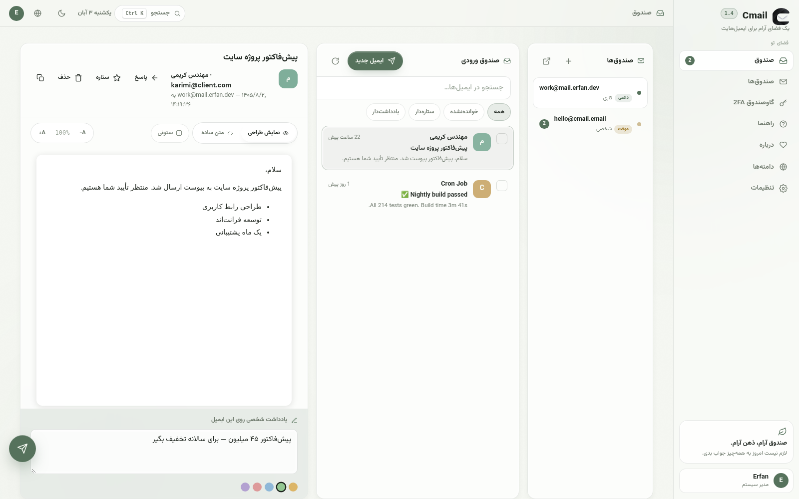
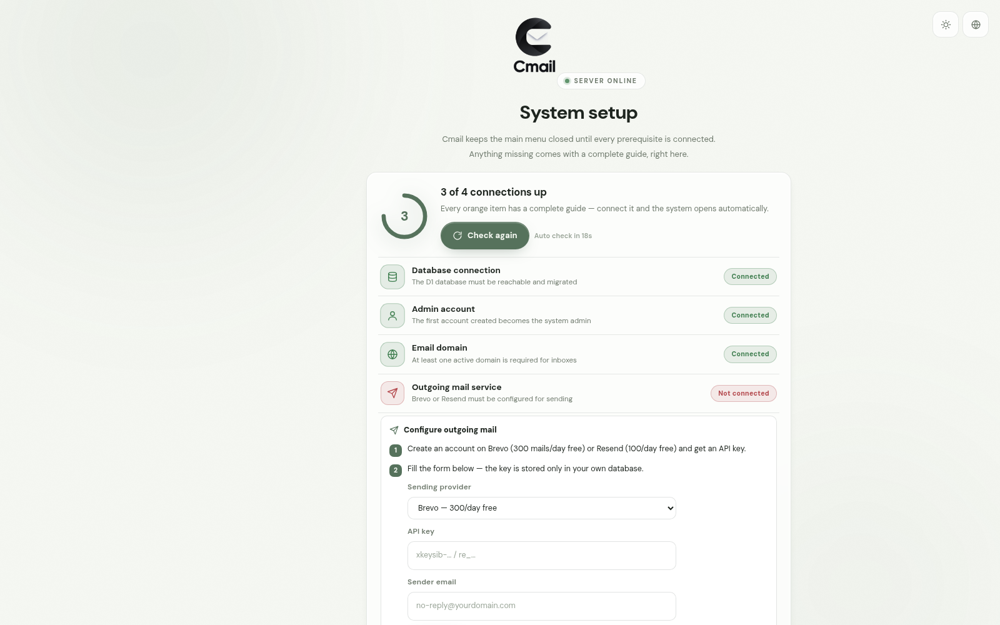
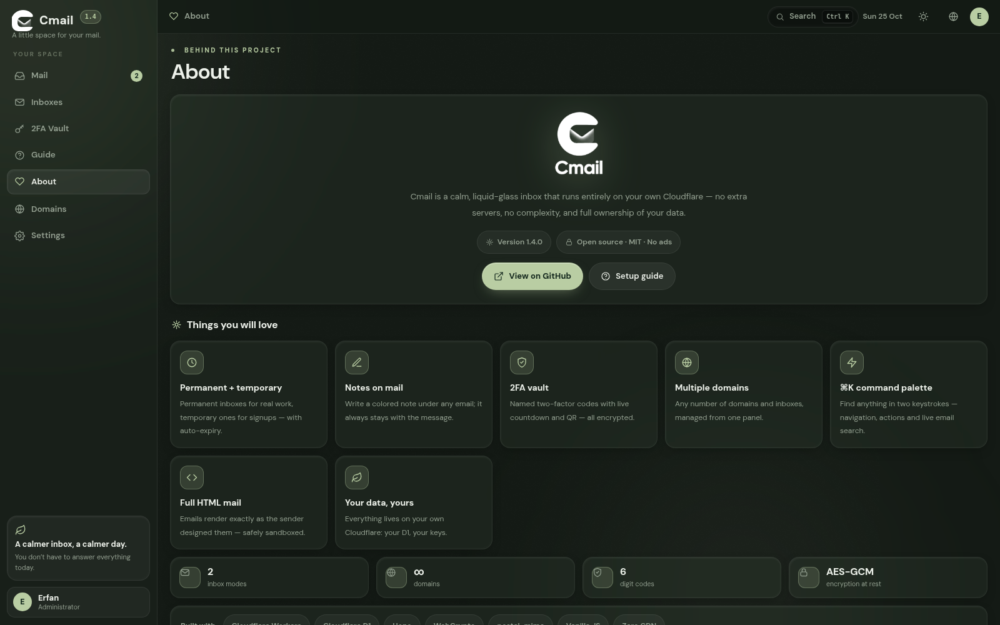
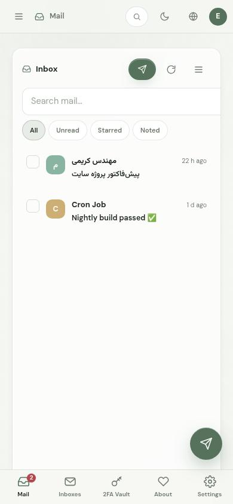

<div align="center">


# Cmail

**Your own mail ecosystem — liquid-glass, private, and living entirely on your Cloudflare.**

Temporary & permanent inboxes · notes on every email · built-in 2FA vault · multi-domain · outgoing mail

`Cloudflare Workers` · `D1` · `Email Routing` — zero servers, zero monthly cost, 100% yours

[Install](#-install) · [Setup](#-cloudflare-setup-step-by-step) · [Usage](#-using-cmail) · [Troubleshooting](#-troubleshooting) · [راهنمای فارسی](README.fa.md)

</div>

---

## 🖼️ Screenshots

| The inbox (dark) | Reading mail — full HTML, RTL, notes |
|---|---|
|  |  |

| Command palette (⌘K) | 2FA vault with live codes |
|---|---|
|  |  |

| Setup gate — nothing opens until everything is connected | Daylight theme |
|---|---|
|  |  |

| Onboarding | About |
|---|---|
|  |  |

| Phone — inbox | Phone — reading mail |
|---|---|
|  |  |

## ✨ What is Cmail?

Cmail is a complete mail platform that runs **entirely inside your own Cloudflare account**. There is no VPS to rent, no database server to babysit, no monthly invoice: incoming mail flows through **Cloudflare Email Routing**, everything is stored in **Cloudflare D1** (SQLite at the edge), and the whole interface ships as a static bundle served by a single **Worker**.

That means your mail lives in *your* account, behind *your* domain, with *your* keys. Delete it when you want, export it whenever you like — nobody else holds it.

Cmail is an **ecosystem**, not just an inbox:

- a **burner machine** — spawn a 1-hour disposable address for every signup, keep your real address clean
- a **permanent mailbox** — labels, filters, star, search for the mail you actually keep
- a **notebook** — pin a colored note under any message (order numbers, tracking codes, meeting links) so context never gets lost
- an **authenticator** — named TOTP codes with live countdown, QR export and `otpauth://` import, encrypted at rest
- a **multi-user platform** — invite people, give each one their own inboxes, or keep registration closed

### Everything it can do

| | |
|---|---|
| 📬 **Temporary + permanent inboxes** | One address can live for an hour; the next one lives forever. Set a TTL when you create it, extend it any time. |
| 🌐 **Unlimited domains** | Add as many domains / subdomains as your Cloudflare account holds — one Worker receives them all. |
| 🗒️ **Notes on emails** | A colored personal note pinned to any message. Search finds it instantly. |
| 🔐 **2FA vault** | Your built-in authenticator: 6-digit codes with a live countdown ring, encrypted with AES-256-GCM. |
| 🛡️ **Account 2FA** | Protect sign-in itself with TOTP two-factor verification. |
| 📤 **Outgoing mail** | Connect Brevo or Resend with one API key and send from your domain. |
| ➡️ **Forwarding** | Mirror copies of any inbox to a real address you already check. |
| 🧑‍🤝‍🧑 **Multi-user** | Optional open registration; everyone sees only their own inboxes. Admin panel included. |
| 🧹 **Auto-cleanup** | An hourly cron expires temporary inboxes and purges old mail automatically. |
| 🌙 **Liquid-glass UI** | Dark & Daylight themes, adjustable glass transparency, 4 accent palettes, Persian RTL + English. |
| ⌘ **Command palette** | Press <kbd>Ctrl/⌘</kbd>+<kbd>K</kbd> anywhere: jump to anything, run actions, search mail as you type. |
| ⌨️ **Keyboard-first** | `j`/`k` to move, `Enter` to open, `x` to select, `s` to star — full shortcut map built in. |
| 🧭 **Setup gate** | Until every prerequisite is connected, the main menu stays closed and a live checklist walks you through each fix. |
| 📱 **Truly responsive** | From a 320px phone to a 1920px desktop — three panes collapse into drawers and bottom sheets. |
| 🔒 **Your data, yours** | Your D1, your keys, your rules. No telemetry, no third-party scripts, zero CDN calls. |

## 🚀 Install

> **Prerequisites:** [Node.js 18+](https://nodejs.org) and a **Cloudflare account** (the free plan is enough).

### One command

```bash
git clone https://github.com/Erfan-8910/CMail.git
cd CMail
bash deploy.sh
```

The installer takes over everything:

1. installs dependencies
2. logs you into Cloudflare (`wrangler login` opens your browser)
3. creates the **D1 database** and wires its id into `wrangler.jsonc`
4. applies the schema migrations
5. generates a strong random **APP_SECRET** and stores it as a Worker secret
6. **deploys the Worker** and prints your URL
7. *(optional)* configures **Email Routing** automatically (MX + SPF + catch-all → Worker) when you give it an API token

When it finishes, open the printed `https://cmail.<your-subdomain>.workers.dev` — the **setup wizard** takes over:

1. create the first admin account
2. add your domain (the exact DNS records are shown to you)
3. optionally connect Brevo or Resend for outgoing mail
4. done — the main menu unlocks and the inbox opens 🎉

### Manual install

<details>
<summary><b>Step by step</b> (click to expand)</summary>

```bash
npm install
npx wrangler login

# 1. database
npx wrangler d1 create cmail-db           # copy the database_id
#   → paste it into wrangler.jsonc (REPLACE_WITH_D1_ID)
npx wrangler d1 migrations apply cmail-db --remote

# 2. secrets
npx wrangler secret put APP_SECRET        # paste a long random string
#   generate one:  node -e "console.log(require('crypto').randomBytes(32).toString('base64url'))"

# 3. deploy
npx wrangler deploy
```

Then, in the Cloudflare dashboard:
**your domain → Email → Email Routing → enable it → Catch-all address → Action: Send to Worker → `cmail`**

</details>

## ☁️ Cloudflare setup, step by step

### 1 · The domain

Your domain must use **Cloudflare DNS** (free plan is fine). A dedicated subdomain like `mail.yourdomain.com` works great and keeps your root inbox untouched. Add it in **Dashboard → Websites → Add a domain**, then let Cmail know about it (wizard or **Domains** panel).

### 2 · Receiving mail (Email Routing)

For each domain you add:

| Record | Value | Notes |
|---|---|---|
| MX | `route1.mx.cloudflare.net` (prio 10) | added by Cloudflare when you enable Email Routing |
| MX | `route2.mx.cloudflare.net` (prio 20) | 〃 |
| MX | `route3.mx.cloudflare.net` (prio 30) | 〃 |
| TXT | `v=spf1 include:_spf.mx.cloudflare.net ~all` | SPF — also added for you |

Then: **Email Routing → Routing rules → Catch-all address → Action: Send to Worker → `cmail`**.

From that moment, **any** address on the domain (`whatever@your.domain`) lands in Cmail. With **catch-all auto-create** (on by default), unknown recipients instantly become temporary inboxes — that is your disposable-mail machine. Turn catch-all off per domain if you prefer explicit inboxes only.

> Automation shortcut: `bash scripts/configure-email-routing.sh mail.yourdomain.com` with `CLOUDFLARE_API_TOKEN` set does all of the above via the API.

### 3 · Sending mail (optional but recommended)

Cmail sends through **Brevo** (300 mails/day free) or **Resend** (100 mails/day free):

1. create an account on the provider and verify your sending domain
2. copy the API key
3. in Cmail: **Settings → Outgoing mail** — pick the provider, paste the key, set the verified sender address
4. hit **Test** — a test mail confirms the wiring

The key is stored **only in your own D1 database** — it never leaves your Cloudflare.

### 4 · The setup gate

Cmail refuses to open the main menu until **all four prerequisites** are green:

- ✅ **Database connection** — D1 reachable & migrated
- ✅ **Admin account** — the first account becomes the admin
- ✅ **Email domain** — at least one active domain
- ✅ **Outgoing mail service** — Brevo or Resend configured

Anything orange shows a complete inline tutorial (copyable terminal commands, DNS tables, provider forms) — fix it right there, the system opens automatically the moment the last check turns green. You can always revisit it from the user menu → **System status** (or `#/status?stay`).

## 📬 Using Cmail

### The inbox

Three panes: **inboxes** (left), **mail list** (middle), **reader** (right). On a phone they fold into a single pane with a drawer and a bottom tab bar. Filters — *All / Unread / Starred / Noted* — live above the list, and the search box matches sender, subject, body **and** your notes.

### Temporary vs permanent

Create an inbox (**Inboxes → New inbox**), pick the domain, type any local part (or hit **Random**), and choose its lifetime: **1 hour**, **24 hours**, or **permanent**. Temporary inboxes show a live countdown; extend them any time. Permanent ones are simply yours forever.

### Notes

Open any mail and write into **Personal note on this email** — pick one of five colors. Notes show right under the message and are searchable, so a tracking number is always one query away.

### The 2FA vault

**2FA Vault → Add code** — give it a name (e.g. *GitHub*), paste the `otpauth://` secret or scan-import it, and it becomes a card with a **live 6-digit code and countdown ring**. Codes regenerate every 30 seconds; copy with one tap. All secrets are encrypted at rest (AES-256-GCM).

### Command palette

Press <kbd>Ctrl/⌘</kbd>+<kbd>K</kbd> anywhere — a glass panel appears: jump to any view, run actions (*Compose new email*, *Refresh*, *Toggle theme*…) and search mail live as you type. Arrow keys to move, <kbd>Enter</kbd> to run, <kbd>Esc</kbd> to close.

### Keyboard shortcuts

| Keys | Action |
|---|---|
| <kbd>Ctrl/⌘</kbd> + <kbd>K</kbd> | command palette |
| <kbd>/</kbd> | focus inbox search |
| <kbd>j</kbd> / <kbd>k</kbd> | next / previous email |
| <kbd>Enter</kbd> or <kbd>o</kbd> | open selected email |
| <kbd>x</kbd> | select / deselect row |
| <kbd>s</kbd> | star / unstar |
| <kbd>Esc</kbd> | back to the list |

### Make it yours

**Settings** is where the ecosystem bends to your taste: **Dark / Daylight** theme, glass transparency, four accent palettes (*Sage, Blue, Violet, Amber*), interface language (**فارسی / English**), session lifetime, and — for admins — registration policy, catch-all defaults, outgoing mail and user management.

### Multi-user

Registration is closed by default. Open it in **Settings → Registration** and new visitors can create their own accounts — each sees only their own inboxes and mail. Admins additionally get the **Domains** panel, **user management** and **System status**.

### Auto-cleanup

A Worker cron (hourly) expires temporary inboxes past their TTL and purges old mail per your retention settings. Nothing to remember, nothing to configure.

## 🧱 Architecture

```
                     ┌─────────────────────────────────────────┐
                     │              Cloudflare                  │
 incoming mail       │                                          │
 SMTP ──────────►  Email Routing (MX)                           │
                     │        │ catch-all                       │
                     │        ▼                                 │
 browser ────────►  Worker  ────────  static UI (glass app)     │
                     │   │  │                                   │
                     │   │  └── Brevo / Resend ──► outgoing mail│
                     │   ▼                                      │
                     │  D1 (SQLite) — mail · inboxes · users    │
                     │               · notes · TOTP · settings  │
                     └─────────────────────────────────────────┘
```

One Worker serves the UI and the API, receives incoming mail, sends outgoing mail, and runs the cleanup cron. One D1 database holds everything. That is the whole system.

## 🔐 Security

- **Passwords** — PBKDF2-SHA256, 100 000 iterations, per-user salt
- **Sessions** — random tokens in httpOnly SameSite cookies, configurable lifetime, instant logout everywhere
- **TOTP secrets** — encrypted at rest (AES-256-GCM with an HKDF-derived key)
- **Brute force** — login rate-limiting per IP
- **Headers** — strict CSP and security headers on every response
- **Mail HTML** — rendered inside a fully sandboxed iframe; scripts never run

## 🛠️ Local development

```bash
npm install
npm run db:migrate:local
npm run dev          # http://localhost:8787
```

The full app runs locally: wizard, gate, inbox, vault, sending (needs a real provider key to actually deliver).

## 🔄 Updating

```bash
git pull
npm install
npx wrangler d1 migrations apply cmail-db --remote   # if migrations changed
npm run deploy
```

Your data is untouched — migrations only add what is missing.

## 🧯 Troubleshooting

| Symptom | Cause → Fix |
|---|---|
| Main menu never opens | Open **System status** (`#/status?stay`) — the orange item's inline tutorial shows exactly what to do. |
| Mail never arrives | Domain not on Cloudflare DNS, Email Routing disabled, or catch-all not set to *Send to Worker → cmail*. Recheck the three steps above. |
| Sending test fails | Provider key invalid, sender not verified on the provider, or wrong provider selected. The key must match the verified domain. |
| `wrangler deploy` rejects config | `wrangler.jsonc` still contains `REPLACE_WITH_D1_ID` → run the D1 step of the manual install. |
| Forgot admin password | Redeploy with a fresh database, or reset the row for your user in D1 (`users` table) — passwords are hashed, there is no recovery shortcut by design. |
| 2FA code rejected | Phone clock drift — TOTP is time-based; enable automatic time sync on the device. |

## 🗺️ API routes

| Method | Endpoint | |
|---|---|---|
| GET | `/api/setup/status` | public bootstrap & gate state |
| POST | `/api/setup/admin` | create the first admin |
| POST | `/api/auth/login` · `/login/totp` · `/register` · `/logout` | auth |
| GET/POST/PATCH/DELETE | `/api/addresses` · `/api/addresses/domains` | inboxes & domains |
| GET | `/api/emails` · `/api/emails/:id` · `/stats` | mail |
| PUT | `/api/emails/:id/note` | notes |
| POST | `/api/emails/bulk` · `/api/emails/send` | bulk & outgoing |
| GET/POST/PATCH/DELETE | `/api/totp` | 2FA vault |
| GET/PUT | `/api/admin/settings` · `/overview` · `/users` | admin |

## 📄 License

MIT © [Erfan-8910](https://github.com/Erfan-8910)

---

<div align="center">

**Cmail** — craft, own, and use your mail.

فارسی؟ [README فارسی](README.fa.md)

</div>
